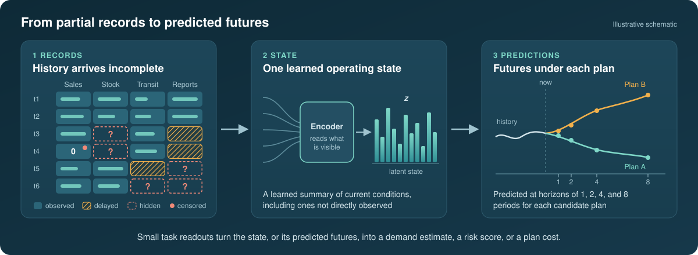
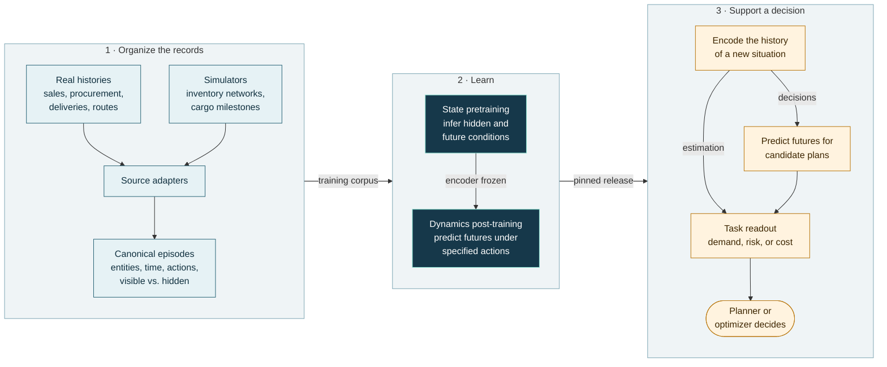

<div align="center">

# SupplyChain-JEPA

**A predictive world model for partially observed supply-chain systems**

[Documentation](docs/README.md) · [Model on Hugging Face](https://huggingface.co/htizhang/SupplyChain-JEPA) · [Getting started](docs/guide/GETTING_STARTED.md) · [How it works](#how-it-works) · [Evidence](#what-the-evidence-shows) · [Quick start](#quick-start)

<sub>Code in this repository · Pretrained weights on Hugging Face at [`htizhang/SupplyChain-JEPA`](https://huggingface.co/htizhang/SupplyChain-JEPA), pinned revision [`493786f`](https://huggingface.co/htizhang/SupplyChain-JEPA/tree/493786fda0855b72f61235068c62cc7b2a11fbec) · Both public, no account needed</sub>

<br>



</div>

## The planning problem

Supply-chain decisions rest on records that are late, censored, or incomplete, and the
consequences of a decision unfold over several periods after it is made.

| What the records show | What the planner needs to know |
|---|---|
| A store sold nothing on a stockout day | How much customers actually wanted |
| A shipment's latest milestone report has not arrived | Whether the delivery is at risk |
| A replenishment order went out today | Inventory, backlog, and cost several periods from now, and how a different order would change them |

Each of these questions is commonly handled by its own model, fitted to one table.
SupplyChain-JEPA instead learns a shared description of the operating situation from ten real and
simulated sources, and three different applications reuse it with small task-specific additions.

## What the model does

The model reads an operating history as typed records: products at locations, orders, shipments,
route stops, process events, and the links among them. Every record keeps its time and its
observation status: a missing value stays absent instead of becoming a zero, and a delayed or
censored value stays marked as delayed or censored. From this history the model forms a
**latent operational state**, a learned numerical summary of current conditions, including
conditions that are not directly observed because records are delayed, censored, missing, or
spread across systems. In operations-research terms it plays the role of a belief state.

Training teaches the model to answer three kinds of question about that state:

| Question | Business example | What answers it |
|---|---|---|
| What is hidden now? | Demand during a stockout, or stock at a warehouse whose report is missing | The State predictor, trained on deliberately hidden parts of real and simulated histories |
| What comes next? | Milestones, inventory, and backlog one to eight periods ahead, under the operating pattern seen in the data | The same State predictor, trained on held-back future intervals |
| What changes if we act differently? | The future under a low-order plan compared with a high-order plan | The Dynamics predictor, trained on paired simulator runs that differ only in the action |

The model's outputs are learned representations rather than business quantities. A small
readout fitted for each task translates them into a demand estimate, a risk score, or an expected
cost, and a decision rule or optimizer makes the choice. Inventory balance, capacity, and service
constraints stay with that optimization or control layer.

> [!NOTE]
> **Where the name comes from.** JEPA stands for *joint-embedding predictive architecture*. In
> training, part of an operating history is hidden and the model predicts a learned summary of
> the hidden part. A second, slowly updated copy of the encoder reads the actual hidden records
> and produces the summary that the prediction is compared with, so the main comparison happens
> between learned summaries rather than raw values. [State learning](docs/guide/STATE_LEARNING.md)
> works through this with an example.

## How it works

One chain connects the data, the two training stages, and the applications.



| Stage | What happens | Read more |
|---|---|---|
| Organize | Each source has its own adapter. It converts the raw records into canonical episodes and keeps the source's own entities, network links, timing, and observation status instead of forcing everything into one flat table. | [Data to episodes](docs/guide/DATA_TO_EPISODES.md) |
| Learn the state | Training hides a coherent piece of an episode, such as a run of days, one warehouse's reports, or the last events of a process, or it holds back a later interval. An encoder summarizes the visible records and the State predictor infers a summary of the missing piece. | [State learning](docs/guide/STATE_LEARNING.md) |
| Learn action effects | The State encoder is frozen. A separate Dynamics predictor learns from pairs of simulator runs that share their history and future demand but follow different replenishment plans, so the difference between the two futures is attributable to the plan. | [Dynamics learning](docs/guide/DYNAMICS_LEARNING.md) |
| Apply | An application encodes the history available at decision time, projects it under candidate plans when a choice is involved, and fits a small readout for its own metric. | [Using the model](docs/guide/USING_THE_MODEL.md) |

## What the evidence shows

Three applications test whether one pretrained representation can support distinct, partially
observed tasks. Each keeps a conventional baseline fixed, and all were rerun against the pinned
model release.

| Application | Metric | Conventional baseline | SupplyChain-JEPA system | Fresh improvement |
|---|---|---:|---:|---:|
| **Stockout demand recovery**<br><sub>Estimate true demand inside masked, stockout-shaped intervals</sub> | WAPE, lower is better | 0.416952 | 0.399117 | 4.28% lower |
| **Early SLA-risk ranking under delayed reports**<br><sub>Rank shipments for review while a critical leg's reports are delayed</sub> | AUPRC, higher is better | 0.386170 | 0.412200 | 6.74% higher |
| **Replenishment-plan selection**<br><sub>Choose between two quantity-matched replenishment plans</sub> | Regret, lower is better | 9.274 | 5.883 | 36.6% lower |

Demand recovery reads the frozen State encoder and its released canonical-state head, SLA-risk
ranking reads only the frozen State encoder, and plan selection also adapts a copy of the
pretrained Dynamics predictor with a scalar cost readout. Each fits a small readout on limited
labeled data.

<details>
<summary><b>What the three metrics measure</b></summary>
<br>

- **WAPE** (weighted absolute percentage error) is the total absolute error of the recovered
  demand divided by total true demand.
- **AUPRC** (area under the precision-recall curve) rewards placing the shipments that do miss
  their service level near the top of the review list, which matters when only a minority of
  shipments are late.
- **Regret** is the extra cost of the chosen plan relative to the cheaper of the two plans in
  hindsight, averaged over simulated worlds.

</details>

<details>
<summary><b>Additional comparison for plan selection</b></summary>
<br>

A same-architecture matched-random diagnostic repeats the plan-selection recipe with randomly
initialized weights and obtains regret 6.119. The pretrained system is 3.85% lower and wins
three of five world splits. The much stronger comparison with the fixed public-history baseline
therefore supports the complete decision system, while the smaller and run-sensitive
matched-random difference is not presented as a clean causal estimate of pretraining. Exact
protocols and negative boundary results are documented in [Evaluation](docs/EVALUATION.md).

</details>

## Choose a reading path

<table>
<tr>
<td width="34%" valign="top">

**Understand the idea**

The four guides follow one operating history from raw records to a decision, for readers in
operations research and management who are new to deep learning.

1. [Data to episodes](docs/guide/DATA_TO_EPISODES.md)
2. [State learning](docs/guide/STATE_LEARNING.md)
3. [Dynamics learning](docs/guide/DYNAMICS_LEARNING.md)
4. [Using the model](docs/guide/USING_THE_MODEL.md)

</td>
<td width="33%" valign="top">

**Run the code**

The practical guide covers installation, downloading the pinned weights, the CPU smoke chain,
and preparing a new dataset.

- [Getting started](docs/guide/GETTING_STARTED.md)
- [Reproducibility](docs/REPRODUCIBILITY.md)
- [Quick start](#quick-start) below

</td>
<td width="33%" valign="top">

**Check the specification**

The reference documents give the exact contracts, objectives, configurations, and evaluation
protocols.

- [Architecture](docs/ARCHITECTURE.md)
- [Training](docs/TRAINING.md)
- [Data contract](docs/DATA_CONTRACT.md) and [Data adapters](docs/DATA_ADAPTERS.md)
- [Evaluation](docs/EVALUATION.md) and [Limitations](docs/LIMITATIONS.md)

</td>
</tr>
</table>

The [documentation index](docs/README.md) states the question each document answers and links a
[knowledge graph](graphify-out/GRAPH_REPORT.md) of how the documents and code connect.

## Quick start

> [!NOTE]
> This repository is the clean reference implementation. The pretrained weights are in the public
> Hugging Face model repository
> [`htizhang/SupplyChain-JEPA`](https://huggingface.co/htizhang/SupplyChain-JEPA) and download
> without an account or token; datasets and fitted downstream artifacts are not stored in Git.

Install the locked environment:

```bash
uv sync --all-extras
```

Load the immutable model revision. The first call downloads it anonymously from Hugging Face and
later calls reuse the local cache:

```python
from supplychain_jepa import load_pretrained

bundle = load_pretrained(device="cpu")
model = bundle.model
```

The loader pins revision
`493786fda0855b72f61235068c62cc7b2a11fbec` by default and verifies the release checksums.

The package exposes a small, shape-explicit inference API over the loaded bundle:

| Function | Returns | Typical use |
|---|---|---|
| `load_pretrained()` | `ModelBundle`: modules plus the fitted tensor interface | Load the pinned, checksum-verified release |
| `encode_state(bundle, batch)` | Token latents `[B,L,D]` plus sequence-level latents `[B,D]`, including the belief latent | Summarize an observed history |
| `predict_masked_state(bundle, batch)` | Target latents `[B,Q,D]` | Hidden-current or future State queries |
| `predict_dynamics(bundle, state_latents, actions, horizons)` | Future latents `[B,Q,D]` | One action sequence from one state |
| `compare_actions(bundle, state_latents, candidate_actions, horizons)` | `ActionComparison`: candidate futures and their pairwise distances | Several candidate plans from the same state; ranking them still needs a task readout |

Two bounded checks need no external dataset. The first downloads and verifies the pinned release
from Hugging Face; the second generates four canonical records and runs both training stages on
CPU:

```bash
uv run python scripts/verify_model_release.py

uv run --all-extras python scripts/run_training_smoke.py \
  --work-dir /tmp/supplychain-jepa-smoke \
  --updates 2
```

The test suite that CI runs skips tests that need the downloaded weights or external data. The
marker `private_model` keeps its historical name and marks the tests that read the weights:

```bash
uv run pytest -q -m "not private_model and not external_data"
```

[Getting started](docs/guide/GETTING_STARTED.md) covers access, a new dataset, and reading the
outputs. The [Training guide](docs/TRAINING.md) gives the full two-stage training commands.

## Training

The reference implementation separates two objectives without training two unrelated models:

1. **Predictive State pretraining** learns hidden-state recovery and observational future
   prediction from real and simulated trajectories.
2. **Action-conditioned Dynamics post-training** starts from the same encoder, initially freezes
   it, and learns paired future differences under supported actions.

The detailed [Training guide](docs/TRAINING.md) documents corpus sampling, structured masks,
objective equations and weights, EMA/final alignment, paired action controls, checkpoint contents,
and the distinction between a training checkpoint and the published bundle. The
[Data contract](docs/DATA_CONTRACT.md) defines canonical records, while
[Data adapters](docs/DATA_ADAPTERS.md) documents and exposes converters for all ten real and
simulated pretraining sources.

### Data adapters

The sources are not flattened into one artificial table. Each adapter preserves the source's
entities, topology, timing, observation status, events, and actions, then emits the same canonical
episode format consumed by the shared tensorizer:

```text
raw dataset or pinned simulator -> source adapter -> canonical episode JSONL
    -> schema validation -> train-only tensorizer -> entity / event / action tokens
```

| Source group | Included sources | Training eligibility |
|---|---|---|
| Recorded operational histories | M5, BPI Challenge 2019, LaDe, Olist, planned-versus-actual routes | State JEPA only |
| State-only simulators | SupplyNetPy, ISOMORPH, MilestoneFlow | State JEPA only |
| Intervention-capable simulators | Stockpyl, MABIM | State JEPA and paired Dynamics JEPA |

Recorded histories teach what operations look like, including their gaps and delays. Simulators
also expose internal states that real systems do not report, and the two intervention-capable
simulators supply paired runs in which only the replenishment action differs. Observational
records are never used as evidence about actions that were not taken.

<details>
<summary><b>Adapter commands</b></summary>
<br>

List the adapters, fetch the four pinned external simulator revisions, or build all ten configured
sources as follows:

```bash
uv run --extra adapters python -m supplychain_jepa.adapters list
uv run python scripts/fetch_simulator_sources.py --root /path/to/simulator-checkouts

cp configs/adapters.example.json /path/to/adapters.json
# Edit the local raw-data and simulator paths in /path/to/adapters.json.
uv run --extra adapters python -m supplychain_jepa.adapters build \
  --config /path/to/adapters.json
```

Raw datasets remain under their original terms and must be acquired separately. See
[Data adapters](docs/DATA_ADAPTERS.md) for required files, field-level mappings, split rules,
missingness semantics, and Dynamics pairing requirements.

</details>

## Model at a glance

<details>
<summary><b>Released components and size</b></summary>
<br>

The released core has **73,629,696 parameters**, a width of 384, six encoder layers,
three State-predictor layers, and four Dynamics-predictor layers. Inputs use a fitted
309-feature schema with numerical values, categorical identities, observation status, time,
entity roles, and local topology indices.

| Component | Role | Parameters |
|---|---|---:|
| Online State encoder | Summarizes the visible context | 27,987,456 |
| Target State encoder | Exponential-moving-average copy that summarizes the target view in training | 27,987,456 |
| State predictor | Predicts hidden-current and future latent targets | 7,255,680 |
| Dynamics predictor | Predicts latent futures under structured actions and horizons | 10,399,104 |
| **Complete core** | | **73,629,696** |
| Auxiliary State heads | Pooled-state, semantic-concept, and numerical grounding heads, loaded alongside the core | 2,943,285 |

The core uses 12 attention heads and a 1,536-dimensional feed-forward block. The
[Architecture](docs/ARCHITECTURE.md) note describes each component and objective.

</details>

## Repository map

```text
src/supplychain_jepa/   model, tensorizer, training, verified loading, and inference API
  adapters/             converters for the ten pretraining sources
  schemas/              canonical episode JSON Schema
configs/                released model, State, Dynamics, adapter, and simulator-pin settings
data/manifests/         training lineage, adapter inputs, downstream input hashes, release manifest
evaluations/            the three canonical application protocols
results/                compact summaries regenerated against the pinned release
examples/               quickstart and a tiny canonical corpus generator
scripts/                smoke training, simulator fetch, release verification, boundary check
tests/                  unit and integration tests
docs/                   conceptual guides and technical reference
graphify-out/           knowledge graph of this repository
```

## Repository boundary

- Git contains project-authored code, compact configurations, tests, documentation, and
  regenerated summary results.
- The public Hugging Face model repository
  [`htizhang/SupplyChain-JEPA`](https://huggingface.co/htizhang/SupplyChain-JEPA) contains the
  pretrained weights and fitted tensor interface.
- External datasets remain under their original terms and must be acquired separately.
- Raw experiments, third-party checkouts, paper full texts, credentials, and machine-specific
  execution metadata are excluded.

No open-source license is granted for this repository. All rights are reserved pending an
ownership and provenance review. See [Third-party notices](THIRD_PARTY_NOTICES.md),
[Datasets](DATASETS.md), and [Provenance](PROVENANCE.md).

## References

The design builds on I-JEPA, V-JEPA 2, T-JEPA, LaT-PFN, and latent world-model research.
See [References](docs/REFERENCES.md) for primary sources. Citation metadata for this software is
in [`CITATION.cff`](CITATION.cff).
