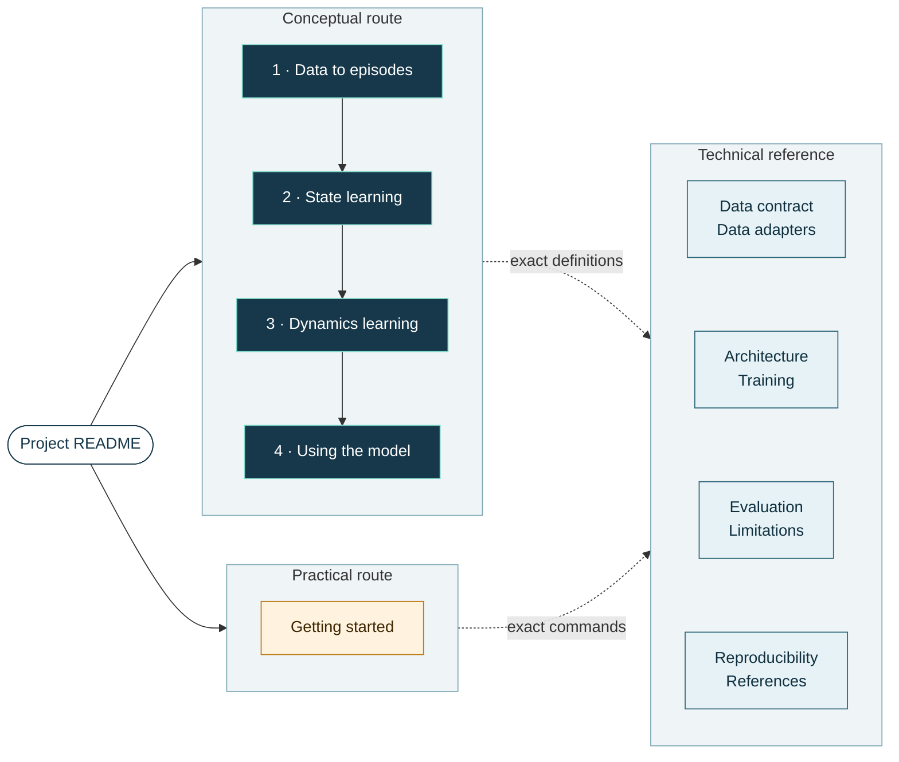

# Documentation

**From partial supply-chain records to a reusable operating state, and the exact specification behind each step**

[Conceptual guides](#conceptual-guides) · [Getting started](guide/GETTING_STARTED.md) · [Technical reference](#technical-reference) · [Knowledge graph](#knowledge-graph) · [Glossary](#glossary) · [Project README](../README.md)

The documentation has two layers. The guides in [`guide/`](guide/) explain the method in business
terms, with small illustrative examples, and assume no background in deep learning. The reference
documents in this folder state the exact contracts, objectives, configurations, and protocols that
the code implements. Every guide links to the reference documents and source files behind it.

## Documentation map

Short on time? Read the [project README](../README.md), then [Using the model](guide/USING_THE_MODEL.md).

## Conceptual guides

Read these in order. Each one answers a single question and ends where the next one begins.

| Step | Guide | The question it answers | Code it explains |
|:---:|---|---|---|
| 1 | [Data to episodes](guide/DATA_TO_EPISODES.md) | How do sales histories, procurement logs, delivery records, and simulator runs become one training format, and what can each of the ten sources teach? | [`adapters/`](../src/supplychain_jepa/adapters/), [episode schema](../src/supplychain_jepa/schemas/canonical_episode.schema.json), [`semantic_features.py`](../src/supplychain_jepa/semantic_features.py) |
| 2 | [State learning](guide/STATE_LEARNING.md) | How does the model learn to describe a partly observed operating situation, using windows, masks, and target summaries? | [`model.py`](../src/supplychain_jepa/model.py), [`windows.py`](../src/supplychain_jepa/windows.py), [`masking.py`](../src/supplychain_jepa/masking.py), [`training.py`](../src/supplychain_jepa/training.py) |
| 3 | [Dynamics learning](guide/DYNAMICS_LEARNING.md) | How do a frozen State encoder and paired simulator runs teach the model what a different replenishment plan would change? | [`model.py`](../src/supplychain_jepa/model.py), [`training.py`](../src/supplychain_jepa/training.py), [`stockpyl.py`](../src/supplychain_jepa/adapters/stockpyl.py), [`mabim.py`](../src/supplychain_jepa/adapters/mabim.py) |
| 4 | [Using the model](guide/USING_THE_MODEL.md) | How do the learned representations become a demand estimate, a risk ranking, and a plan choice in the three applications? | [`api.py`](../src/supplychain_jepa/api.py), [`evaluations/`](../evaluations/) |

The practical guide stands on its own:

| Guide | The question it answers | Code it explains |
|---|---|---|
| [Getting started](guide/GETTING_STARTED.md) | What do I need to install, load, verify, and adapt the released model, and what can I run without external datasets? | [`loading.py`](../src/supplychain_jepa/loading.py), [`scripts/`](../scripts/), [`examples/`](../examples/) |

## Technical reference

These documents are the specification. Where a guide simplifies, the reference states the exact
rule.

| Document | The question it answers |
|---|---|
| [Architecture](ARCHITECTURE.md) | What does the released model contain, and what do the State and Dynamics objectives optimize? |
| [Training](TRAINING.md) | How is each stage trained: corpus and sampling, structured masks, loss terms and weights, optimizer, EMA and final alignment, commands, and checkpoints? |
| [Data contract](DATA_CONTRACT.md) | What must a canonical episode, a tensorized batch, and a paired action record contain? |
| [Data adapters](DATA_ADAPTERS.md) | How is each of the ten sources mapped into canonical episodes, split, and validated? |
| [Evaluation](EVALUATION.md) | What are the three application protocols, their primary metrics, and the release results, including the negative boundary cohort? |
| [Reproducibility](REPRODUCIBILITY.md) | What is pinned, what does the smoke chain prove, and which gates must a release pass? |
| [Limitations](LIMITATIONS.md) | What does the release not establish? |
| [References](REFERENCES.md) | Which papers, implementations, datasets, and simulators does the design build on? |

Project-level records live at the repository root and beside the code they describe:

| Document | The question it answers |
|---|---|
| [Datasets](../DATASETS.md) | Which sources trained the model, which are reserved for downstream evaluation, and under what terms? |
| [Provenance](../PROVENANCE.md) | Where do this repository and the pinned model release come from? |
| [Third-party notices](../THIRD_PARTY_NOTICES.md) | Which external software and data does the project use, and under which terms? |
| [Results](../results/README.md) | Which result files are fresh release reruns, and which are pre-release reference values? |
| Protocols for [demand recovery](../evaluations/demand_recovery/README.md), [SLA risk](../evaluations/sla_risk/README.md), and [action selection](../evaluations/action_selection/README.md) | How is each application run, which inputs does it verify, and what did the release rerun obtain? |

## Knowledge graph

[graphify](https://github.com/Graphify-Labs/graphify) maps this repository into a knowledge graph:
Python modules, classes, and functions from the source code, plus the concepts, claims, and
cross-references stated in every Markdown document listed above. It answers questions such as
which code implements a documented idea, or which documents depend on the paired-branch contract.

| File | What it contains | How to read it |
|---|---|---|
| [`GRAPH_REPORT.md`](../graphify-out/GRAPH_REPORT.md) | Named communities of related concepts, the most connected nodes, links that cross documents, and the share of extracted versus inferred edges | Directly on GitHub |
| [`graph.html`](../graphify-out/graph.html) | Interactive map: search a concept, click a node to see its source file, filter by community | Download, then open in a browser |
| [`graph.json`](../graphify-out/graph.json) | Node-link data with the source location of every node and edge | Scripts and graph tools |

> [!TIP]
> GitHub renders Markdown but shows an HTML file as source text. To explore `graph.html`, clone the
> repository or use **Download raw file** on the file's GitHub page, then open the local copy in a
> desktop browser. The page loads the open-source vis-network library from a public CDN when it
> opens; the graph data is embedded in the file and drawn locally.

Communities worth opening first in `graph.html` (in the legend, untick **Select All**, then tick a
community to show it alone):

| Community | What it connects |
|---|---|
| Release loading and verification | `load_pretrained`, checksum verification, and the release verification script |
| State learning: masks, windows, examples | The State guide's training questions next to the mask and window concepts they rely on |
| Paired-branch Dynamics corpus | How Stockpyl and MABIM branch pairs become the only training evidence for action effects |
| Canonical episode boundary | The episode contract as the guides, the adapter reference, and the data contract state it |
| SLA-risk evidence and claim boundaries | The SLA-risk evaluation, the comparisons each application reports, and what the three evaluations do and do not establish |

<b>How the graph is built and how to read its edges</b>

 

Code structure comes from a deterministic parse of the Python source: modules, classes,
functions, imports, and calls. Documentation concepts come from reading each Markdown document
and illustration, with a line or section reference for every node; explicit links and file paths
named in the documents add edges to the code and files they point to. The episode JSON Schema
appears at the level of its definitions. Each edge carries one of three labels:

| Label | Meaning |
|---|---|
| `EXTRACTED` | Stated directly in the source, such as an import, a call, or an explicit link |
| `INFERRED` | A reasoned connection, with a confidence score between 0.55 and 0.95 |
| `AMBIGUOUS` | A possible connection flagged for review |

Communities are found by graph clustering and named by hand. The report states its own coverage
gaps.

## Glossary

<b>Terms used across the guides</b>

 

| Term | Meaning | Explained in |
|---|---|---|
| Episode | One bounded business history from one source, such as an item-store sales series, a purchase-order trace, a courier-day of deliveries, or one simulated network run | [Data to episodes](guide/DATA_TO_EPISODES.md) |
| Canonical episode | The shared record format every adapter emits, defined by the packaged JSON Schema | [Data contract](DATA_CONTRACT.md) |
| Observation and target views | The part of each step the context encoder may see, and the finalized or internal record used as a training target | [Data adapters](DATA_ADAPTERS.md) |
| Semantic concepts | Seventeen operational groups, such as demand and sales or lead time and delay, that label individual fields rather than whole episodes | [Data to episodes](guide/DATA_TO_EPISODES.md) |
| Tensorizer | The interface fitted once on training data that scales numbers, codes categories, and builds tokens; downstream data never refits it | [Data contract](DATA_CONTRACT.md) |
| Window and mask | A window selects a time span of an episode; a mask decides which records inside it are hidden for one training question | [State learning](guide/STATE_LEARNING.md) |
| Latent representation | A vector of learned numbers that summarizes records; it becomes a business quantity only through a readout | [State learning](guide/STATE_LEARNING.md) |
| Belief state | The encoder's summary of the current operating situation, including conditions the records do not show directly; also called the latent operational state | [Architecture](ARCHITECTURE.md) |
| Context encoder | The encoder that reads the visible records; also called the online encoder | [State learning](guide/STATE_LEARNING.md) |
| Target encoder | A copy of the encoder that follows the context encoder by an exponential moving average (EMA) and reads the actual target records to produce training targets | [State learning](guide/STATE_LEARNING.md) |
| State predictor | Predicts the representation of hidden-current or future records from the context and a query | [State learning](guide/STATE_LEARNING.md) |
| Dynamics predictor | Predicts the representation of a future state from the current state, an action sequence, and a horizon | [Dynamics learning](guide/DYNAMICS_LEARNING.md) |
| Paired branches | Simulator runs that share their world, history, and future external inputs such as demand, and differ in the replenishment action | [Dynamics learning](guide/DYNAMICS_LEARNING.md) |
| Task adapter | Code that writes an application's records into the released tensor interface without refitting it | [Using the model](guide/USING_THE_MODEL.md) |
| Readout | A small task-specific model fitted on the frozen representations to produce a demand estimate, risk score, or cost | [Using the model](guide/USING_THE_MODEL.md) |

