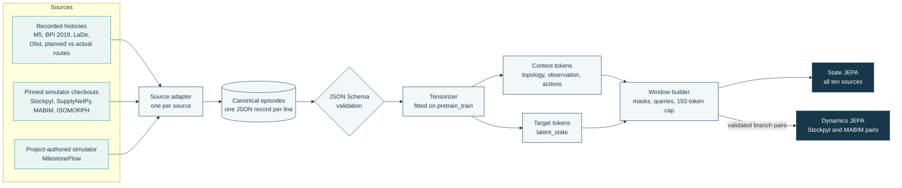
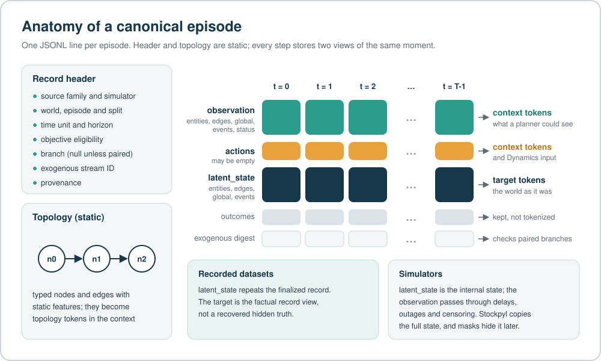
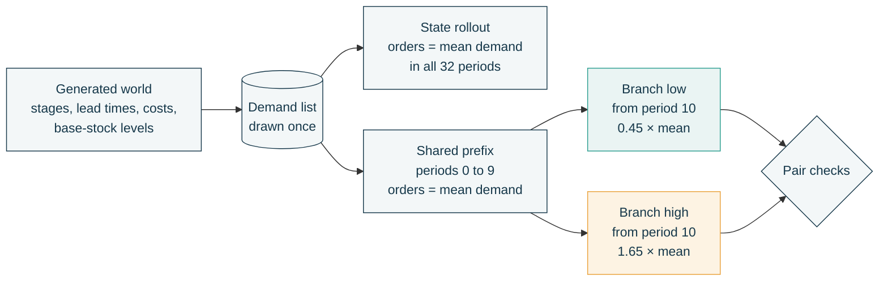
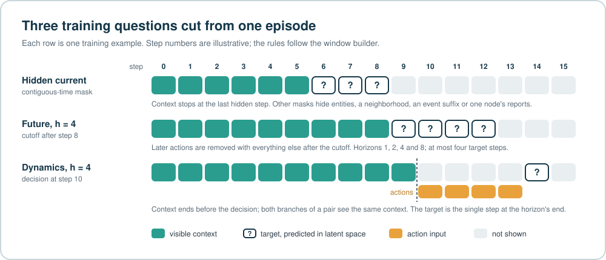

# From raw data to episodes and tokens

<sub>Conceptual guide 1 of 4 · Next: [State learning](STATE_LEARNING.md) · [Documentation index](../README.md)</sub>

SupplyChain-JEPA learns from ten sources that share almost nothing at the file level. M5 is a wide
table of daily unit sales, BPI Challenge 2019 is a procurement event log, and Stockpyl is a
simulator that produces no data until someone runs it. Each source has its own adapter, which
rewrites it into the same canonical **episode**: a bounded history that keeps the source's own
entities, network and clock, and that stores what an observer could see separately from what the
world actually was. A shared tensorizer then turns every episode into tokens, and a window builder
cuts those tokens into training questions.

| At a glance | |
|---|---|
| Sources | 5 recorded operational histories, 4 pinned open-source simulators, 1 project-authored simulator |
| One episode | one bounded history of one source unit: an item-store series, a purchase-order item, a courier-day, a seller, a route, or one generated world |
| What the context encoder reads | topology, the `observation` view of each step, and recorded actions |
| Where targets come from | the `latent_state` view of each step |
| What a concept class labels | a field name, never a whole episode |
| State training | all ten sources |
| Dynamics training | paired low/high branches from Stockpyl and MABIM only |

**Contents** ·
[1 Pipeline](#1-the-pipeline) ·
[2 Episode](#2-what-an-episode-contains) ·
[3 Concept classes](#3-the-17-concept-classes) ·
[4 Ten sources](#4-the-ten-sources) ·
[5 M5 walkthrough](#5-walkthrough-an-m5-sales-series) ·
[6 Stockpyl walkthrough](#6-walkthrough-a-stockpyl-world-and-its-paired-branches) ·
[7 Tokens and windows](#7-from-episodes-to-tokens-and-windows) ·
[8 Run and read further](#8-run-the-adapters-and-read-further)

## 1. The pipeline



Each stage makes one promise to the next.

| Stage | What it guarantees | Code |
|---|---|---|
| Source adapter | Keeps the source's entities, topology, clock, observation status and actions. Never fills a field from another source's schema. Refuses a simulator checkout at the wrong revision. | [`adapters/`](../../src/supplychain_jepa/adapters/) |
| Validation | Every record matches the packaged JSON Schema, record IDs are unique, numbers are finite, the family matches the adapter, and only adapters that support Dynamics may emit Dynamics records. | [`build.py`](../../src/supplychain_jepa/adapters/build.py), [`canonical_episode.schema.json`](../../src/supplychain_jepa/schemas/canonical_episode.schema.json) |
| Tensorizer | Context comes only from topology, observations and recorded actions; targets come only from `latent_state`. Feature lists, vocabularies and scaling are fitted on `pretrain_train` records alone. | [`data.py`](../../src/supplychain_jepa/data.py) |
| Window builder | Context is causal, masked targets are redacted from it, and the 192-token cap never drops mandatory evidence. | [`masking.py`](../../src/supplychain_jepa/masking.py), [`windows.py`](../../src/supplychain_jepa/windows.py) |

The trainer itself does not run JSON Schema validation; corpus builds validate records before they
reach it ([Data contract](../DATA_CONTRACT.md)).

## 2. What an episode contains

An episode is one JSON object on one line of a JSONL file. Its header says where the history came
from and what it may be used for; its `steps` carry the history itself.

```text
episode record
├── record_id · split · simulator {family, name, version, source_repository, source_commit, license}
├── episode {episode_id, world_id, time_unit, horizon, exogenous_stream_id, domain_parameters}
├── objective_eligibility {state_jepa, dynamics_jepa, decision_heads}
├── branch                     null, or {branch_group_id, branch_id, branch_at, common_random_numbers}
├── topology {nodes[], edges[]}                                     static and typed
├── steps[]                                                         at least 2, in time order
│   ├── t · clock                                                   step index, time in the source's unit
│   ├── observation {entities, edges, global, events, status[]}     becomes context
│   ├── actions[]                                                   context, and the Dynamics action input
│   ├── latent_state {entities, edges, global, events}              becomes targets
│   ├── outcomes {...}                                              kept in the record, not tokenized
│   └── exogenous_digest · terminal
└── provenance {adapter_version, generator, causal_semantics, observation_semantics, source_files}
```

The State and Dynamics trainers read the `state_jepa` and `dynamics_jepa` flags; `decision_heads` is
carried for downstream tooling.

<p align="center">
  
</p>

The code uses five words for different scales of the same history.

| Term | Meaning | Example |
|---|---|---|
| World | One series, case, courier-day, seller, route or generated world. Splits are assigned per world by a stable hash (about 90% `pretrain_train`, 5% `pretrain_dev`, 5% `pretrain_test`), so one history never straddles two splits. | one M5 item-store series; one Stockpyl world |
| Episode (record) | One JSONL line. A generated world can own several. | a Stockpyl world owns a State rollout and a low/high branch pair |
| Step | One point on the record's own clock. | a day (M5), an event (BPI 2019), a stop (routes), a period (Stockpyl) |
| Token | One entity, edge, event, action, global summary or topology object, usually at one step. | one item-store-day record |
| Training example | A context window and a target window cut from one record. | days 0 to 2 visible, days 3 to 5 as the target |

### Two views of every step

Every step stores the same moment twice. `observation` holds what a planner could have known at
that time. `latent_state` holds the target view, and what fills it depends on the source.

- In a **recorded dataset** there is no hidden truth to recover. `latent_state` repeats the
  finalized record, the episode declares `hidden_truth_claimed: false`, and later steps supply the
  future targets.
- In a **simulator**, `latent_state` is the simulator's internal state. Most adapters pass it
  through a generated reporting process to build `observation`: reports arrive late, a node stops
  reporting, milestones go missing, or demand is capped at sales during a stockout. Stockpyl is the
  exception. It copies the full state into `observation` and leaves all hiding to the training
  masks.

Each observed value can carry a status. The tensorizer keeps it per field, together with the
report's age in steps.

| Status | Meaning | Emitted by |
|---|---|---|
| `observed` | Reported as is. Also the default when an adapter lists no status. | every adapter |
| `censored` | Reported, but limited by the system: reported demand equals sales during a stockout. | MABIM, ISOMORPH |
| `delayed` | Reported late; the age records how late. | ISOMORPH, MilestoneFlow |
| `missing` | Not reported, either lost or hidden by design. | ISOMORPH (edge reports next to an outage), MilestoneFlow (lost milestones, hidden regimes) |
| `outage` | Withheld because a node's reporting is down. | SupplyNetPy, ISOMORPH |
| `not_applicable` | The field does not apply. | allowed by the schema; no released adapter emits it |

> [!WARNING]
> **Recorded sales are not demand.** When a shelf is empty, sales stop while customers keep asking.
> The episode format keeps the two quantities apart instead of guessing. M5 carries only
> `units_sold`, so a zero stays a recorded zero, and no M5 field claims inventory, stockouts or
> demand. MABIM and ISOMORPH keep true demand in `latent_state` and put demand capped at sales,
> marked `censored`, in `observation`. Recovering demand behind stockouts is evaluated as a
> separate downstream task ([Evaluation](../EVALUATION.md)).

Missing information is also kept distinct from zero. Feature maps stay sparse: a field that a source
does not have is simply absent from its tokens and carries a false presence flag. Adapters never
copy a field in from another source's schema, and an empty value in a record (JSON `null`) becomes
an absent feature, not a zero.

## 3. The 17 concept classes

Across the ten adapters the released lineage fitted 309 distinct feature names, each prefixed by
the kind of token it belongs to: `entity::units_sold`, `global::sales_total`,
`event::__report_time`, and so on. A fixed rule maps every name to one of 17 operational concept
classes, so that inventory fields spelled differently by Stockpyl, SupplyNetPy, MABIM and ISOMORPH
are still recognized as inventory.

> [!IMPORTANT]
> **A concept class is a label on a field.** No episode is assigned to one of the 17 classes, no
> timestamp becomes a vector of 17 numbers, and fields are never merged into 17 columns. Each field
> keeps its own identity and embedding. An ordinary M5 day touches six classes (seven on a
> calendar-event day) and leaves the others empty. Demand and sales share the `demand_sales` class
> and remain two different fields.

| # | Class (code ID) | What it covers | Example fields from the released adapters | Sources |
|---:|---|---|---|---:|
| 1 | `demand_sales` (3) | What customers asked for and what was sold, kept as separate fields | `units_sold` (M5); `demand`, `sale`, `demand_reported`, `demand_censored` (MABIM); `demand_true`, `sales_observed` (ISOMORPH) | 5 |
| 2 | `inventory` (4) | Stock levels, stock positions and stock targets | `inventory_level`, `inventory_on_hand`, `base_stock_level` (Stockpyl); `in_stock` (MABIM); `inventory_position`, `reorder_point`, `order_up_to` (SupplyNetPy) | 4 |
| 3 | `backlog_shortage` (5) | Unmet demand, backorders, stockouts and overflow | `backorders` (Stockpyl); `shortage_cumulative` (SupplyNetPy); `stockout`, `excess` (MABIM); `backlog` (ISOMORPH) | 4 |
| 4 | `fulfillment_service` (6) | Demand served and deliveries completed | `fill_rate`, `accepted` (MABIM); `served_from_stock` (ISOMORPH); `delivered` (MilestoneFlow); `delivered_timestamp` (Olist); `delivery_indicator` (routes) | 6 |
| 5 | `shipment_transit` (7) | Goods dispatched, in transit or in the pipeline | `inbound_pipeline`, `outbound_shipments` (Stockpyl); `in_transit` (MABIM); `shipment_units_dispatched` (ISOMORPH); `active_shipments` (MilestoneFlow) | 4 |
| 6 | `lead_time_delay` (8) | Durations, waits and deviations from plan | `shipment_lead_time` (Stockpyl); `vlt` (MABIM); `travel_time_days` (ISOMORPH); `queue_wait` (MilestoneFlow); `recorded_delivery_duration_hours` (LaDe); `delivery_vs_estimate_hours` (Olist); `sequence_deviation` (routes) | 8 |
| 7 | `capacity_queue` (9) | Capacity, queues, busy resources and congestion | `capacity` (SupplyNetPy, MABIM); `daily_total_capacity` (ISOMORPH); `queue_length`, `hub_busy`, `congestion_regime` (MilestoneFlow) | 4 |
| 8 | `cost_price` (10) | Costs, prices and monetary values | `holding_cost`, `stockout_cost` (Stockpyl); `selling_price`, `procurement_cost` (MABIM); `price`, `freight_value` (Olist); `cumulative_net_worth_eur` (BPI 2019) | 6 |
| 9 | `event_progress` (11) | Process milestones, sequence positions and event timing | `event_name`, `event_timestamp` (BPI 2019); `planned_index`, `actual_index`, `arrived_time` (routes); `last_event`, `latest_reported_milestone` (MilestoneFlow); the event time of every event token | 8 |
| 10 | `calendar_time` (12) | Calendar position and simulation clock | `date`, `weekday`, `week_id`, `calendar_day` (M5); `day_of_week` (routes); `period` (Stockpyl); `snapshot_day` (ISOMORPH); `clock` (MilestoneFlow) | 7 |
| 11 | `product_attributes` (13) | Product category, type and physical attributes | `department_id`, `category_id` (M5); `item_type`, `item_category` (BPI 2019); `product_weight_g` and dimensions (Olist); `sku_count` (MABIM) | 4 |
| 12 | `reporting_observability` (14) | Whether, and how recently, information was reported | `report_available` (MABIM, ISOMORPH); `report_age`, `delivery_reported` (MilestoneFlow); the report time of every event token | 3 |
| 13 | `risk_regime` (15) | Operating regimes, disruptions and active or inactive status | `reporting_outage_active`, `node_active` (SupplyNetPy); `scenario_shock_flag` (ISOMORPH); `hidden_regime`, `reliability_regime`, `status` (MilestoneFlow) | 3 |
| 14 | `topology_location` (16) | Places, routes, echelons and network structure | `state_id` (M5); `city`, `region_id`, coordinates (LaDe); `country` (routes); `latitude`, `longitude` (ISOMORPH); `echelon` (MABIM); `route`, `mode` (MilestoneFlow) | 10 |
| 15 | `action_order` (2) | Orders, releases and policy settings | `replenishment_order` (Stockpyl); `replenish` (MABIM); `pending_orders`, `policy` (SupplyNetPy); `release_time` (MilestoneFlow); `order_status` (Olist) | 6 |
| 16 | `identity` (1) | Identifiers of companies, vendors, couriers, drivers, documents and resources | `store_id` (M5); `vendor`, `purchasing_document` (BPI 2019); `courier_id` (LaDe); `driver_id` (routes) | 4 |
| 17 | `generic` (0) | Fields that no rule claims | `snap_eligible` (M5); `goods_receipt_required` (BPI 2019); `aoi_type` (LaDe); event `quantity` (simulators); `service_class` (MilestoneFlow) | 9 |

The code ID is the class's position in
[`FEATURE_CONCEPTS`](../../src/supplychain_jepa/semantic_features.py#L16-L34). The source counts
include only fields that the released adapters emit under their own names; the event bookkeeping
fields described below add a few more sources to classes 4, 9 and 12.

### How a field gets its class

The mapping lives in [`semantic_features.py`](../../src/supplychain_jepa/semantic_features.py). It
strips the token-kind prefix (`entity::`, `event::` and so on), normalizes the rest of the name and
tests ordered substring rules; the first rule that matches wins. The rules run from economically
specific quantities to metadata: cost and price, demand and sales, inventory, backlog, lead time,
shipments, fulfillment, capacity, calendar, actions, events, risk, product, location, reporting and
identity. Anything left over is `generic`. Two prefixes add defaults: a field in the `action`
namespace that no earlier rule claims becomes `action_order`, and a topology field that no earlier
rule claims becomes `topology_location`. No source or downstream dataset name enters the rules, so
the map is fixed before any downstream adaptation. Every event token also carries three bookkeeping
fields, `__event_time`, `__report_time` and `__observed`, which the rules place in `event_progress`,
`reporting_observability` and `fulfillment_service`.

<details>
<summary><b>Rule-order effects worth knowing</b></summary>

Because the rules match substrings in a fixed order, a few assignments follow the rule order rather
than the business meaning. They are listed here for domain review.

| Field | Class | Why |
|---|---|---|
| `inventory_backlog` (Stockpyl) | `inventory` | The inventory rule fires before the backlog rule; `backorders` lands in `backlog_shortage`. |
| `demand_censored` (MABIM) | `demand_sales` | The demand rule fires before the reporting rule. |
| `event::__observed`, `reserved_hub_busy` (MilestoneFlow) | `fulfillment_service` | Both names contain the substring "served". |
| `execution_validated` (Stockpyl action) | `calendar_time` | "validated" contains "date". |
| `replenishment_this_period` (SupplyNetPy) | `calendar_time` | "period" is tested before "replenish". |
| `purchase_timestamp` (Olist) | `action_order` | "purchase" is tested before "timestamp". |
| `event_name_1` (M5 calendar event) | `event_progress` | Calendar events share the word "event" with process milestones. |
| `late_shipments` (MilestoneFlow) | `shipment_transit` | The shipment rule fires before the risk rule; the event field `late` lands in `risk_regime`. |
| event `quantity` vs action `quantity` | `generic` vs `action_order` | Only the `action` namespace has a default class. |
| `driver_id` on a topology node vs on an entity | `topology_location` vs `identity` | The topology default fires before the identity rule. |

</details>

### Where the classes enter training

The classes shape one auxiliary State objective. For each training question, the target encoder's
latent vectors for the hidden tokens are averaged into one slot per class; a token joins a slot if
at least one of its hidden fields belongs to that class. A small decoder predicts the slots from the
visible context. `generic`, `identity` and `action_order` are excluded, leaving 14 active slots, and
a slot exists only when the hidden tokens carry a field of its class. The slot loss enters the State
objective with weight 0.30 ([Training](../TRAINING.md)). Model inputs are unaffected: the released
configuration (`feature_semantic_mode = feature_specific`) gives every fitted field its own
embedding.

### Which source carries which class

Read down a column to see what one source can teach. The empty cells are the point of the table:
no source carries everything, and adapters never fill the gaps.

| Class | M5 | BPI 2019 | LaDe | Olist | Routes | SupplyNetPy | ISOMORPH | MilestoneFlow | Stockpyl | MABIM |
|---|:-:|:-:|:-:|:-:|:-:|:-:|:-:|:-:|:-:|:-:|
| `demand_sales` | ● | | | | | ● | ● | | ● | ● |
| `inventory` | | | | | | ● | ● | | ● | ● |
| `backlog_shortage` | | | | | | ● | ● | | ● | ● |
| `fulfillment_service` | | ○ | ○ | ● | ● | ● | ● | ● | ○ | ● |
| `shipment_transit` | | | | | | | ● | ● | ● | ● |
| `lead_time_delay` | | | ● | ● | ● | ● | ● | ● | ● | ● |
| `capacity_queue` | | | | | | ● | ● | ● | | ● |
| `cost_price` | | ● | | ● | | ● | | ● | ● | ● |
| `event_progress` | ● | ● | ● | ● | ● | ● | ○ | ● | ○ | ● |
| `calendar_time` | ● | | | | ● | ● | ● | ● | ● | ● |
| `product_attributes` | ● | ● | | ● | | | | | | ● |
| `reporting_observability` | | ○ | ○ | ○ | ○ | ○ | ● | ● | ○ | ● |
| `risk_regime` | | | | | | ● | ● | ● | | |
| `topology_location` | ● | ● | ● | ● | ● | ● | ● | ● | ● | ● |
| `action_order` | | | | ● | | ● | ● | ● | ● | ● |
| `identity` | ● | ● | ● | | ● | | | | | |
| `generic` | ● | ● | ● | ● | | ● | ● | ● | ● | ● |

● at least one emitted field maps to the class · ○ only the event bookkeeping fields map to it ·
empty: the source has no field of this class

## 4. The ten sources

The sources fall into three groups by what they can teach. Recorded histories show how real
operations unfold. State-only simulators add internal states that their reports do not show. The
two intervention-capable simulators also run the same world under different orders, which is the
only evidence the Dynamics objective accepts.

| # | Source (adapter) | Episode unit | Clock | What it records | State | Dynamics |
|---:|---|---|---|---|:-:|:-:|
| | **Recorded operational histories** | | | | | |
| 1 | M5 (`m5`) | one item at one store, 64 consecutive days | day | recorded unit sales; calendar, event and SNAP flags; store, department and category | Yes | No |
| 2 | BPI Challenge 2019 (`bpi2019`) | one purchase-order item, up to 64 events | hours since the first event | activity, resource, vendor, document and item types, cumulative net worth | Yes | No |
| 3 | LaDe (`lade`) | one courier's day in one city, up to 64 completed deliveries | hours since the first delivery | accept and delivery times, recorded duration, region, area of interest, coordinates | Yes | No |
| 4 | Olist (`olist`) | one seller's order items, up to 64, by purchase time | hours since the first purchase | lifecycle timestamps, delivery versus estimate, price, freight, product size and weight | Yes | No |
| 5 | Planned-versus-actual routes (`planned_actual_routes`) | one route in actual stop order, up to 64 stops | stop position | planned and actual sequence, time windows, leg and cumulative distances | Yes | No |
| | **State-only simulators** | | | | | |
| 6 | SupplyNetPy (`supplynetpy`) | one generated supplier, warehouse, retailer and customer chain under (s, S) policies | day | inventory, backorders, shortages, pending orders, demand and fulfillment, lead times; one node's report withheld one day in seven | Yes | No |
| 7 | ISOMORPH (`isomorph`) | one generated three-product scenario on the simulator's facility network | day | node-product inventory, backlog, in-transit stock, dispatches, transport capacity; delayed, censored and outage-hit reports | Yes | No |
| 8 | MilestoneFlow (`milestone_flow`) | one generated cargo world of 6 to 10 shipments through queues and hubs | hour | physical milestones, queues and busy servers, costs, hidden regimes; reports delayed or lost | Yes | No |
| | **Intervention-capable simulators** | | | | | |
| 9 | Stockpyl (`stockpyl`) | one generated serial chain of 3 or 4 stages: a State rollout plus a low/high pair | period | inventory, backorders, pipeline, shipments, orders, costs, demand and sales | Yes | Paired branches |
| 10 | MABIM (`mabim`) | one generated world with 2 warehouses and 2 SKUs: a State rollout plus a low/high pair | day | stock, in-transit units, arrivals, demand and sales, prices and costs; demand censored at stockouts | Yes | Paired branches |

Recorded data never reaches the Dynamics objective. Observational adapters hard-code
`dynamics_jepa: false`, the corpus build rejects a Dynamics record from any adapter that does not
support Dynamics, and FreshRetailNet-50K, Cargo2000 and gym-invmgmt lineages are kept out of
pretraining altogether ([Datasets](../../DATASETS.md)). Raw datasets are not distributed with the
repository; each must be obtained from its provider under its own terms
([Third-party notices](../../THIRD_PARTY_NOTICES.md)).

### Source details

Each card lists what the released adapter actually emits. The field-level mapping notes in
[Data adapters](../DATA_ADAPTERS.md) and the adapter code remain the reference.

<details>
<summary><b>1 · M5</b>: item-store daily sales</summary>

| | |
|---|---|
| Local input | `m5-forecasting-accuracy.zip` with `calendar.csv` and `sales_train_validation.csv` |
| Episode | one item-store series (`world_id` is the M5 row ID); 64 consecutive days starting at an offset fixed by a stable hash of the series ID |
| Topology | one `retail_store` node for the store, no edges |
| Each step | one `item_store_daily_sales` entity on the store node with the item as product, and a global token holding `calendar_day` |
| Context and target | the same recorded facts; `hidden_truth_claimed` is false |
| Not in the source | inventory, stockouts and uncensored demand; the price file is not read |
| Code | [`adapters/m5.py`](../../src/supplychain_jepa/adapters/m5.py) |

</details>

<details>
<summary><b>2 · BPI Challenge 2019</b>: procurement event traces</summary>

| | |
|---|---|
| Local input | `BPIChallenge2019CSV.zip` with `BPI_Challenge_2019.csv` |
| Episode | one purchase-order item case; events sorted by timestamp, then event ID; first 64 events |
| Clock | hours since the case's first event |
| Topology | one `purchasing_company` node |
| Each step | one `purchase_order_item_case` entity with the item as product, and one event whose type is the activity name, carrying the resource |
| Context and target | the same recorded facts |
| Boundary | purchasing activities are recorded process steps, not intervention labels |
| Code | [`adapters/bpi2019.py`](../../src/supplychain_jepa/adapters/bpi2019.py) |

</details>

<details>
<summary><b>3 · LaDe</b>: one courier's completed deliveries</summary>

| | |
|---|---|
| Local input | `delivery_jl.csv` |
| Episode | one courier in one city on one date; deliveries sorted by delivery time; first 64 |
| Clock | hours since the day's first delivery |
| Topology | one `delivery_region` node |
| Each step | one `completed_delivery_record` entity per order and one `delivery_completed` event |
| Derived field | `recorded_delivery_duration_hours`, from acceptance to delivery |
| Code | [`adapters/lade.py`](../../src/supplychain_jepa/adapters/lade.py) |

</details>

<details>
<summary><b>4 · Olist</b>: seller order-item lifecycles</summary>

| | |
|---|---|
| Local input | `olist.zip` with the orders, order items, products and sellers tables |
| Episode | one seller; order items sorted by purchase time; first 64 |
| Clock | hours since the seller's first purchase in the episode |
| Topology | one `seller` node with city and state |
| Each step | one `order_item_lifecycle_record` entity and one `order_item_purchased` event |
| Derived fields | `recorded_delivery_hours` (purchase to delivery) and `delivery_vs_estimate_hours` (delivery minus estimate; positive means late) |
| Boundary | each step holds the finalized lifecycle, including facts learned after the purchase; no inventory or replenishment is recorded |
| Code | [`adapters/olist.py`](../../src/supplychain_jepa/adapters/olist.py) |

</details>

<details>
<summary><b>5 · Planned-versus-actual routes</b>: execution against a plan</summary>

| | |
|---|---|
| Local input | `last-mile-route-deviations-v1.zip` with the route performance workbook |
| Episode | one route; stops sorted by actual visit index; first 64 |
| Clock | stop position (`route_stop`) |
| Topology | one `route_depot` node with driver, country and week |
| Each step | one `route_stop_execution_record` entity and one `recorded_stop_arrival` event |
| Derived fields | `sequence_deviation` (actual minus planned index), before-window and after-window flags, cumulative planned and actual distance |
| Boundary | the gap between plan and execution is recorded history, not an alternative route |
| Code | [`adapters/planned_actual_routes.py`](../../src/supplychain_jepa/adapters/planned_actual_routes.py) |

</details>

<details>
<summary><b>6 · SupplyNetPy</b>: stock flows with reporting gaps</summary>

| | |
|---|---|
| Local input | pinned SupplyNetPy checkout; only its core module is loaded, and every network, demand stream and parameter is generated by the adapter |
| Episode | one generated world: an infinite supplier, a warehouse and a retailer under (s, S) policies, and a customer demand process; 32 days by default |
| Topology | 4 nodes; two replenishment links with lead time and transport cost, and a demand-fulfillment edge |
| Each step | supplier, warehouse, retailer and demand-process entities; link states; customer-order, replenishment and receipt events; `replenish` actions labeled observational |
| Context sees | everything except one stocking node's report and events on one day in seven (the warehouse in even-numbered worlds, the retailer in odd ones); global totals limited to visible inventory and reported demand and sales |
| Target holds | the full simulator state, including shortages and backorders |
| Code | [`adapters/supplynetpy.py`](../../src/supplychain_jepa/adapters/supplynetpy.py) |

</details>

<details>
<summary><b>7 · ISOMORPH</b>: multi-product network operations</summary>

| | |
|---|---|
| Local input | pinned ISOMORPH checkout; one simulator source file is loaded |
| Episode | one generated scenario (baseline and demand-shock worlds alternate) restricted to products I01, I02 and I03, run under the simulator's internal (s, S) and reactive dispatch policy |
| Topology | the simulator's facility network: sources, warehouses and a destination with coordinates; transport edges with travel time, container volume and daily capacity |
| Each step | node-product inventory, backlog, in-transit and open-order entities; edge dispatch and remaining capacity; demand and shipment-dispatch events; dispatch actions labeled non-interventional |
| Context sees | inventory snapshots one day late, a two-day reporting outage at two warehouses, edge reports missing next to the outage, events one day after they happen, and per-product demand capped at sales during stockouts (`censored`) |
| Target holds | the same-day physical state, true demand and every event |
| Code | [`adapters/isomorph.py`](../../src/supplychain_jepa/adapters/isomorph.py) |

</details>

<details>
<summary><b>8 · MilestoneFlow</b>: physical cargo events and their reports</summary>

| | |
|---|---|
| Local input | none; a project-authored SimPy discrete-event model in this repository |
| Episode | one generated cargo world: 6 to 10 shipments from an origin through a hub (or an alternate hub) to a destination and a customer, with capacity-limited processing; one snapshot per hour |
| Topology | 5 nodes and 5 legs: a main route, an alternate route and a shared last mile |
| Each step | one entity per shipment; leg states; physical milestone events `BKD`, `RCS`, `ARR_HUB`, `DEP`, `RCF` and `DLV`; queue, busy-server and cost totals |
| Context sees | each shipment's latest reported milestone and report age, published leg capacity, and only those milestone reports whose report time has passed; some reports never arrive |
| Target holds | physical shipment status, queues, costs, and the hidden congestion and reliability regimes |
| Released use | State only; the simulator's expedite, capacity-reservation and reroute policies are not part of the released corpus |
| Code | [`adapters/milestone_flow.py`](../../src/supplychain_jepa/adapters/milestone_flow.py) |

</details>

<details>
<summary><b>9 · Stockpyl</b>: serial inventory systems with paired orders</summary>

| | |
|---|---|
| Local input | pinned Stockpyl checkout |
| Episode | one generated serial system of 3 or 4 stages; each world yields a State rollout and a low/high branch pair; 32 periods by default |
| Topology | stages in a chain (`supplier`, `inventory_echelon`, `retailer`) linked by replenishment edges |
| Each step | one entity per stage (inventory level, on hand, backlog, inbound orders, shipments, pipeline, backorders, order, costs); one state per edge; global totals; replenishment and customer-demand events; one replenishment action per stage |
| Context sees | a full copy of the simulator state; State training masks decide what is hidden |
| Dynamics | the pair shares world, seed, demand list and pre-branch orders; orders differ from the branch period on (walkthrough in [Section 6](#6-walkthrough-a-stockpyl-world-and-its-paired-branches)) |
| Code | [`adapters/stockpyl.py`](../../src/supplychain_jepa/adapters/stockpyl.py) |

</details>

<details>
<summary><b>10 · MABIM</b>: multi-warehouse, multi-SKU replenishment</summary>

| | |
|---|---|
| Local input | pinned ReplenishmentEnv checkout; bundled datasets are not read |
| Episode | one generated world: `warehouse_0` supplies `warehouse_1`, which serves consumers, with two SKUs; each world yields a State rollout and a low/high branch pair; 32 days by default |
| Generated inputs | demand, purchase and selling prices, lead times, initial stock and order streams, written to temporary files for the run |
| Each step | one entity per warehouse-SKU; one state for the transfer link; global totals; replenishment events; one `replenish` action per warehouse-SKU |
| Context sees | reported inventory and in-transit stock, observed sales, reported demand (equal to sales at `warehouse_1` during a stockout, marked `censored`), prices, costs and lead time |
| Target holds | the environment's internal state, including true demand, sales, stockout flags, excess and arrivals |
| Dynamics | after the branch period, low orders = round(0.25 × prefix order) and high orders = round(1.75 × prefix order + 2) |
| Code | [`adapters/mabim.py`](../../src/supplychain_jepa/adapters/mabim.py) |

</details>

## 5. Walkthrough: an M5 sales series

M5 is the simplest source in the corpus: one item, one store, one number per day. That simplicity
makes it a clean place to follow a record all the way to the model. The identifiers below follow
M5's naming pattern but describe a hypothetical item; the calendar values are M5's, and the unit
sales are illustrative.

### Raw input and selection

`sales_train_validation.csv` stores one row per item-store pair with daily columns `d_1` to
`d_1913`; `calendar.csv` maps each day code to a date, weekday, retail week, calendar events and
SNAP eligibility by state. The adapter ranks series by a stable hash of their ID, so a fixed
`--limit` always selects the same series. For each series it keeps 64 consecutive days, starting at
an offset fixed by another hash of the series ID, and joins every day to its calendar row. Suppose
the offset for the hypothetical series `FOODS_3_999_CA_1_validation` lands on the first day of the
file.

### The episode, read as a table

<table>
  <thead>
    <tr>
      <th rowspan="2">t</th>
      <th colspan="4"><code>calendar_time</code></th>
      <th colspan="2"><code>event_progress</code></th>
      <th><code>generic</code></th>
      <th><code>demand_sales</code></th>
    </tr>
    <tr>
      <th><code>calendar_day</code>*</th>
      <th><code>date</code></th>
      <th><code>weekday</code></th>
      <th><code>week_id</code></th>
      <th><code>event_name_1</code></th>
      <th><code>event_type_1</code></th>
      <th><code>snap_eligible</code></th>
      <th><code>units_sold</code></th>
    </tr>
  </thead>
  <tbody>
    <tr><td>0</td><td>d_1</td><td>2011-01-29</td><td>Saturday</td><td>11101</td><td></td><td></td><td>0</td><td>4</td></tr>
    <tr><td>1</td><td>d_2</td><td>2011-01-30</td><td>Sunday</td><td>11101</td><td></td><td></td><td>0</td><td>3</td></tr>
    <tr><td>2</td><td>d_3</td><td>2011-01-31</td><td>Monday</td><td>11101</td><td></td><td></td><td>0</td><td>0</td></tr>
    <tr><td>3</td><td>d_4</td><td>2011-02-01</td><td>Tuesday</td><td>11101</td><td></td><td></td><td>1</td><td>2</td></tr>
    <tr><td>4</td><td>d_5</td><td>2011-02-02</td><td>Wednesday</td><td>11101</td><td></td><td></td><td>1</td><td>5</td></tr>
    <tr><td>5</td><td>d_6</td><td>2011-02-03</td><td>Thursday</td><td>11101</td><td></td><td></td><td>1</td><td>1</td></tr>
    <tr><td>6</td><td>d_7</td><td>2011-02-04</td><td>Friday</td><td>11101</td><td></td><td></td><td>1</td><td>0</td></tr>
    <tr><td>7</td><td>d_8</td><td>2011-02-05</td><td>Saturday</td><td>11102</td><td></td><td></td><td>1</td><td>6</td></tr>
    <tr><td>8</td><td>d_9</td><td>2011-02-06</td><td>Sunday</td><td>11102</td><td>SuperBowl</td><td>Sporting</td><td>1</td><td>8</td></tr>
    <tr><td>⋮</td><td>⋮</td><td>⋮</td><td>⋮</td><td>⋮</td><td>⋮</td><td>⋮</td><td>⋮</td><td>⋮</td></tr>
    <tr><td>63</td><td>d_64</td><td>2011-04-02</td><td>Saturday</td><td>11110</td><td></td><td></td><td>1</td><td>2</td></tr>
  </tbody>
</table>

<sub>* `calendar_day` sits on the step's global token; every other column is a field of the
item-store-day entity. Four more entity fields are constant across this episode: `store_id = CA_1`
(`identity`), `state_id = CA` (`topology_location`), and `department_id = FOODS_3` and
`category_id = FOODS` (`product_attributes`). Empty event cells are JSON `null` in the record and
become absent features in the tokens. The days with zero sales stay zero sales.</sub>

### One step of the canonical record

The header and the step for `t = 8` look like this. Comments mark what the excerpt omits.

```jsonc
{
  "record_id": "m5:FOODS_3_999_CA_1_validation:single:<16 hex>",
  "simulator": {"family": "m5", "name": "M5 Forecasting Accuracy",
                "source_commit": "not_applicable_observational_dataset" /* version, repository, license */},
  "split": "pretrain_train",              // or pretrain_dev / pretrain_test, fixed by a hash of the series ID
  "episode": {
    "world_id": "FOODS_3_999_CA_1_validation",          // also episode_id, config_id, seed
    "time_unit": "day",
    "horizon": 64,
    "exogenous_stream_id": "m5:recorded:FOODS_3_999_CA_1_validation",
    "domain_parameters": {
      "data_kind": "finalized_recorded_observations",
      "hidden_truth_claimed": false,
      "series_semantics": "recorded item-store unit sales",
      "window_start": "d_1",
      "window_end": "d_64"
    }
  },
  "branch": null,
  "objective_eligibility": {"state_jepa": true, "dynamics_jepa": false, "decision_heads": false},
  "topology": {
    "topology_id": "m5:FOODS_3_999_CA_1_validation:topology",
    "nodes": [{"node_id": "CA_1", "node_type": "retail_store", "features": {"state_id": "CA"}}],
    "edges": []
  },
  "steps": [
    // ... t = 0 to 7 ...
    {
      "t": 8,
      "clock": 8.0,
      "observation": {
        "entities": [{
          "entity_id": "FOODS_3_999_CA_1_validation:d_9",
          "entity_type": "item_store_daily_sales",
          "node_id": "CA_1",
          "product_id": "FOODS_3_999",
          "features": {
            "units_sold": 8, "store_id": "CA_1", "state_id": "CA",
            "department_id": "FOODS_3", "category_id": "FOODS",
            "date": "2011-02-06", "weekday": "Sunday", "week_id": 11102,
            "event_name_1": "SuperBowl", "event_type_1": "Sporting", "snap_eligible": 1
          }
        }],
        "edges": [],
        "global": {"calendar_day": "d_9"},
        "events": [],
        "status": [{"path": "observation.entities", "status": "observed", "age_steps": 0.0,
                    "reason": "factual field present in the finalized source record"}]
      },
      "latent_state": { /* the same entities, edges, global and events, without the status list */ },
      "actions": [],
      "outcomes": {"recorded_units_sold": 8},
      "exogenous_digest": "<sha256 of the entity and its features>",
      "terminal": false
    }
    // ... t = 9 to 63 ...
  ]
  // provenance: "observational finalized records only; no interventions or counterfactual action effects"
}
```

### What the model receives

The store becomes one `topology_node` token of type `retail_store`. Each day becomes two context
tokens, an `entity` token of type `item_store_daily_sales` and a `global` token holding
`calendar_day`, and the same two tokens from `latent_state` become the day's targets. A 64-day
episode therefore yields 129 context tokens and 128 target tokens, which fits under the 192-token
context cap without any subsampling.

Raw identifiers never reach the network. Within this episode the store `CA_1` becomes local object
2 and the item becomes local product 2 (0 is padding, 1 is unknown), and every other M5 episode
reuses the same small numbers for its own store and item. The department and category codes are
identifier fields too, since their names end in `_id`, so they become episode-local numbers rather
than portable category labels. Weekdays, dates and event names stay categorical values whose
vocabularies were fitted on training records.

### Two training questions from the same 64 days

- **Hidden current.** A contiguous-time mask hides days 3 to 5. The context holds days 0 to 2 and
  the store token; nothing after day 5 is shown. The targets are the latent tokens of days 3, 4 and
  5, and the question is what those days looked like.
- **Future.** A cutoff at day 40 with horizon 8 shows days 0 to 40 and asks for the last four steps
  of the horizon, days 45 to 48.

In both cases the predictor sees only where the targets sit (source family, token kind and type,
step, clock and local identity), never their values. The target encoder reads the actual recorded
days, and the main loss compares prediction and target in latent space rather than in units sold.
Masking hides values from the context; it never rewrites a recorded value as zero.
[Training](../TRAINING.md) lists every loss term, including the light numerical grounding kept for
inventory, demand, backlog, lead-time and stockout fields.

### What M5 can and cannot teach

Across thousands of item-store series, M5 teaches how recorded retail sales move with weekdays,
retail weeks, calendar events and SNAP days. It cannot teach inventory, stockouts, demand behind an
empty shelf, or the effect of an order, because the dataset contains none of them.
Simulators supply those mechanisms; the next walkthrough follows one.

## 6. Walkthrough: a Stockpyl world and its paired branches

Stockpyl contributes in two ways. Its State rollout teaches what a serial inventory system looks
like from partial evidence, and its paired branches teach what a different order quantity does to
the same system. Every quantity below follows the adapter's rules, and the numbers in the example
table are illustrative.

### Generate a world

The adapter samples every world from a seeded generator and passes the inputs to a pinned Stockpyl
checkout.

| Element | How the adapter samples it |
|---|---|
| Network | 3 or 4 stages in series; stage 0 buys from an external supplier and the last stage serves customers |
| Demand | Poisson around a mean of 8 to 24 units, with a weekly cycle of 5% to 30% amplitude and one 2-to-4-period surge in the middle third of the horizon, adding roughly 0.4 to 1.2 times the mean |
| Lead times | 1, 2 or 3 periods per stage, fixed within the world |
| Costs | holding cost 0.2 to 1.5 per stage; one stockout cost of 6 to 18 |
| Base stock | stage *i* of *N*, counting from 0 at the supplier end, gets mean × (1.25 + 0.55 × (*N* - *i*)) and starts with that much inventory |
| Orders | set explicitly by the adapter for every stage in every period; the adapter checks that Stockpyl executed exactly the requested quantity and exactly the generated demand |

### The State rollout

In the State rollout every stage orders the mean-demand quantity in every period. The record's
`observation` is a full copy of the simulator state with an empty status list, so nothing is hidden
at conversion time; the structured masks of State training decide what the encoder sees. The record
has `branch: null` and `dynamics_jepa: false`. A three-stage world produces, per period, three stage
entities, two edge states, one global token, four events (three replenishment orders and the
customer demand) and three actions: 13 context tokens and 10 target tokens. Over the default 32
periods that is 421 context tokens, more than twice the cap, which is why the window builder
samples.

### The paired branches



The branch period is max(1, min(*H* - 2, ⌊*H*/3⌋)), which is period 10 for the default horizon
*H* = 32. Both branches replay the same demand list with the same simulator seed, so they share one
`exogenous_stream_id`. Before conversion finishes, the adapter checks that the two records have
identical exogenous digests in every period, identical orders and identical states before the
branch, different orders from the branch on, and different futures. A pair that fails any check
stops the conversion with an error.

The two branch records are tagged with their group:

```jsonc
{
  "simulator": {"family": "stockpyl", "name": "Stockpyl", "source_commit": "097d99e2..." /* pinned */},
  "episode": {
    "episode_id": "<world_id>:low",
    "time_unit": "period",
    "horizon": 32,
    "exogenous_stream_id": "<digest of the seed and demand list>",   // identical in all three records of the world
    "domain_parameters": {"num_nodes": 3.0, "mean_demand": 20.0, "branch_at": 10.0,
                          "generated_inputs_only": true /* also season_amplitude, total_cost, ... */}
  },
  "branch": {"branch_group_id": "<world_id>:branch-at-10", "branch_id": "low",
             "branch_at": 10.0, "common_random_numbers": true},
  "objective_eligibility": {"state_jepa": true, "dynamics_jepa": true, "decision_heads": true}
}
```

and every period carries one action per stage, for example the retailer's order in the low branch:

```jsonc
{"action_type": "replenishment_order", "actor_id": "node:2", "target_id": "node:1", "quantity": 9.0,
 "features": {"requested_quantity": 9.0, "executed_quantity": 9.0,
              "execution_validated": true, "interventional": true}}
```

### An illustrative pair

Take a three-stage world with a mean-demand parameter of 20, so the prefix orders are 20 units, the
low branch orders 0.45 × 20 = 9 and the high branch orders 1.65 × 20 = 33. To keep the arithmetic
checkable by hand, the table follows only the retailer, assumes a one-period lead time and an
upstream stage that always ships in full, and starts from an inventory level of 30 at the end of
period 7. The adapter itself records every stage, edge and cost.

| Period | Demand (shared) | Order A (low) | Order B (high) | Inventory level A | Inventory level B | Sales A | Sales B |
|---:|---:|---:|---:|---:|---:|---:|---:|
| 8 | 19 | 20 | 20 | 31 | 31 | 19 | 19 |
| 9 | 22 | 20 | 20 | 29 | 29 | 22 | 22 |
| **10** (branch) | 18 | **9** | **33** | 31 | 31 | 18 | 18 |
| 11 | 24 | 9 | 33 | 16 | 40 | 24 | 24 |
| 12 | 27 | 9 | 33 | -2 | 46 | 25 | 27 |
| 13 | 21 | 9 | 33 | -14 | 58 | 9 | 21 |

Inventory level is on-hand stock minus backorders, so -14 means 14 units owed to customers. Up to
period 10 the two records are identical except for the order placed at period 10 itself. From period
11 the arrivals differ and the states drift apart. In branch A, sales fall below demand in periods
12 and 13 and backorders build up; the simulator still records demand, so `demand` and `sales` stay
two separate fields with different values.

> [!NOTE]
> Stockpyl's `observation` copies the full state, so in these records demand stays visible even
> when sales fall short. Censored demand reports come from MABIM and ISOMORPH, which cap reported
> demand at sales and mark it `censored`.

### Cutting a Dynamics example

The window builder turns the pair into one example per branch and horizon. For horizon 4:

- **Context:** every token before period 10. The two branches share these steps exactly, and the
  context sampler is seeded by the branch group, so both branches see the same subset.
- **Actions:** the orders placed in periods 10 to 13, three per period in a three-stage world. Each
  action becomes eight numbers: quantity, action type, step, acting stage, target stage, product,
  a presence flag and log arrival lag.
- **Target:** the latent tokens of period 14, encoded by the frozen State encoder.

Horizons 1, 2 and 8 work the same way, with targets at periods 11, 12 and 18. Training adds three
controls built from the same pair: a no-op version with quantities set to zero, the sibling branch's
actions, and actions redirected to a distant stage. MABIM pairs follow the same contract with
their own order rule and four warehouse-SKU actions per day. [Training](../TRAINING.md) describes
the Dynamics losses and the 55:45 Stockpyl-to-MABIM sampling mix.

## 7. From episodes to tokens and windows

### Token kinds

| Kind | Built from | Context | Target | Step index |
|---|---|:-:|:-:|---|
| `topology_node` | `topology.nodes` | Yes | No | -1 (static) |
| `topology_edge` | `topology.edges` | Yes | No | -1 (static) |
| `entity` | `observation.entities` / `latent_state.entities` | Yes | Yes | `t` |
| `edge` | `observation.edges` / `latent_state.edges` | Yes | Yes | `t` |
| `global` | `observation.global` / `latent_state.global` | Yes | Yes | `t` |
| `event` | `observation.events` / `latent_state.events` | Yes | Yes | `t` |
| `action` | `actions` | Yes | No | `t` |

An event enters the context only if it is marked observed and its report time is not later than the
step's clock, even if an adapter placed it in `observation` by mistake. Outcomes, domain parameters
and provenance stay in the record and never become tokens.

### What every token carries

Feature names carry their token kind, so `entity::inventory_level` and `global::inventory_total`
are different features, and a token has a slot for every fitted feature.

| Part | Content |
|---|---|
| Values | numbers standardized with means and standard deviations fitted on training records |
| Categorical IDs | strings and booleans mapped through fitted vocabularies; unseen values map to an unknown ID |
| Presence | true only for fields the token actually has; absent fields are not zeros |
| Status and age | per field: `observed`, `censored`, `delayed`, `missing`, `outage` or `not_applicable`, with the report's age in steps |
| Legal-observation mask | for target fields, whether the same field of the same object at the same step was legally visible in the context |
| Position and role | step index, clock in the source's own unit, source family, token kind, token type (such as the entity, event or action type), and local indices for the entity, product, node, edge endpoints and alignment |

### Fitted once, on training records

Before State training, the tensorizer scans `pretrain_train` records only and fixes the union of
feature names, each feature's kind, the scaling of numeric features and every vocabulary. The
released lineage produced 309 feature identities. The fitted state is saved in the State checkpoint
and reused unchanged by Dynamics training and by downstream applications; development, test and
downstream records never refit it.

### Identifiers stay local

Entity, node, product and edge-endpoint IDs, fields whose names end in `_id`, and string values that
match one of those IDs are renumbered within each episode in order of first appearance. Renaming
raw IDs consistently, while keeping the record order, leaves every model-facing index unchanged. The
model learns roles and relations ("the second object in this episode, linked to the third") rather
than memorizing store codes or simulator node names.

### Training windows

<p align="center">
  
</p>

| Question | How it is cut | Context | Target window | Extra input |
|---|---|---|---|---|
| Hidden current | one of five structured masks: contiguous steps, an entity group, a network neighborhood, an event suffix, or one node's reports over a span | every unmasked token up to the last hidden step | up to 4 hidden steps | role: hidden current |
| Future (State) | a cutoff and a horizon of 1, 2, 4 or 8 steps | every token up to the cutoff; later actions are removed too | the last up to 4 steps of the horizon | role: future, and the horizon |
| Dynamics | the branch period of a validated pair and a horizon of 1, 2, 4 or 8 | tokens before the branch period | the latent tokens at the horizon's end | the actions from the branch period up to the horizon's end |

Two of every five State examples are future questions; the other three rotate through the five
masks, with spans of up to 6 steps and entity groups of up to 6 entities. Any context field aligned
with a hidden target (same token kind, step and object) is removed from the context. A future
question predicts what tends to follow under whatever policy produced the data; predictions under a
chosen action belong to the Dynamics objective.

Context is capped at 192 tokens. When an episode has more, the window builder first keeps the
mandatory tokens: every global and action token, the topology around the queried objects, the
latest observation of each queried or acting object, and at least one token per step. It then fills
the remaining room with a deterministic sample. If the mandatory tokens alone exceed the cap, it
raises an error instead of silently truncating history.

### Leakage rules in one place

- The context never reads `latent_state`; unreported events stay out of it.
- Masked targets are redacted from the context field by field, and future questions drop every later
  token, actions included.
- Feature lists, scaling and vocabularies come from `pretrain_train` alone.
- Branch group IDs, exogenous stream IDs and digests are used for batching and checks, never as
  model inputs.
- The trainer rejects any record or input path that names a downstream-only source.

## 8. Run the adapters and read further

List the adapters (no optional dependencies needed), fetch the four pinned simulator checkouts, and
convert sources one at a time or all together:

```bash
uv run python -m supplychain_jepa.adapters list

uv run python scripts/fetch_simulator_sources.py --root /path/to/simulator-checkouts

uv run --extra adapters python -m supplychain_jepa.adapters convert \
  --source m5 --raw-root /path/to/m5 --output /path/to/corpus/m5.jsonl

uv run --extra adapters python -m supplychain_jepa.adapters convert \
  --source stockpyl --source-root /path/to/simulator-checkouts/stockpyl \
  --worlds 8 --horizon 32 --output /path/to/corpus/stockpyl.jsonl

cp configs/adapters.example.json /path/to/adapters.json   # set every raw-data and checkout path
uv run --extra adapters python -m supplychain_jepa.adapters build --config /path/to/adapters.json
```

Each conversion validates its records against the schema and prints a manifest with record, step,
State and Dynamics counts and a SHA-256 of the output file. MilestoneFlow needs no checkout, and
[`generate_tiny_corpus.py`](../../examples/training/generate_tiny_corpus.py) writes four tiny
schema-valid records for a quick end-to-end smoke run.

| To learn | Read |
|---|---|
| Field-level mappings, split rules and the pairing requirement | [Data adapters](../DATA_ADAPTERS.md) |
| The raw record contract and the tensor interface | [Data contract](../DATA_CONTRACT.md) and [`canonical_episode.schema.json`](../../src/supplychain_jepa/schemas/canonical_episode.schema.json) |
| Masks, losses, sampling weights and the State-to-Dynamics chain | [Training](../TRAINING.md) |
| How tokens are encoded and predicted | [Architecture](../ARCHITECTURE.md) |
| Dataset terms, pinned revisions and downstream exclusions | [Datasets](../../DATASETS.md), [Third-party notices](../../THIRD_PARTY_NOTICES.md), [`source_pins.json`](../../configs/source_pins.json), [`adapter_inputs.json`](../../data/manifests/adapter_inputs.json) |
| Tokenization, masks, windows and concept rules in code | [`data.py`](../../src/supplychain_jepa/data.py), [`masking.py`](../../src/supplychain_jepa/masking.py), [`windows.py`](../../src/supplychain_jepa/windows.py), [`semantic_features.py`](../../src/supplychain_jepa/semantic_features.py) |

---

<sub>Next: [State learning](STATE_LEARNING.md) · [Documentation index](../README.md) · [Project README](../../README.md)</sub>
