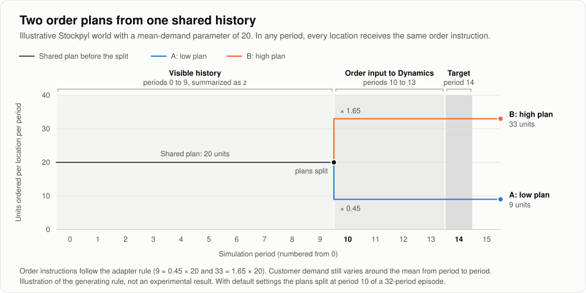
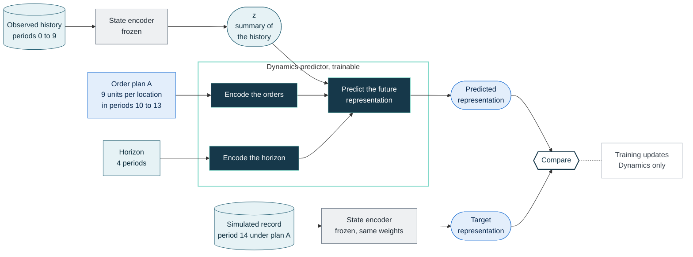
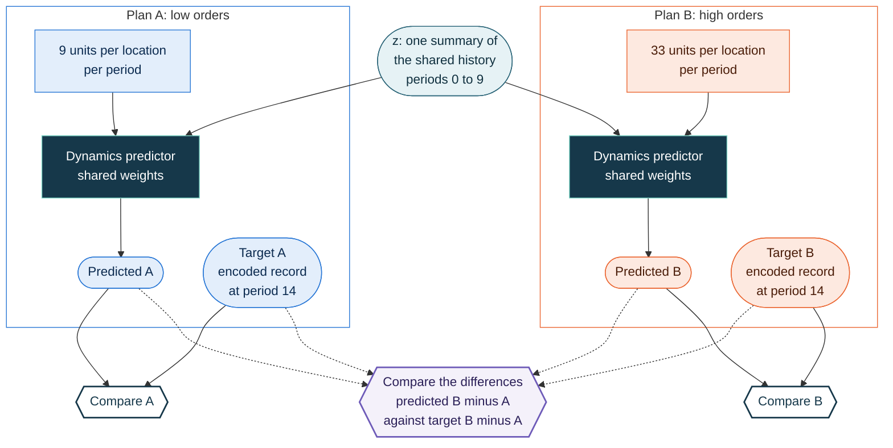
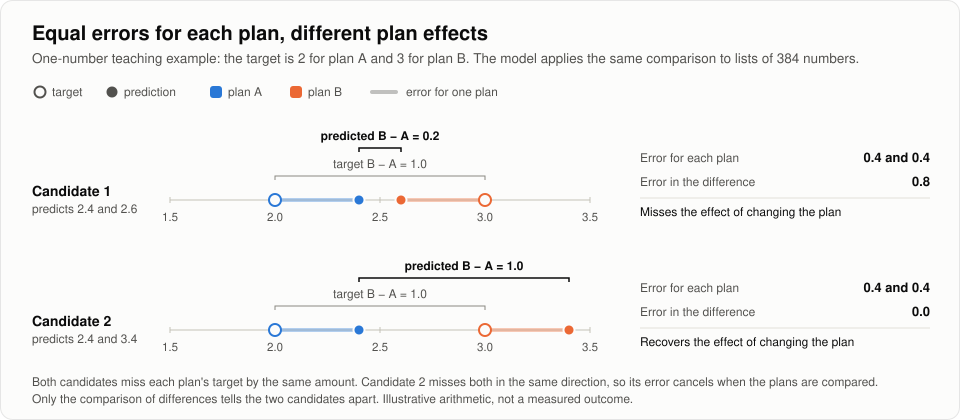
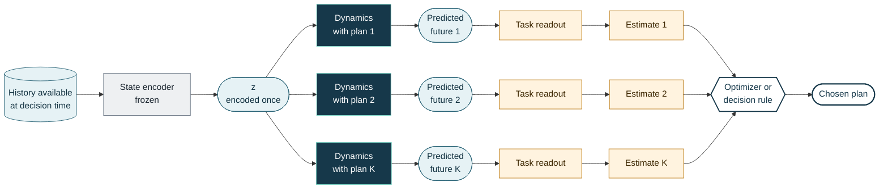

# Dynamics learning

*How SupplyChain-JEPA learns what a replenishment plan does to the future, from pairs of simulator
runs that differ only in their orders.*

<sub>Conceptual guide 3 of 4 · Previous: [State learning](STATE_LEARNING.md) · Next: [Using the model](USING_THE_MODEL.md) · [Documentation index](../README.md)</sub>

> [!NOTE]
> **In short.** State training teaches the model to describe an operating situation from
> incomplete records. Dynamics training teaches a separate predictor how that situation evolves
> under a specified order plan. Its training data are pairs of simulator runs that share their
> history and their future customer demand but follow different replenishment plans, so the
> difference between the two simulated futures is caused by the plan. The State encoder stays
> frozen throughout, and the predictor is fitted by reducing its prediction error, without
> rewards or a policy.

| At a glance | |
|---|---|
| **Learns from** | Paired runs of two inventory simulators, Stockpyl and MABIM |
| **Reads** | A summary of the history, the orders through the horizon, and the horizon |
| **Predicts** | A learned representation of the network's record at the end of the horizon |
| **Trains** | The Dynamics predictor only; the State encoder is frozen |
| **Used for** | Comparing candidate plans, through a readout fitted for the task |

**Contents**

1. [The question Dynamics answers](#1-the-question-dynamics-answers)
2. [Where the training actions come from](#2-where-the-training-actions-come-from)
3. [One training example, step by step](#3-one-training-example-step-by-step)
4. [Learning from the pair](#4-learning-from-the-pair)
5. [The complete objective](#5-the-complete-objective)
6. [What learns and what stays fixed](#6-what-learns-and-what-stays-fixed)
7. [No extra masking step](#7-no-extra-masking-step)
8. [Predictive learning, not reinforcement learning](#8-predictive-learning-not-reinforcement-learning)
9. [From prediction to decision](#9-from-prediction-to-decision)
10. [Scope](#10-scope)

[Code map](#code-map) · [Glossary](#glossary)

## 1. The question Dynamics answers

A planner about to commit to an order plan wants to know what the network will look like a few
periods later: stock at each location, backlog, goods in transit, and the costs that follow.
Dynamics answers that question in the model's own numerical language. Given a summary of the
history so far, a specified sequence of orders, and a horizon, it predicts the summary that the
State encoder would produce for the network's record at the end of the horizon.

That summary is a **representation**: a list of 384 numbers produced by the encoder. Individual
numbers carry no business label. Together they describe the operating situation, much as a belief
state does in a partially observed decision problem. [State learning](STATE_LEARNING.md) explains
how the encoder learns to produce them.

| | What it is | Example used on this page |
|---|---|---|
| Input: state summary *z* | The frozen State encoder's summary of everything observed before the decision | Periods 0 to 9 of a three-location Stockpyl network |
| Input: order plan | Every order placed from the decision period up to the horizon | 9 units at each location in each of periods 10, 11, 12, and 13 |
| Input: horizon | How many periods ahead the prediction refers to | 4 periods |
| Output | A predicted representation of the future record | 384 numbers describing period 14 |
| Training answer | The same encoder's summary of the record the simulator actually produced | The encoded period-14 record under that plan |

Two things never enter as inputs: the customer demand that occurs after the decision, and any
label saying which simulated branch an example came from. Future demand appears only on the answer
side, as part of the simulated record that the target summarizes.

> [!TIP]
> **An OR reading.** Dynamics is a learned transition model in representation space,
> fitted to designed simulation experiments. In simulation terms it is a metamodel: a fast
> approximation of a simulator's response that can be evaluated for many candidate decisions.
> Its response is a learned description of the whole future state rather than one performance
> measure such as cost.

## 2. Where the training actions come from

Learning the effect of an action needs examples in which the action was varied on purpose while
everything else stayed the same. Recorded business histories rarely provide that, because a store
that ordered more may have done so because it expected more demand. The released Dynamics corpus
therefore comes from two inventory simulators, Stockpyl and MABIM, which can replay one world under
different orders. The five real datasets and the other three simulators contribute to State
training only. [Data to episodes](DATA_TO_EPISODES.md) describes all ten sources.

### An inventory world

The [Stockpyl adapter](../../src/supplychain_jepa/adapters/stockpyl.py#L104) generates a serial
network of three or four locations. The first location orders from an external supplier, each
later location orders from the one before it, and the last one serves customers. Each generated
world fixes a mean-demand parameter between 8 and 24 units, a seven-period seasonal pattern with a
short demand surge, holding and stockout costs, starting inventories, and a lead time of one to
three periods for each location. The whole customer-demand sequence is drawn before the first
order is placed.

Every period, the simulator records each location's on-hand stock, backlog, incoming and outgoing
shipments, goods in transit, orders, and costs, together with customer demand and sales. These
records become an episode in the common format.

### Two order plans

The adapter does not let an ordering policy choose the quantities; it instructs the simulator
directly. Up to a branch period, every location orders the world's mean-demand parameter in every
period. From the branch period onward the run splits into two continuations, one sustaining a low
order and the other a high order, again at every location.

| Order instruction | Plan A: low | Plan B: high |
|---|---|---|
| Before the branch | 20 units per location per period | 20 units per location per period |
| From the branch onward | 0.45 × 20 = 9 units per location per period | 1.65 × 20 = 33 units per location per period |

<p align="center">
  
</p>

<p align="center"><sub><b>Figure 1.</b> One illustrative world with a mean-demand parameter of 20. The bands mark the parts of one training example at a four-period horizon. The quantities follow the adapter's rule; they are not experimental results.</sub></p>

The comparison is between sustained low and sustained high ordering across the whole network, not
between two isolated orders. An order is also a request rather than an arrival. Upstream stock and
lead times decide what ships, when it arrives, and how much backlog remains, so the two plans
produce different futures only through the simulator's own mechanics. The adapter
[checks](../../src/supplychain_jepa/adapters/stockpyl.py#L328) that the simulator executed exactly
the requested quantity at every location in every period.

> [!NOTE]
> An action in this corpus is a replenishment instruction set by the data generator. It is not
> inferred from a sales table, and the model never chooses it.

### Same demand, different orders

Both runs start from the same network and starting inventories, place the same orders until the
branch, and face the same pre-generated demand. Before a pair is accepted, the adapter
[verifies](../../src/supplychain_jepa/adapters/stockpyl.py#L500) that customer demand matches in
every period, that orders and simulator state match exactly before the branch, that orders differ
from the branch onward, and that the two futures actually diverge.

The trainer [repeats the structural checks](../../src/supplychain_jepa/windows.py#L478) for every
group of sibling runs: the same simulator family, network, and decision time, an identical record
of everything before the decision, and the same identifier for the future demand stream. Reusing a
random seed would not be enough, because a different order can change how a simulator consumes
random numbers later in the run.

This is the common-random-numbers design used to compare alternatives in simulation studies.
Because the history and the demand are shared, any difference between the two simulated futures
comes from the change in orders.

<details>
<summary><b>MABIM, the other paired source</b></summary>
<br>

MABIM supplies the rest of the paired corpus; batches draw Stockpyl and MABIM groups with
weights 55 and 45. Each generated MABIM world has two warehouses and two products, with generated
demand, prices, lead times, and starting stock. A shared generated order plan runs until about a
third of the way into the episode. From there the
[low branch](../../src/supplychain_jepa/adapters/mabim.py#L851) orders 25% of that plan's
quantity and the high branch 175% of it plus two units, both rounded to whole units. The branches
share the world, the earlier orders, and every future external input, and the adapter applies the
same pair checks as Stockpyl.

The released Dynamics lineage contains 4,500 branch records in 2,250 paired groups
([Training](../TRAINING.md#4-action-conditioned-dynamics-training)).

</details>

## 3. One training example, step by step

Take plan A in the world of Figure 1 at a four-period horizon. The history runs through period 9,
the plan supplies the orders of periods 10 to 13, and the answer is the simulator's record for
period 14.



<p align="center"><sub><b>Figure 2.</b> One plan, one prediction, one training answer. Both encoder boxes are the same frozen State encoder. The simulated future supplies only the answer, never an input.</sub></p>

1. **Describe the starting situation.** The frozen State encoder reads everything observed before
   period 10: the network description with its lanes, lead times, and costs; every period's stock,
   backlog, shipments, costs, customer demand, and sales; and the earlier 20-unit orders. It
   returns *z*. The period-10 orders are kept out of this history and enter only through the plan.
2. **Specify the plan and the horizon.** With three locations the plan holds twelve orders of
   9 units, one per location in each of periods 10 to 13, each tagged with its period, the
   ordering location, and its supplier. Small trainable parts of Dynamics turn each order, and
   the horizon of 4, into numbers the predictor can combine with *z*.
3. **Build the training answer.** The simulator's record for period 14 under plan A passes
   through the same frozen encoder. In the released configuration the target window is that single
   period, not the rest of the episode.
4. **Compare and update.** A Huber-type error (Smooth-L1) measures the gap between the predicted
   and target representations, averaged over their 384 numbers. Only the Dynamics predictor's
   parameters, the adjustable numbers inside it, change to reduce that error.

The same pair supplies examples at horizons of 1, 2, 4, and 8 periods whenever the episode is long
enough. At horizon 1 the plan contains only the period-10 orders and the target is period 11; at
horizon 8 it contains eight periods of orders and the target is period 18.

> [!IMPORTANT]
> The targets are future representations, not raw costs. Costs are fields of the simulated record,
> so they are part of what the target summarizes, together with inventory, backlog, shipments,
> demand, and sales. Turning a predicted representation into a cost estimate is the job of a
> separately fitted readout ([section 9](#9-from-prediction-to-decision)).

<details>
<summary><b>What exactly the predictor receives</b></summary>
<br>

| Input | What it contains |
|---|---|
| History | Every observed record before the decision period, plus the network description. When a long history exceeds the budget of 192 records, a [deterministic selection](../../src/supplychain_jepa/windows.py#L273) always keeps every earlier order, the network-wide summary of every period, the network around the ordering locations, and the latest record of every location involved in the plan or the target. The selection is seeded by the pair, not by the branch, so both plans see an identical history. |
| Orders | [Eight fields](../../src/supplychain_jepa/windows.py#L540) per order: quantity, order type, period, ordering location, supplier or lane, product, a presence flag, and an arrival lag when the source records one. Quantities enter on a signed logarithmic scale, and locations and products are numbered within the episode rather than by global identifiers. |
| Horizon | A number of periods. |
| Not received | Future demand, the branch label, the sibling plan, or any target value. |

*z* and the predicted representation each hold 384 numbers. *z* averages the encoder's
descriptions of the individual history records, and the target applies the same average to the
period-14 records.

In symbols, with *E* the frozen State encoder, $x_{t+h}$ the simulated record at the end of the
horizon, and $a_t,\dots,a_{t+h-1}$ the orders:

```math
\hat z_{t+h} = P_{\mathrm{dyn}}\left(z_t,\ a_{t:t+h-1},\ h\right),
\qquad
\mathcal{L}_{\mathrm{future}} = \mathrm{SmoothL1}\left(\hat z_{t+h},\ E(x_{t+h})\right).
```

</details>

## 4. Learning from the pair

Plans A and B start from the same *z*. Each plan runs through the same Dynamics predictor
separately, and each prediction is checked against its own target. Training then adds a second
comparison: the predicted change from A to B against the actual change.



<p align="center"><sub><b>Figure 3.</b> Each future is matched to its own target, and the predicted difference is matched to the target difference. The simulator used the same demand for both plans; the predictor never receives that demand.</sub></p>

The branch comparison asks whether each future is right: the low-order prediction against the
low-order target, the high-order prediction against the high-order target. The difference
comparison asks whether changing the plan has the right effect. A predictor can describe the
shared operating situation well and still give almost the same answer for both plans. Scoring
predicted B minus predicted A against target B minus target A directs learning toward the
consequence of changing the orders.

### A one-number example

Suppose the two target representations were single numbers: 2 for plan A and 3 for plan B, so
the target difference is 1. Compare two candidate predictors.

| Candidate | Predicts A and B | Error for each plan | Predicted B − A | Error in the difference |
|---|---|---|---:|---:|
| 1 | 2.4 and 2.6 | 0.4 and 0.4 | 0.2 | 0.8 |
| 2 | 2.4 and 3.4 | 0.4 and 0.4 | 1.0 | 0.0 |

<p align="center">
  
</p>

<p align="center"><sub><b>Figure 4.</b> A teaching example with single numbers, not a measured outcome. The model applies the same comparison to lists of 384 numbers.</sub></p>

The branch comparison cannot separate the candidates, since both miss each target by 0.4.
Candidate 2's errors point the same way for both plans, so they cancel when the plans are compared
and the full effect of the change survives. Candidate 1 compresses a one-unit effect into 0.2. A
planner choosing between A and B is better served by candidate 2, because a shared error does not
change which plan looks better, and only the difference comparison rewards it.

<details>
<summary><b>The same arithmetic with the released weights</b></summary>
<br>

Smooth-L1 with its threshold of 1 equals half the squared error for errors below 1.

| | Branch term (weight 1.00) | Difference term (weight 0.25) | Total |
|---|---:|---:|---:|
| Candidate 1 | ½ × 0.4² = 0.08 | 0.25 × ½ × 0.8² = 0.08 | 0.16 |
| Candidate 2 | ½ × 0.4² = 0.08 | 0.25 × 0 = 0 | 0.08 |

During training, each pair's predictions and targets are first divided by the size (root mean
square) of that pair's target difference, with a small floor, so pairs whose plans barely change
the future count as much as pairs with large effects
([`_paired_loss`](../../src/supplychain_jepa/training.py#L2753)). Here the target difference is 1,
so the scaling changes nothing.

</details>

Plans A and B are never combined into a single input. The predictor sees one plan at a time, and
the pairing exists only in how the errors are scored. Batches keep the members of a pair together
at the same horizon, so the difference can always be formed. Two plans make the idea easy to draw;
at decision time the same predictor scores any number of candidate plans from one history, each
through its own input.

## 5. The complete objective

The two comparisons above carry the central learning task. Four further terms check that the
predictor responds to the orders it is given and stays consistent when its predictions are
chained. The weights are those of the released configuration,
[`configs/dynamics.json`](../../configs/dynamics.json).

| Term | Weight | What it asks of the predictor |
|---|---:|---|
| Future prediction | 1.00 | Each plan's prediction matches its own encoded future |
| Paired difference | 0.25 | Predicted B minus A matches target B minus A |
| Control margin | 0.10 | The registered orders fit the true future better, by a margin of 0.05, than a no-op version with every quantity set to zero or the same orders assigned to a different location or lane |
| Shuffled future | 0.50 | The shared history combined with the sibling plan's orders predicts the sibling's future |
| Two-step consistency | 0.10 | At horizon 2, a one-period prediction fed back in with the next period's orders still lands on the true record two periods ahead |
| Branch contrast | 0.25 | After removing what the sibling futures share, each prediction points toward its own branch's future rather than its sibling's |

The two-step term works because the predictor's output has the same form as *z*, so a prediction
can serve as the starting summary for the next step.

<details>
<summary><b>Optimizer settings and diagnostics</b></summary>
<br>

Dynamics training uses AdamW with a learning rate of 2 × 10⁻⁴, weight decay 0.05, gradient
clipping at 1.0, two-step gradient accumulation, 5% warmup, and cosine decay to 10% of the
initial rate. Only Dynamics parameters are passed to the optimizer
([`run_dynamics`](../../src/supplychain_jepa/training.py#L3234)). After training, the trainer
reports how often the registered orders beat their controls, how often each branch is matched to
its own future, and an action-sensitivity diagnostic: how far predictions move when the
registered orders are replaced by a no-op. [Training](../TRAINING.md#dynamics-loss) states the
full objective formally.

</details>

## 6. What learns and what stays fixed

A frozen component keeps its learned parameters fixed. State training keeps two copies of the
encoder, one updated directly and one that follows it slowly, and aligns them to a single set of
weights at the end of that stage. Dynamics training freezes that encoder and uses it twice, once
for the history and once for the simulated future, so *z* and the targets live in the same
numerical space.

| Component | Role in Dynamics training | Parameters |
|---|---|---|
| State encoder | Encodes the observed history into *z* and the simulated future record into the target | Frozen |
| State predictor | Infers hidden or future representations during State training; not called in this stage | Unchanged, unused |
| Dynamics predictor | Combines *z*, the encoded orders, and the encoded horizon into a predicted future representation | Trained, including its order and horizon encoding |

The State predictor sits out because this stage asks a different question. Inferring a hidden
part of a history and projecting a history forward under specified orders are separate jobs, and
the encoder takes over neither of them; it only describes the records it is given.

Holding the encoder fixed keeps the targets still. If the encoder could change during this stage,
one easy way to shrink the prediction error would be to make every future look alike. Freezing
also protects what the encoder learned from all ten sources while Dynamics sees only two
simulators, and it keeps the coordinate system stable for every readout built on the State
representation.

The repository's [smoke test](../../tests/test_training_smoke.py#L26) runs the full chain on a
tiny generated corpus and checks that every State encoder and State predictor weight is unchanged
after Dynamics training while the Dynamics weights move. A
[unit test](../../tests/test_training_pipeline.py#L118) checks that a Dynamics loss sends no
gradient into the encoder.

## 7. No extra masking step

State training creates its questions by hiding parts of a history on purpose. Dynamics training
does not repeat that step: it does not hide records and ask the State predictor to fill them in.
The frozen encoder reads the available pre-decision history directly, and Dynamics learns how that
situation evolves under the supplied orders.

The history can still be incomplete because of how a source reports information. In MABIM, the
downstream warehouse
[reports demand capped at its sales](../../src/supplychain_jepa/adapters/mabim.py#L529)
whenever it stocks out, and marks that report as censored, while the simulator keeps the true
demand in its internal record. Stockpyl's observation is a full copy of the simulator state. These
reporting limits belong to the data that Dynamics reads and are separate from the artificial masks
of State training.

## 8. Predictive learning, not reinforcement learning

Dynamics training is ordinary supervised prediction. Each example has a known answer, the encoded
record that the simulator produced, and training reduces the error against those answers.

| | Reinforcement learning | Dynamics training |
|---|---|---|
| Who chooses the actions | The learning agent, by trial and error | The data generator, before training begins |
| Learning signal | A reward to maximize | The error in predicting a recorded future |
| What is learned | A policy or value function | A transition model in representation space |
| Where decisions are made | Inside the learned policy | Later, in a separate readout and optimizer |

Costs appear only as fields of the recorded future, never as a reward. The closest OR analogue
is fitting a simulation metamodel to a designed experiment with two levels of the order quantity
and common random numbers.

## 9. From prediction to decision

At decision time there is no simulated future to read. An application encodes its available
history once, supplies each candidate order plan and the horizon to Dynamics, and receives one
predicted future representation per plan. A task readout, fitted separately, turns each
representation into an estimate such as expected cost or service level. An optimizer or decision
rule compares the estimates and chooses.



<p align="center"><sub><b>Figure 5.</b> One history summary supports several plan evaluations. Dynamics supplies the predicted futures, the readout supplies their business meaning, and the decision rule makes the choice.</sub></p>

The public API mirrors this split. [`compare_actions`](../../src/supplychain_jepa/api.py#L94)
evaluates K candidate plans from the same state in one batched call and returns their predicted
futures. It stops short of ranking them, because a ranking needs a readout for the operator's
objective.

The released replenishment-plan evaluation follows the same pattern. It keeps the State encoder
frozen, adapts a copy of the pretrained Dynamics predictor together with a
[linear cost readout](../../evaluations/action_selection/evaluate.py#L36) on its own simulated
worlds, and [chooses the plan](../../evaluations/action_selection/evaluate.py#L189) with the lower
predicted cost. [Evaluation](../EVALUATION.md#3-replenishment-plan-selection) gives the protocol
and results, and [Using the model](USING_THE_MODEL.md) covers readouts and decision rules.

## 10. Scope

> [!IMPORTANT]
> - Dynamics has learned the effects of the actions in its paired corpus: sustained replenishment
>   orders in Stockpyl and MABIM, at horizons of 1, 2, 4, and 8 periods. Interventions of other
>   kinds, or operating states far from those simulated worlds, are outside what it was trained to
>   predict.
> - Its predictions do not enforce inventory balance, capacity, or service constraints. The
>   optimization or control layer remains responsible for feasibility.
> - Recorded business histories contribute to State training only and are never used as
>   counterfactual labels.

[Limitations](../LIMITATIONS.md) lists the boundaries of the whole release.

## Code map

| Topic | Where to look |
|---|---|
| Stockpyl worlds, order plans, and pair checks | [`adapters/stockpyl.py`](../../src/supplychain_jepa/adapters/stockpyl.py): [`_world_spec`](../../src/supplychain_jepa/adapters/stockpyl.py#L104), [`_requested_actions`](../../src/supplychain_jepa/adapters/stockpyl.py#L208), [`_validate_pair`](../../src/supplychain_jepa/adapters/stockpyl.py#L500) |
| MABIM branches and censored reports | [`adapters/mabim.py`](../../src/supplychain_jepa/adapters/mabim.py): [`generate_mabim_records`](../../src/supplychain_jepa/adapters/mabim.py#L798), [`_observation_from_state`](../../src/supplychain_jepa/adapters/mabim.py#L529) |
| Pair validation, history selection, order fields, and controls | [`windows.py`](../../src/supplychain_jepa/windows.py): [`build_dynamics_examples`](../../src/supplychain_jepa/windows.py#L778), [`_extract_actions`](../../src/supplychain_jepa/windows.py#L540), [`_action_variant`](../../src/supplychain_jepa/windows.py#L753) |
| Frozen encoder and Dynamics predictor | [`model.py`](../../src/supplychain_jepa/model.py): [`freeze_encoders_for_dynamics`](../../src/supplychain_jepa/model.py#L1408), [`canonical_belief_latent`](../../src/supplychain_jepa/model.py#L1537), [`DynamicsPredictor`](../../src/supplychain_jepa/model.py#L1033) |
| Objective terms | [`_dynamics_objective`](../../src/supplychain_jepa/training.py#L3015) in `training.py`; [`paired_difference_loss`](../../src/supplychain_jepa/losses.py#L157) in `losses.py` |
| Training loop | [`run_dynamics`](../../src/supplychain_jepa/training.py#L3234) in `training.py` |
| Released settings | [`configs/dynamics.json`](../../configs/dynamics.json) |
| Scoring candidate plans | [`compare_actions`](../../src/supplychain_jepa/api.py#L94) in `api.py`; [`PlanQualityModel`](../../evaluations/action_selection/evaluate.py#L36) in the action-selection evaluation |
| Frozen-chain tests | [`test_training_smoke.py`](../../tests/test_training_smoke.py#L26), [`test_training_pipeline.py`](../../tests/test_training_pipeline.py#L118) |

The bounded CPU chain in [Getting started](GETTING_STARTED.md) runs State and Dynamics training
on four generated records:

```bash
uv run --all-extras python scripts/run_training_smoke.py \
  --work-dir /tmp/supplychain-jepa-smoke \
  --updates 2
```

Its tiny losses test the contract and the frozen boundary, not the released model's quality.

## Glossary

<details>
<summary><b>Terms used on this page</b></summary>
<br>

| Term | Meaning here |
|---|---|
| Representation | A list of numbers produced by the encoder, 384 in the released model. Individual numbers have no business label. |
| Encoder | The part of the model that turns records into a representation. |
| Predictor | A part of the model that predicts the representation of something it cannot see. |
| Parameters | The adjustable numbers inside a model component that training changes. |
| Frozen | Parameters held fixed during a training stage. |
| Loss | A score of how wrong a prediction is. Each training update nudges the trainable parameters to lower it. |
| Smooth-L1 | A Huber-type error: squared for small gaps, absolute for large ones, so outliers weigh less. |
| Horizon | How many periods ahead a prediction refers to. |
| Branch | One simulated continuation under one plan. |
| Pair, or branch group | The sibling branches that share a history and a demand stream. |
| Common random numbers | Comparing alternatives under identical random inputs, so differences reflect the decision. |
| Readout | A small model fitted for one task that maps a representation to a business quantity. |

</details>

---

<sub>Previous: [State learning](STATE_LEARNING.md) · Next: [Using the model](USING_THE_MODEL.md) · [Documentation index](../README.md) · [Project README](../../README.md)</sub>
