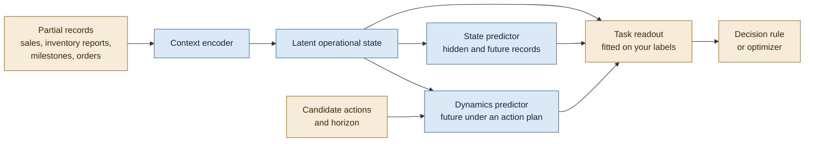
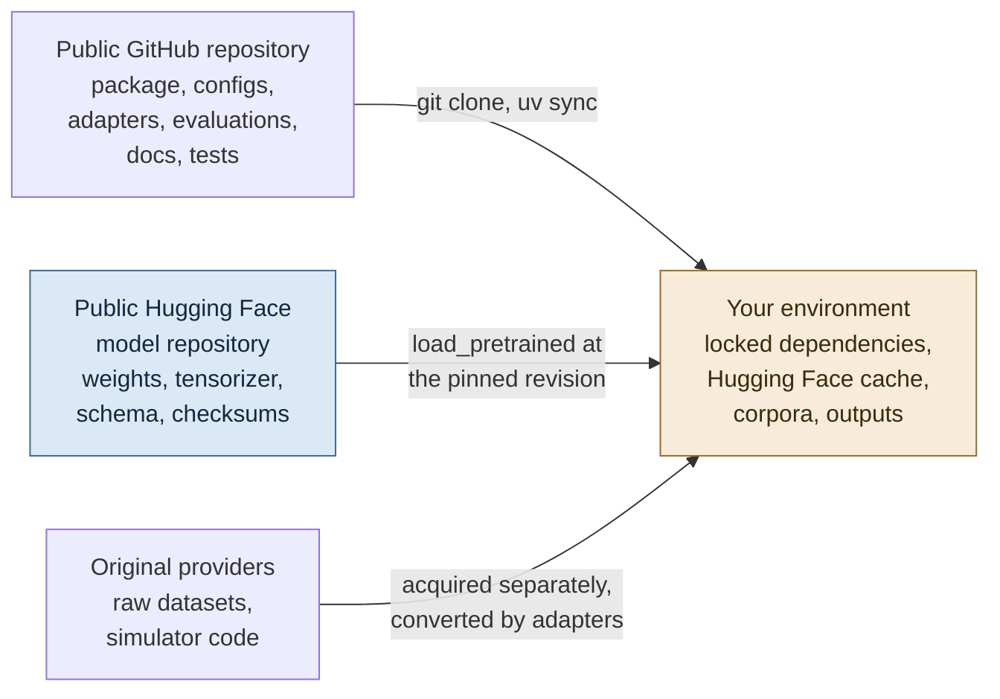
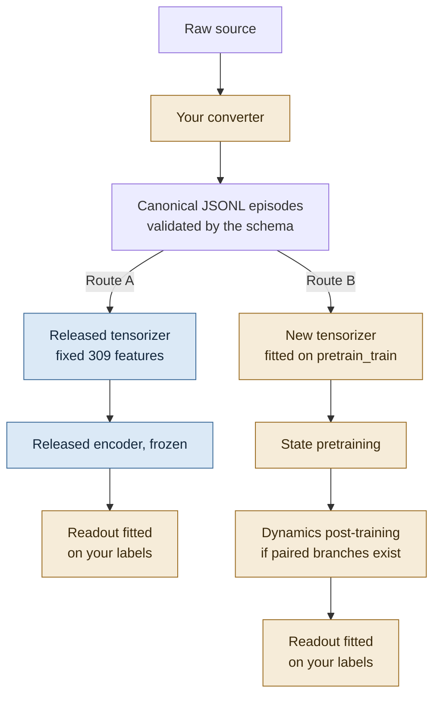
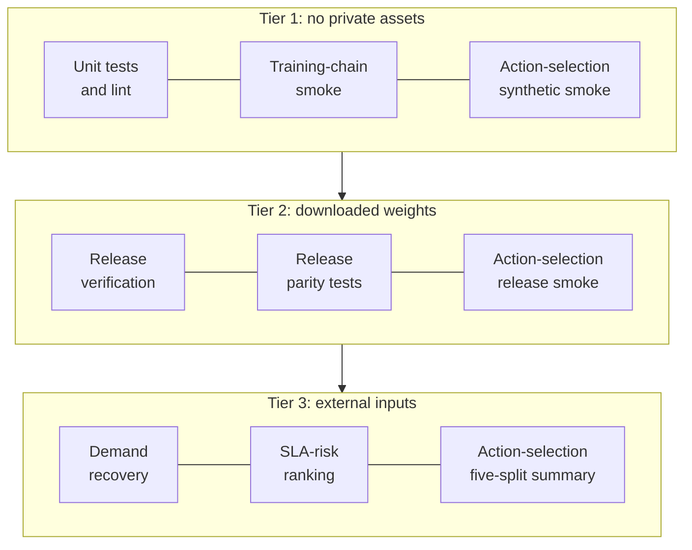

# Getting started with SupplyChain-JEPA

*A first-use guide for operations research and operations management readers: what the model
does, how to load the released weights, how to bring your own records, and how to reproduce the
reported examples.*

<sub>Practical guide · Conceptual guides start at [Data to episodes](DATA_TO_EPISODES.md) · [Documentation index](../README.md) · [Project README](../../README.md)</sub>

SupplyChain-JEPA learns a reusable latent state from incomplete supply-chain records, then
predicts how that state would change, either on its own or under a specified action plan. The
code and the trained weights are distributed separately: this repository holds the code, and
the public Hugging Face model repository
[`htizhang/SupplyChain-JEPA`](https://huggingface.co/htizhang/SupplyChain-JEPA) holds the weights.
Both download without an account. Most of a first session is therefore spent on verification and
data shape rather than on modeling.

| If you want to | Start here | What you need |
|---|---|---|
| Know what the model does, and what it does not do | [1. Understand the model](#1-understand-the-model) | Nothing |
| Load the released weights and run them on CPU | [2. Load the released weights](#2-load-the-released-weights) | Python 3.11 to 3.13 and a network connection for the first download |
| Feed the model records of your own | [3. Prepare a new dataset](#3-prepare-a-new-dataset) | Your data, under its own terms |
| Turn latent vectors into estimates, risk scores, or plan choices | [4. Turn states into business answers](#4-turn-states-into-business-answers) | A modest labeled sample |
| Re-run the published checks and results | [5. Reproduce the examples](#5-reproduce-the-examples) | Depends on the example; several need neither the weights nor external data |

> [!TIP]
> Three commands take a fresh clone to a verified model running on CPU, with no account or token:
>
> ```bash
> uv sync --all-extras
> uv run python scripts/verify_model_release.py
> uv run python examples/quickstart.py
> ```

## 1. Understand the model

### The planning problem

Supply-chain records describe the system with gaps. Point-of-sale data records sales, so a
stockout hides how much customers wanted. Carrier milestones arrive after the physical event,
sometimes much later. Orders in transit are known to exist, but not where they are. A
replenishment decision made today plays out over several periods while more information arrives.

SupplyChain-JEPA asks two questions of such records:

- **State.** What operating situation do the available records describe, including the parts
  that are hidden or not yet reported?
- **Dynamics.** How would that situation evolve under a specified sequence of actions?

It answers both inside a learned representation space. A task-specific readout, which you fit,
translates the representation into a lost-sales estimate, a delay-risk score, or a plan cost. An
optimizer or decision rule then acts on that readout.

### One encoder, two predictors



Blue components ship in the release. Amber ones come from your application: the records you
supply, the plans you want compared, the readout you fit, and the rule that makes the decision.

The encoder and both predictors come from one continuous training chain with two stages.

State pretraining hides a coherent piece of an episode (a run of periods, a group of entities, a
network neighborhood, the end of an event sequence, or a reporting outage) and trains the encoder
and State predictor to predict a representation of what was hidden. Some questions concern hidden
parts of the history up to now. Others concern records 1, 2, 4, or 8 steps ahead, with future
actions removed from view, so they describe what usually follows under whatever policy produced
the data rather than the effect of a chosen action. A slowly averaged copy of the encoder, the EMA
target encoder, produces the representations being predicted.

Dynamics post-training then freezes the encoder and trains a separate predictor on simulator runs
that branch from the same state under different orders while facing the same future demand. All
of the released action knowledge comes from these paired Stockpyl and MABIM branches; recorded
real-world histories never serve as action labels.

[Architecture](../ARCHITECTURE.md) and [Training](../TRAINING.md) give the full specification.

### What an episode looks like

A source adapter converts each dataset or simulator into episodes: bounded histories such as one
product at one store, one purchase-order item, one courier's day, or one simulated inventory
network. Every time step carries two views of the same world:

- `observation`, what a planner could have seen at that moment, with stale, censored, or missing
  values marked;
- `latent_state`, the target view. For recorded data it holds the finalized facts; for a
  simulator it can also hold internal state that the reporting process concealed.

The encoder reads topology, observations, and recorded actions. The target view never enters its
input.

The smallest complete example ships with the code.
[`generate_tiny_corpus.py`](../../examples/training/generate_tiny_corpus.py) builds a supplier and
a store joined by a replenishment lane with a two-period lead time, starting from 16 units of
stock. Both records of its training pair share this history:

| Period | Demand, target view | Demand field, observation view | On hand, target view | On hand, observation view | What the record says |
|---:|---:|---:|---:|---:|---|
| 0 | 3 | 3 | 13 | 13 | Fully observed |
| 1 | 4 | 4 | 9 | 9 | Fully observed |
| 2 | 5 | 4 | 4 | 4 | The reported demand field equals sales, which stock caps at 4. The store orders 4 units in one branch and 14 in the other, due in period 4 |
| 3 | 3 | 3 | 1 | 4 | The on-hand report is one period stale (status `delayed`, `age_steps` 1), and the period's shipment report has not arrived |

The two branches then diverge:

| Period | Low order (4 units): on hand / backlog | High order (14 units): on hand / backlog |
|---:|---:|---:|
| 4 | 0 / 1 | 9 / 0 |
| 5 | 0 / 5 | 5 / 0 |
| 6 | 0 / 10 | 0 / 0 |

Both branches see the same demand stream and identical records before the order, so any
difference in their futures is caused by the order. Simulation analysts will recognize this as
common random numbers; it is what allows Dynamics to learn an action's effect rather than a
difference in luck.

> [!NOTE]
> These are project-authored smoke-test records, kept small enough to read. They illustrate the
> data contract, not model quality.

### Reading the model in OR and OM terms

| Familiar idea | Closest component | Difference to keep in mind |
|---|---|---|
| Belief state of a partially observed system | Canonical state: one pooled 384-number vector per episode | A learned embedding, not a probability distribution over physical states |
| Imputing censored or late values | State predictor, hidden-current queries | Predicts the representation of hidden records; a readout converts it to quantities |
| Forecasting | State predictor, future queries at 1, 2, 4, or 8 steps | Describes what usually follows with future actions hidden, not the result of a chosen plan |
| Transition model under an action | Dynamics predictor | Learned from paired replenishment branches; supported only for similar actions and regimes |
| Cost or value function | A readout you fit | Not part of the release; the three evaluations show worked examples |
| Optimizer, policy, constraints | Your code | Outside the model |

> [!IMPORTANT]
> The encoder and both predictors return 384-dimensional latent vectors whose individual
> coordinates carry no business unit. Read them only through a readout fitted for your question. The model enforces no
> inventory balance, capacity, or service constraint, and its action-conditioned predictions are
> supported only for action types and operating regimes like those in the paired simulator data.
> [Limitations](../LIMITATIONS.md) lists the remaining boundaries.

## 2. Load the released weights

### Code and weights live in different places



| Location | What it holds | Access |
|---|---|---|
| This GitHub repository | The `supplychain_jepa` package, configs, the canonical JSON Schema, source adapters, evaluation protocols, tests, compact result files | Public; clone without an account |
| Hugging Face model repository [`htizhang/SupplyChain-JEPA`](https://huggingface.co/htizhang/SupplyChain-JEPA) | Weights, fitted tensorizer, schema, normalization statistics, release manifest, checksums, model card | Public and ungated; downloads without an account or token |
| Original providers | Raw datasets (M5, BPI Challenge 2019, LaDe, Olist, planned-versus-actual routes, FreshRetailNet-50K, Cargo2000) and simulator code | Each source's own terms; nothing is redistributed here |

| Release at a glance | |
|---|---|
| Pinned model revision | `493786fda0855b72f61235068c62cc7b2a11fbec` |
| Core parameters | 73,629,696 |
| Latent width | 384 |
| Layers | 6 encoder, 3 State predictor, 4 Dynamics predictor |
| Fitted input interface | 309 features |
| Python | 3.11 to 3.13; `.python-version` and CI use 3.12 |

The revision is immutable and every reference result in this repository was computed against it.
[Provenance](../../PROVENANCE.md) describes what the release manifest records.

### Get access

Both repositories are public, so there is nothing to request.

1. Clone this GitHub repository.
2. Install [uv](https://docs.astral.sh/uv/). It reads the pinned Python version and the locked
   dependency graph in `uv.lock`.
3. Load the weights anonymously. A Hugging Face login is optional: if you already use one, the
   client picks up a token stored by `hf auth login` or set as `HF_TOKEN`. Keep any token out of
   the repository; `.env` files are already ignored by Git.

```bash
git clone https://github.com/htizhang/SupplyChain-JEPA.git
cd SupplyChain-JEPA
uv sync --all-extras        # locked environment with every optional extra
```

### Verify, then load

```bash
uv run python scripts/verify_model_release.py
```

The script fetches the release at the pinned revision, verifies it, builds the model on CPU, and
prints a summary. When download, checksums, and architecture all agree, the summary reads:

```json
{
  "core_parameters": 73629696,
  "device": "cpu",
  "feature_count": 309,
  "model_id": "htizhang/SupplyChain-JEPA",
  "revision": "493786fda0855b72f61235068c62cc7b2a11fbec",
  "verified": true
}
```

In Python, the same release is one call:

```python
from supplychain_jepa import load_pretrained

bundle = load_pretrained(device="cpu")

bundle.revision                                     # the pinned revision
bundle.tensorizer.state.feature_count               # 309
sum(p.numel() for p in bundle.model.parameters())   # 73629696
```

Before it returns, `load_pretrained`:

1. fetches only the files the release declares, at the pinned revision;
2. checks the SHA-256 digest of every file listed in `CHECKSUMS.sha256`, and refuses a release
   with a missing or undeclared required file;
3. builds the architecture from `config.json` and loads the core and auxiliary weights strictly;
4. compares the parameter count with `release_manifest.json`;
5. puts every module in evaluation mode with gradients disabled.

> [!WARNING]
> Keep verification on for anything you report. If a checksum fails, delete the damaged cached
> copy and download it again. The SLA-risk evaluation's `--skip-model-verification` flag exists
> only to diagnose a damaged cache. Published comparisons always use the pinned revision, never a
> moving branch.

| Situation | Call |
|---|---|
| Normal use: pinned revision, verified | `load_pretrained(device="cpu")` |
| No network, release already in the local Hugging Face cache | `load_pretrained(local_files_only=True)` |
| A copied release directory | `load_pretrained("/path/to/release", revision="493786fda0855b72f61235068c62cc7b2a11fbec")` |
| Optional: pass a Hugging Face token explicitly | `load_pretrained(token="<token>")` |
| Locate the downloaded snapshot for other tools | `bundle.source` |

When you load from a directory, the `revision` argument only labels the bundle; without it,
`bundle.revision` is `None`.

<details>
<summary>What a <code>ModelBundle</code> contains</summary>

| Field | Contents |
|---|---|
| `model` | `SupplyChainJEPACore`: online and EMA target encoders, State predictor, Dynamics predictor |
| `tensorizer` | `EpisodeTensorizer` holding the fitted interface: feature names and kinds, means, standard deviations, vocabularies |
| `state_pool_predictor` | Predicts a pooled hidden or future state from the canonical state |
| `semantic_concept_slot_predictor` | Auxiliary head trained to preserve operational concepts shared across sources |
| `grounding_head` | Auxiliary linear head trained to retain the scale of inventory, demand, backlog, lead-time, and stockout fields |
| `config`, `tensorizer_config`, `schema`, `normalization`, `release_manifest` | The parsed JSON files of the release |
| `source`, `revision` | The snapshot directory and the revision it came from |

`tensorizer.json` is the authoritative interface. `normalization.json` is a projection of it for
inspection and interoperability, not an independently fitted object.

</details>

> [!NOTE]
> CPU is enough for everything in this section, for the unit tests and smoke checks, and for the
> canonical evaluations, whose command lines default to `--device cpu`. Pretraining at the
> released width is accelerator work: the trainer's default `--device auto` selects an available
> accelerator and enables mixed precision only there.

## 3. Prepare a new dataset

### Pick a route



| | Route A: released weights, frozen | Route B: your own pretraining |
|---|---|---|
| Use when | You want features for estimation, ranking, or plan comparison and can label a modest sample | Your fields fall largely outside the released 309-feature interface, or you need action effects beyond replenishment quantities |
| Feature interface | Fixed: the released `tensorizer.json` | Fitted on your `pretrain_train` records when State training starts |
| What you train | A small readout | State, then optionally Dynamics, then a readout |
| Data you need | Canonical episodes, plus labels for the readout | A canonical corpus with train and development splits; paired simulator branches for Dynamics |
| Compute | CPU | An accelerator at the released width |

Both routes start from the same canonical episode format, so the next three subsections apply to
either one.

### Acquire the source data

For the ten released pretraining sources, the repository ships converters, not data.
[`adapter_inputs.json`](../../data/manifests/adapter_inputs.json) lists the files each recorded
dataset needs together with its license note, and [`source_pins.json`](../../configs/source_pins.json)
pins the four external simulators to exact commits:

```bash
uv run --extra adapters python -m supplychain_jepa.adapters list
uv run python scripts/fetch_simulator_sources.py --root /path/to/simulator-checkouts

cp configs/adapters.example.json /path/to/adapters.json      # then edit every placeholder path
uv run --extra adapters python -m supplychain_jepa.adapters build \
  --config /path/to/adapters.json
```

`build` writes one `<source>.jsonl` per source and a `manifest.json` into the configured
`output_dir`; the trainer accepts that manifest as `--data`. To try one source on a small sample
first, convert it alone with `--pilot`:

```bash
uv run --extra adapters python -m supplychain_jepa.adapters convert \
  --source m5 --raw-root /path/to/m5 --output /path/to/corpus/m5.jsonl --pilot
```

For a source of your own, obtain it under its terms and keep raw and derived files out of Git.
The `data/raw/`, `data/processed/`, and `data/cache/` folders are ignored, and the repository
boundary test rejects model and dataset binaries (such as `.safetensors`, `.pt`, or `.parquet`)
and any file over 2 MiB.
[Datasets](../../DATASETS.md) lists the sources reserved for downstream evaluation, which must stay
out of pretraining corpora.

### Write canonical episodes

A converter emits one JSON object per episode, and each object must validate against the packaged
[`canonical_episode.schema.json`](../../src/supplychain_jepa/schemas/canonical_episode.schema.json):

```text
episode record
├── schema_version          "supplychain-jepa.synthetic-episode.v1" (fixed, also for recorded data)
├── record_id, split        split is pretrain_train | pretrain_dev | pretrain_test | simulator_holdout
├── simulator               family, name, version, source_repository, source_commit, license
├── episode                 episode_id, world_id, config_id, seed, time_unit, horizon,
│                           exogenous_stream_id, domain_parameters
├── branch                  null, or branch_group_id, branch_id, branch_at, common_random_numbers
├── objective_eligibility   state_jepa, dynamics_jepa, decision_heads
├── topology                topology_id, nodes[], edges[]
├── steps[]  (two or more)  t, clock, observation, latent_state, actions[], outcomes,
│                           exogenous_digest, terminal
└── provenance              adapter_version, generator, causal_semantics,
                            observation_semantics, source_files
```

The schema fixes the shape. These rules fix the meaning:

- Put in `observation` only what a planner could have known at that step. Censored sales stay
  censored, and late reports stay late.
- Mark each value that is not plainly observed in `observation.status`, with a path such as
  `observation.entities.<entity_id>.<field>`, a status (`observed`, `censored`, `delayed`,
  `missing`, `outage`, or `not_applicable`), an `age_steps` value, and a short `reason`.
- Leave a field out when the source does not measure it. The tensorizer records absence with a
  presence flag, so a missing value and a true zero stay distinct. Never invent numbers to fill
  another source's schema.
- An event enters the encoder's input only when `observed` is true and its `report_time` is no
  later than the step's `clock`.
- Assign splits by whole world, case, or series with a deterministic hash, never by rows of one
  trajectory. The released recorded-data adapters send about 90, 5, and 5 percent of worlds to
  `pretrain_train`, `pretrain_dev`, and `pretrain_test`; the trainers read only the first two.
- Set `dynamics_jepa` to true only for controlled simulator branches. Siblings must share the
  family, topology, decision time (`branch_at`), complete pre-action prefix, and
  `exogenous_stream_id`. Reusing a random seed is not enough when the action changes how later
  random numbers are consumed. Recorded histories always set it to false.
- `decision_heads` marks records meant for downstream decision heads; the released trainers do
  not read it.

The trainer deliberately skips schema validation to stay light, so validate before training, as
the project's own generator does:

```python
import json

from jsonschema import Draft202012Validator
from supplychain_jepa.schemas import canonical_episode_schema

validator = Draft202012Validator(
    json.loads(canonical_episode_schema().read_text(encoding="utf-8"))
)
with open("/path/to/my-episodes.jsonl", encoding="utf-8") as handle:
    for line in handle:
        if line.strip():
            validator.validate(json.loads(line))
```

`supplychain_jepa.adapters.common` provides small builders for schema-shaped pieces:
`make_entity`, `make_edge_state`, `make_event`, `make_action`, `observation_status`,
`make_record_id`, and `write_jsonl`. For complete worked converters, read
[`m5.py`](../../src/supplychain_jepa/adapters/m5.py) for a recorded dataset and
[`stockpyl.py`](../../src/supplychain_jepa/adapters/stockpyl.py) for paired simulator branches.
The `adapters convert` command knows only the ten registered sources, so a new source is easiest
to handle as a standalone script that writes JSONL and validates it.

### How fields become model inputs

The tensorizer turns each record into two aligned token sequences. Context tokens come from
topology, observations, and recorded actions; target tokens come from `latent_state` alone.

| Raw content | What the tensorizer does with it |
|---|---|
| Field names | Prefixes them with where they live: `entity::on_hand`, `edge::in_transit`, `global::period_cost`, `event::progress`, `action::quantity`, `topology_node::capacity`, `topology_edge::nominal_lead_time`. Events also carry `event::__event_time`, `event::__report_time`, and `event::__observed` |
| Numbers | Standardizes them with the fitted mean and standard deviation of that feature |
| Strings and booleans | Looks them up in the fitted vocabulary; unseen values map to an unknown token |
| Identifiers (`*_id`, `item_id`, `product_id`) | Replaces them with indices local to the episode, so raw identifiers never become global features |
| Absent fields | Leaves them empty, with a false presence flag |
| Status and age | Attaches them per feature from `observation.status`; unmarked context values count as observed |
| Source family, token kind, token type | Looks them up in fitted metadata vocabularies; unseen values map to an unknown token |

Each step adds one context token per observed entity, edge state, reported event, and action,
plus one global token; topology adds one token per node and per edge. Training contexts were
capped at 192 tokens, so keep the records you encode for inference to a similar size.

### Route A: encode with the released interface

> [!CAUTION]
> The released tensorizer skips, without warning, any field name outside its 309-feature
> interface, and maps unseen categories to the unknown token. A converter whose names do not match
> encodes little beyond structure and timing. Check coverage first, and rename fields to existing
> names wherever the meaning genuinely matches.

```python
from supplychain_jepa import load_pretrained

bundle = load_pretrained(device="cpu")
known = bundle.tensorizer.state.feature_index          # {"<kind>::<field>": column}

mine = ["entity::on_hand", "entity::backlog", "edge::in_transit", "global::fill_rate"]
print("known:  ", [name for name in mine if name in known])
print("ignored:", [name for name in mine if name not in known])
print(sorted(name for name in known if name.startswith("entity::")))   # browse candidates
```

Then cut each record at the moment you want a state for, and encode:

```python
from copy import deepcopy

from supplychain_jepa import encode_state
from supplychain_jepa.data import collate_episode_tensors, iter_episode_records


def history_until(record, last_t):
    """Keep the topology and the steps up to and including period last_t."""
    trimmed = deepcopy(record)
    trimmed["steps"] = [step for step in record["steps"] if step["t"] <= last_t]
    return trimmed


records = [history_until(r, last_t=11) for r in iter_episode_records("/path/to/my-episodes.jsonl")]
batch = collate_episode_tensors([bundle.tensorizer.transform(r) for r in records])

encoding = encode_state(bundle, batch)                   # token_latents: [B, L, 384]
state = bundle.model.select_canonical_state(encoding)    # one 384-number state per record
```

The tensorizer places every step it receives into the context, so the cut is what keeps later
information out. For plan comparison, keep only the steps strictly before the decision period;
that is how Dynamics training built its context. The released mean, standard deviation, and
vocabularies apply automatically inside `bundle.tensorizer.transform`. Never refit them on
downstream or test data.

<details>
<summary>Querying hidden or future records directly</summary>

`predict_masked_state(bundle, batch, role_ids=..., horizons=...)` runs the State predictor. Its
queries are the target tokens in `batch`, which come from `latent_state`, but only their metadata
is read: source family, token kind and type, time, and episode-local indices. Values are ignored,
so you can list the entities and periods you want predicted without knowing their values. Use
role 0 with horizon 0 for hidden parts of the current history, and role 1 with the number of steps
ahead for future records, both as `[B, Q]` tensors. The result has shape `[B, Q, 384]`: one
predicted representation per queried record, which still needs a readout before it becomes a
quantity.

</details>

### Route B: pretrain your own chain

1. Build and validate the corpus as described above, with `pretrain_train` and `pretrain_dev`
   splits.
2. Copy `configs/state.json` (and `configs/dynamics.json` if you have paired branches) and add
   your `simulator.family` names to `source_sampling_weights`. State training stops with an error
   when a corpus family has no weight; Dynamics silently skips such a family.
3. Run the bounded smoke chain from [section 5](#tier-1-no-private-assets) once, to confirm the
   environment end to end.
4. Train State, then Dynamics:

```bash
# Set UPDATES and MICRO_BATCH for your corpus and hardware first.
uv run python -m supplychain_jepa.train state \
  --model-config configs/model.json --config /path/to/my-state.json \
  --data /path/to/corpus/manifest.json \
  --output-dir /path/to/state-output \
  --max-updates "$UPDATES" --batch-size "$MICRO_BATCH"

uv run python -m supplychain_jepa.train dynamics \
  --model-config configs/model.json --config /path/to/my-dynamics.json \
  --data /path/to/corpus/manifest.json \
  --checkpoint /path/to/state-output/state_checkpoint.pt \
  --output-dir /path/to/dynamics-output \
  --max-updates "$UPDATES" --batch-size "$MICRO_BATCH"
```

The State run fits a fresh tensorizer on your `pretrain_train` records and stores it in its
checkpoint; Dynamics reuses that interface unchanged and trains only its own predictor.
[Training](../TRAINING.md) covers corpus sampling, masks, losses, optimizer settings, and
checkpoint contents. Training refuses records and corpus files whose text contains the name of a
downstream-evaluation source (case, spaces, and punctuation are ignored when matching), which
keeps those sources out of pretraining by construction.

> [!IMPORTANT]
> Training writes PyTorch checkpoints (`state_checkpoint.pt`, `dynamics_checkpoint.pt`) plus
> `metrics.json`, not a release bundle, and the repository has no packaging step that turns one
> into the other. In the same way, `--init-checkpoint` continues from a State *training*
> checkpoint: the published Hugging Face bundle is not one, so continued pretraining from the
> released weights is not available through the command line. Continuation also requires the
> parent's fitted feature schema; with a different corpus, add `--reuse-parent-tensorizer`, and
> fields outside the parent's interface are then ignored.

<details>
<summary>Using a checkpoint you trained</summary>

Only load checkpoints you produced or trust: they are pickled, so loading one can execute code.

```python
import torch

from supplychain_jepa import ModelConfig, SupplyChainJEPACore
from supplychain_jepa.data import (
    EpisodeTensorizer,
    FittedTensorizerState,
    collate_episode_tensors,
)

payload = torch.load(
    "/path/to/dynamics-output/dynamics_checkpoint.pt", map_location="cpu", weights_only=False
)
model = SupplyChainJEPACore(ModelConfig(**payload["model_config"]))
model.load_state_dict(payload["model_state"], strict=True)
model.eval()
for parameter in model.parameters():
    parameter.requires_grad_(False)
tensorizer = EpisodeTensorizer(FittedTensorizerState.from_dict(payload["tensorizer_state"]))

batch = collate_episode_tensors([tensorizer.transform(record) for record in records])
memory = model.canonical_belief_latent(batch)            # [B, 1, D], the Dynamics input
```

The helper functions in `supplychain_jepa.api` expect a `ModelBundle`; with a raw checkpoint,
call the model methods they wrap (`online_encoder.encode_with_special_tokens`,
`select_canonical_state`, `predict_state`, `dynamics_predictor`) directly.

</details>

## 4. Turn states into business answers

### Pick a readout pattern

The three canonical evaluations double as templates. Each keeps the State encoder frozen and fits
only a small component on a limited labeled sample.

| If your question is | Closest worked example | Readout | Released parts used |
|---|---|---|---|
| How much demand did a stockout or reporting gap hide? | [Demand recovery](../../evaluations/demand_recovery/README.md) | Pooled latents reduced by PCA, nearest labeled analogues retrieved in latent space, and a gradient-boosted correction on top of the analog-day baseline, fitted on 5% of the adaptation pool | State encoder, pooled hidden-state predictor |
| Which cases should be reviewed first while reports are late? | [SLA risk](../../evaluations/sla_risk/README.md) | The change in state between two milestones of a shipment's process, scored along a direction estimated from 64 labels and blended at 20% weight into a fixed baseline's ranking | State encoder |
| Which of several candidate plans costs less? | [Action selection](../../evaluations/action_selection/README.md) | An adapted copy of the Dynamics predictor with a zero-initialized scalar cost head, trained on paired simulated costs; the lower predicted cost wins | State encoder, Dynamics predictor |

### A minimal readout

The pattern is simple: encode once with the frozen model, fit a small head on a fit split, choose its settings on a separate selection split, and look at the held-out split once. The
data names below (`fit_records`, `y_fit`, and so on) stand for your own records and labels.

```python
import numpy as np
from sklearn.linear_model import RidgeCV

from supplychain_jepa import encode_state, load_pretrained
from supplychain_jepa.data import collate_episode_tensors

bundle = load_pretrained(device="cpu")


def encode(records, batch_size=64):
    """Return one canonical state per record, shape [N, 384]."""
    parts = []
    for start in range(0, len(records), batch_size):
        chunk = records[start : start + batch_size]
        batch = collate_episode_tensors([bundle.tensorizer.transform(r) for r in chunk])
        parts.append(bundle.model.select_canonical_state(encode_state(bundle, batch)).numpy())
    return np.concatenate(parts)


readout = RidgeCV(alphas=(0.1, 1.0, 10.0, 100.0)).fit(encode(fit_records), y_fit)
print("selection R^2:", readout.score(encode(select_records), y_select))
```

A readout result means little without two comparisons, and the evaluations report both. The
first is your conventional method given the same information. The second is the same readout on a
matched random encoder: identical architecture, untrained weights. If pretraining matters, the
released encoder should beat both.

```python
import torch

from supplychain_jepa.model import SequenceEncoder


def matched_random_states(batch, seed):
    torch.manual_seed(seed)
    encoder = SequenceEncoder(bundle.model.config).eval()
    with torch.no_grad():
        encoding = encoder.encode_with_special_tokens(batch, "context")
    return bundle.model.select_canonical_state(encoding)
```

### Compare candidate plans

```python
import torch

from supplychain_jepa import compare_actions

# Encode the history strictly before the decision period.
memory = bundle.model.canonical_belief_latent(batch)       # [B, 1, 384]

horizon = 4
horizons = torch.full((memory.shape[0], 1), float(horizon))
comparison = compare_actions(
    bundle,
    memory,
    candidate_actions,                  # [B, K, A, 8]: K plans, A actions each
    horizons,
    action_padding_mask=action_padding, # [B, K, A], True marks padding
)
comparison.predicted_latents            # [B, K, 1, 384]: predicted state after each plan
comparison.pairwise_distances           # [B, K, K, 1]: how far apart those futures lie
```

Dynamics was trained on exactly this input: the pooled canonical state of the pre-decision
history, one horizon per example, and the plan's actions from the decision period up to, but not
including, decision time plus the horizon. Keep to that convention. Each action is an 8-number
vector:

<details>
<summary>The 8-field action layout</summary>

| Position | Field | Value used in training |
|---:|---|---|
| 0 | Quantity | The raw order quantity; the action encoder applies a signed log internally |
| 1 | Action type | The vocabulary ID the tensorizer assigns to the action's `action_type` |
| 2 | Time | The step index `t` at which the action is taken |
| 3 | Actor | Episode-local index of the acting entity |
| 4 | Target | Episode-local index of the counterparty, such as the supplier |
| 5 | Product | Episode-local product index |
| 6 | Presence | 1.0 for a real action |
| 7 | Arrival lag | `log(1 + max(arrival_day - t, 0))` from the action's `arrival_day` feature, otherwise 0 |

The reliable way to obtain positions 1 and 3 to 5 is to place each candidate action in the
decision step of a copy of the record, tensorize it, and read `context_type_id`,
`context_entity_index`, `context_target_index`, and `context_product_index` at the action token.
The trainer does the same in `_extract_actions` in
[`windows.py`](../../src/supplychain_jepa/windows.py), and
[`backends.py`](../../evaluations/action_selection/backends.py) shows a hand-built version for the
action-selection plans.

</details>

`pairwise_distances` is zero on the diagonal and symmetric. A large value says two plans lead to
different situations, not which situation is better. Ranking plans needs a cost or value readout
fitted on outcomes, as in the action-selection evaluation, where costs are centered within each
decision pair before training and quality is measured as regret: the realized cost of the chosen
plan minus the best available plan's cost.

### Read the numbers with care

- Compare states produced by the same revision, tensorizer, and pooling. A vector from a different
  checkpoint lives in a different coordinate system.
- Fit and calibrate readouts on data that resembles the decision setting. Hold out whole worlds,
  stores, or routes rather than rows.
- Report the conventional baseline and the matched random encoder side by side. The released
  results do: plan selection beats the public-history baseline by 36.6% but the matched random
  encoder by only 3.85%, and SLA ranking is negative on an adjacent single-shift cohort. Both
  facts are part of the evidence.
- Treat Dynamics outputs as evidence for replenishment-style actions in regimes like those it was
  trained on. For other levers, such as expediting, transshipment, or pricing, supported action
  effects require Route B with paired branches for that lever.

## 5. Reproduce the examples

The checks form three tiers. Each tier needs more than the one before it: the first needs
neither the weights nor external data, and the second adds the anonymous weight download.



Run every command from the repository root after `uv sync --all-extras`.

### Tier 1: no private assets

```bash
uv run ruff check .
uv run pytest -q -m "not private_model and not external_data"     # the CI selection

uv run --all-extras python scripts/run_training_smoke.py \
  --work-dir /tmp/supplychain-jepa-smoke --updates 2

uv run python -m evaluations.action_selection \
  --tiny --worlds 30 --future-replications 3 --epochs 2 \
  --extra-trees-estimators 16 --output-dir /tmp/action-selection-smoke
```

The training smoke generates the corpus from section 1 (two training and two development
records), validates it, and runs State and then Dynamics on CPU with a deliberately tiny model (width 32, one layer per component). It
proves the data contract, tensorizer fitting, weight inheritance from State to Dynamics, the
frozen encoder boundary, and checkpoint writing. It writes `tiny-corpus.jsonl`, both checkpoints
with their `metrics.json`, and `smoke-summary.json` into the work directory. Its losses say
nothing about the released model's quality. The `--tiny` action-selection run uses a small
synthetic backbone in place of the model, so it exercises the protocol and its outputs only. The
`private_model` marker in the CI selection keeps a historical name: it marks the tests that read
the downloaded weights, which Tier 2 runs.

### Tier 2: downloaded weights

```bash
uv run python scripts/verify_model_release.py

# Parity tests: point them at the snapshot directory (print bundle.source to find it).
SUPPLYCHAIN_JEPA_RELEASE_DIR=/path/to/snapshot uv run pytest -q tests/test_core_release.py

# The action-selection reconstruction with the real weights; omit --model-dir to download.
uv run python -m evaluations.action_selection \
  --model-dir /path/to/snapshot --output-dir /tmp/action-selection-release
```

The parity tests confirm that the clean model reproduces the released architecture exactly, that
every tensor loads strictly and frozen, and that the interface has 309 features. The
reconstruction is a self-contained smoke test of the `ModelBundle` path; its numbers are not the
canonical protocol result.

### Tier 3: external inputs

| Example | Entry point | Inputs | Reference result |
|---|---|---|---|
| Stockout demand recovery | `python -m evaluations.demand_recovery` | FreshRetailNet-50K `train.parquet` and `eval.parquet` | Pooled WAPE 0.416952 for the analog-day baseline against 0.399117, a 4.28% reduction with wins under all three mask seeds |
| Early SLA-risk ranking | `python -m evaluations.sla_risk` | Cargo2000 `c2k_data_comma.csv` and the cohort `split_manifest.json`, supplied separately | Confirmation AUPRC 0.386170 baseline, 0.387490 matched random, 0.412200 pretrained; the adjacent single-shift cohort is negative, 0.496580 against 0.477391 |
| Replenishment-plan selection | `python -m evaluations.action_selection.protocol` | Five per-split outputs from runs on the external simulator corpus | Mean regret 5.883 pretrained, 6.119 matched random, 9.274 for public-history ExtraTrees |

```bash
uv run python -m evaluations.demand_recovery \
  --data-root /path/to/freshretail-parquet \
  --cache-dir /path/to/cache \
  --output /path/to/demand-recovery.json

uv run python -m evaluations.sla_risk \
  --data-root /path/to/cargo2000 \
  --split-manifest /path/to/split_manifest.json \
  --cache-dir /tmp/supplychain-jepa-sla-risk \
  --output /tmp/sla-risk-results.json

uv run python -m evaluations.action_selection.protocol \
  /path/to/split-0.json /path/to/split-1.json /path/to/split-2.json \
  /path/to/split-3.json /path/to/split-4.json \
  --model-revision 493786fda0855b72f61235068c62cc7b2a11fbec \
  --public-history-baseline 9.274 \
  --output /tmp/action-selection-summary.json
```

The demand-recovery and SLA-risk commands check the SHA-256 digest of every input before reading
it and refuse a mismatch; the expected digests are in
[`downstream_inputs.json`](../../data/manifests/downstream_inputs.json). The plan-selection
summary records the digests of its five inputs. Each evaluation README documents its protocol in
full.

### Matching the reference numbers

Fresh reruns against the pinned revision live in [`results/summary.json`](../../results/summary.json)
and the three application files beside it, while
[`reproduction_targets.json`](../../results/reproduction_targets.json) keeps the archived
pre-release references apart and never substitutes for a rerun. PyTorch does not promise
bitwise-identical results across releases, platforms, or devices, so agreement is judged by
metric tolerances under fixed seeds rather than identical bytes.
[Reproducibility](../REPRODUCIBILITY.md) lists the release gates that the reruns had to pass.

## 6. Troubleshooting

| Symptom | Likely cause | What to do |
|---|---|---|
| The download fails with an unauthorized request although the repository is public | An expired or invalid token stored by `hf auth login` or set as `HF_TOKEN` | Run `uv run hf auth logout` or unset `HF_TOKEN`; the public weights need no token |
| The Hugging Face client cannot reach or find the repository | No network access, a proxy blocking `huggingface.co`, or a changed `repo_id` or revision | Restore the connection and keep the defaults, or load a copied release directory with `load_pretrained("/path/to/release")` |
| `Checksum mismatch for ...` or `Incomplete model release` | A damaged or partial local copy | Delete the cached snapshot and download again, with verification on |
| `Loaded architecture does not match the release manifest` | Code and release out of step | Use this repository's code with the pinned revision |
| `Missing batch tensor 'context_...'` | A hand-built batch lacks a field | Build batches with `collate_episode_tensors`, or supply every `context_*` field |
| `Expected action dimension 8` | The action tensor is not in the 8-field layout | Use the layout in [section 4](#compare-candidate-plans) |
| Very different records encode to nearly identical states | Field names fall outside the released interface | Run the coverage check in [Route A](#route-a-encode-with-the-released-interface) |
| `State source weights are missing corpus families` | A corpus family has no sampling weight | Add it to your copy of the State config, and to the Dynamics config if it has paired branches |
| `Forbidden downstream source ...` | A record or file name mentions a downstream-evaluation source | Keep downstream-only data out of pretraining, and rename incidental matches |
| `mandatory causal/query/action tokens exceed max_tokens` | Too many entities per step for the training window | Reduce entities per step, or raise `tensorization.max_tokens` explicitly in your config copy |
| `State initialization requires the same fitted feature schema` | `--init-checkpoint` with a corpus whose fitted features differ | Add `--reuse-parent-tensorizer` |
| JSON Schema validation errors | The converter's output differs from the contract | Fix the converter; the trainer does not validate for you |

## Where to read next

- [Architecture](../ARCHITECTURE.md): the token design, the shared model chain, and parameter
  counts.
- [Data contract](../DATA_CONTRACT.md): the raw episode versus the tensor interface, actions, and
  paired branches.
- [Data adapters](../DATA_ADAPTERS.md): mappings for each released source, plus split and leakage
  rules.
- [Training](../TRAINING.md): corpus sampling, masks, losses, optimizer settings, and checkpoints.
- [Evaluation](../EVALUATION.md): the three application protocols and their claim boundary.
- [Reproducibility](../REPRODUCIBILITY.md) and [Limitations](../LIMITATIONS.md).
- [Datasets](../../DATASETS.md), [Provenance](../../PROVENANCE.md),
  [Third-party notices](../../THIRD_PARTY_NOTICES.md), and [References](../REFERENCES.md).

<details>
<summary>Glossary</summary>

| Term | Meaning here |
|---|---|
| Episode | One bounded history: an item at a store, a purchase-order item, a route, a simulated network run |
| World | The independent case an episode belongs to; splits are assigned per world |
| Observation view | What a planner could have seen at each step, with statuses for stale, censored, or missing values |
| Target view | The `latent_state` the model learns to predict; recorded facts for real data, internal state for simulators |
| Mask | The training-time removal of a coherent part of an episode, such as a run of periods or a reporting outage |
| Hidden-current query | A question about a hidden part of the history up to now |
| Future query | A question about records 1, 2, 4, or 8 steps ahead, with future actions hidden |
| Canonical state | The masked mean of the encoder's token outputs; the vector downstream tasks and Dynamics use |
| EMA target encoder | A slowly averaged copy of the encoder that produces the representations State training predicts |
| Paired branches | Simulator runs that share a state, a history, and future randomness, and differ only in the action |
| Readout | The small model you fit to turn latent states into business quantities |
| Matched random encoder | The same architecture with untrained weights, used to isolate what pretraining adds |
| Tensorizer | The fitted interface that turns canonical records into model tensors |
| Pinned revision | The immutable model-repository commit every reference result uses |

</details>

---

<sub>[Data to episodes](DATA_TO_EPISODES.md) · [Documentation index](../README.md) · [Project README](../../README.md)</sub>
