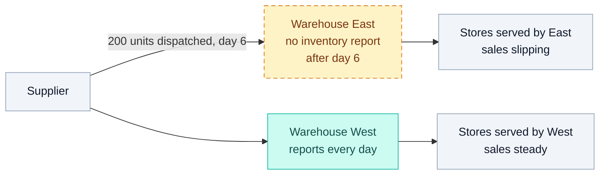
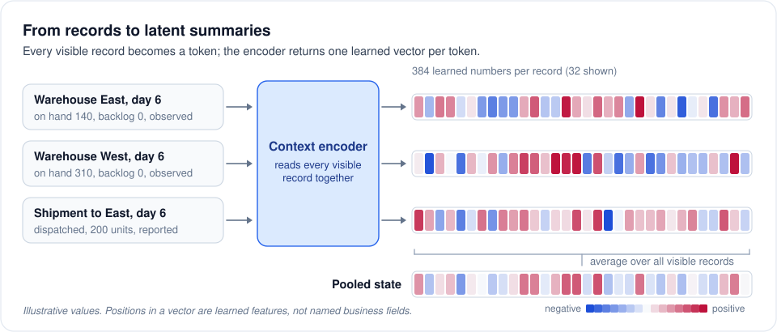
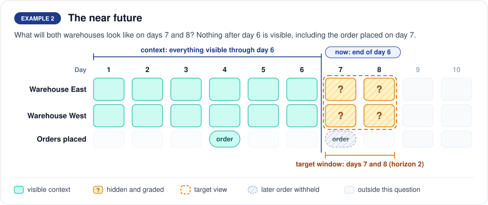
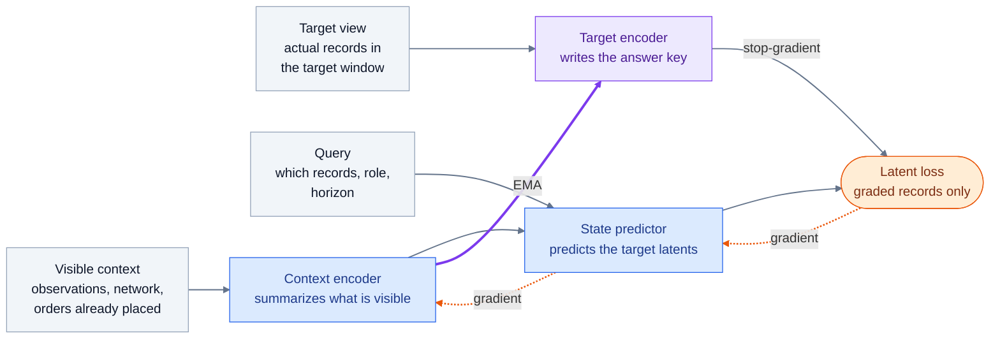

# State learning

*How SupplyChain-JEPA learns a reusable description of an operation from records that arrive
late, censored, or not at all, and how it answers questions about the parts it cannot see.*

<sub>Conceptual guide 2 of 4 · Previous: [Data to episodes](DATA_TO_EPISODES.md) · Next: [Dynamics learning](DYNAMICS_LEARNING.md) · [Documentation index](../README.md)</sub>

| Ingredient | In State learning |
|---|---|
| The question | What operating situation does an incomplete history describe, now and a few periods ahead? |
| What the model sees | Visible records with their reporting status, the network structure, and orders already placed |
| What it is graded on | A learned numerical summary of records that were held back |
| Who learns | A context encoder and a State predictor, by gradient steps; a target encoder follows by EMA |
| What remains | A frozen encoder that describes situations, and predictors that answer hidden-present and future questions |

> [!NOTE]
> Warehouses, quantities, and days in this guide are illustrative. Configuration values,
> component sizes, and loss weights come from the released code and
> [`configs/state.json`](../../configs/state.json).

**Contents:**
[1. A warehouse goes quiet](#1-a-warehouse-goes-quiet) ·
[2. A latent state is a learned summary](#2-a-latent-state-is-a-learned-summary) ·
[3. Three components, three jobs](#3-three-components-three-jobs) ·
[4. From an episode to a training question](#4-from-an-episode-to-a-training-question) ·
[5. Example 1: the hidden present](#5-example-1-the-hidden-present) ·
[6. Example 2: the near future](#6-example-2-the-near-future) ·
[7. One training step](#7-one-training-step) ·
[8. Closing the State phase](#8-closing-the-state-phase) ·
[9. The encoder summarizes, the predictor completes](#9-the-encoder-summarizes-the-predictor-completes) ·
[10. What remains useful after training](#10-what-remains-useful-after-training) ·
[11. Familiar ideas from operations research](#11-familiar-ideas-from-operations-research) ·
[12. Where it lives in the code](#12-where-it-lives-in-the-code)

## 1. A warehouse goes quiet

A regional network has one supplier and two warehouses, East and West. Each warehouse serves its
own stores and sends an inventory report every evening. On day 6 the supplier records a shipment of
200 units dispatched to East. After that, East's reports stop arriving because a system migration
has interrupted its feed. West keeps reporting. Sales at East's stores still come in through the
point-of-sale system, and they are running below their usual level.



At the end of day 8 the planner has two questions. What is East's position right now: has the
shipment arrived, and are its stores selling less because demand fell or because shelves are
empty? And what will both warehouses look like over the next few days?

Neither answer is in the data. The evidence is scattered across East's history up to day 6, the
shipment in transit and the lane's usual lead time, West's reports, the sales pattern at East's
stores, and the orders already placed. Part of it is censored, since an empty shelf makes recorded
sales understate demand. An experienced planner pulls these pieces into a judgment about the
current situation and then reasons forward from it.

State learning trains a model to form that judgment as a numerical summary and to answer specific
questions from it. The training material is history in which the hidden part is known. Simulators
record the internal state that their reporting process conceals, and finalized real records reveal
what an earlier, partial view could not. Training removes parts of such histories on purpose and
asks the model to account for what was removed.

## 2. A latent state is a learned summary

Every record in an episode becomes a token: one product at one location on one day, one transport
lane on one day, one process event, one order, the network as a whole on one day, or one node or
connection of the network itself. A token carries the record's numerical values, its coded
categories, its time, the entity it belongs to, and the reporting status of each field: observed,
censored, delayed, missing, outage, or not applicable. A separate presence marker distinguishes a
field that is unavailable from a field whose value is zero. Numerical fields are standardized with
statistics fitted on training records only.

The context encoder reads all visible tokens of a question together and returns a list of 384
numbers for each one. That list is the token's latent representation. Because the tokens are read
together, East's day-6 summary can reflect West's reports and the shipment in transit, not only
East's own fields. The average of all visible tokens' summaries is a single 384-number vector for
the whole situation: the pooled state that downstream applications reuse.



The numbers carry no fixed business meaning, and no position stands for inventory or backlog. A
summary is good when a small predictor can recover the held-back parts of the situation from it,
and the training objective rewards exactly that property. In this sense the pooled state plays the
role of a belief state in a partially observed decision problem: a compact statement of what the
history implies about conditions nobody can see directly. Unlike a textbook belief state, it is
learned from data rather than computed from a specified model, and it is a point in a learned space
rather than a probability distribution.

<details>
<summary><b>How the encoder reads tokens together</b> (no machine-learning background needed)</summary>

The encoder is a stack of six identical layers. In each layer, every token compares itself with
every other visible token, gives more weight to the ones that matter for it (a warehouse and the
lane that feeds it, for instance), and blends their information into its own summary. A second step
inside the layer then refines each token's numbers on their own. After six rounds, each summary
reflects the token's own fields and the evidence around it.

Identities enter only as indices local to the episode. The encoder can therefore relate records
within an episode (this warehouse feeds that store) without memorizing named entities across
episodes.

</details>

## 3. Three components, three jobs

| | Context encoder | State predictor | Target encoder |
|---|---|---|---|
| Job | Describes what is visible | Answers a question about what is not | Writes the answer key |
| Reads | The visible context | Context latents and a query | The target view: actual records in the target window |
| Produces | One latent per visible token, and the pooled state | One predicted latent per queried record | One latent per target-view token |
| Never sees | Held-back values or the query | Held-back values | The context |
| Weights change by | Gradient steps | Gradient steps | EMA of the context encoder |
| Size in the release | 27,987,456 parameters, 6 layers | 7,255,680 parameters, 3 layers | Same structure as the context encoder |

**The context encoder** describes what is known. Its input is the visible part of a question, after
the mask has removed what the question is about. The code calls it the online encoder.

**The State predictor** answers a question about what is not known. The question arrives as a
query, which works like a blank form with the header filled in: which entity, which kind of record,
which period, and which source, with every value field left empty. The query also states the role,
hidden present or future, and the horizon. Query construction reads metadata only, never target
values. The predictor consults the context latents, and the other forms in the same question, and
returns one predicted latent per queried record.

**The target encoder** writes the answer key. It reads the actual records of the target window,
including the held-back ones, using the same structure as the context encoder. Its outputs are
treated as fixed numbers during a step: no gradient flows back through them, which is what
stop-gradient means. Its weights are never trained directly. They trail the context encoder as an
exponential moving average (EMA).

<details>
<summary><b>Why a slowly moving copy writes the answer key</b></summary>

If the network being trained also wrote its own answer key, it could make every question trivially
easy by giving all situations the same summary. A separate copy that changes slowly keeps the answer
key stable from one step to the next while still improving as the context encoder improves. I-JEPA
and related joint-embedding predictive architectures use the same arrangement
(see [References](../REFERENCES.md)).

The code also supports explicit anti-collapse penalties: VICReg-style variance and covariance terms,
and SIGReg. The release configuration switches them off and instead tracks the spread, effective
rank, and leading-component share of the learned summaries throughout training.

</details>

<details>
<summary><b>The same components in machine-learning terms</b></summary>

- The context encoder is a six-layer Transformer encoder with 12 attention heads, width 384, and a
  1,536-wide feed-forward block.
- The State predictor is a three-layer Transformer decoder. Its queries are embeddings of the target
  tokens' metadata plus a learned role embedding and horizon features; they attend to each other and
  to the context latents.
- The target encoder starts as an exact copy of the context encoder, is excluded from the optimizer,
  and runs without gradient tracking. Query metadata is embedded with its metadata tables, so the
  question and the answer key share one notation.

</details>

## 4. From an episode to a training question

An episode is one bounded history from one source, such as a product at a store over several weeks,
one purchase order's process, or one run of a simulated inventory network. Training turns each
episode into many questions. Building one question takes two separate decisions, made in this
order: the mask decides what the question is about, and the window decides how much of the history
frames it.

The released State corpus holds 37,712 training and 2,035 development episodes from ten real and
simulated sources. Sampling picks a source by its configured weight, then a world or case, then an
episode, so a source with many near-duplicate rows cannot dominate. The sources and their
conversions are documented in [Data adapters](../DATA_ADAPTERS.md).

### The mask decides what is hidden and graded

A mask selects the target records that form the answer, marks them for grading, and removes their
observed counterparts from the context. Removal works field by field through an alignment key that
an observed record shares with its target counterpart, so the model cannot read the answer from
another copy of the same record. Nothing is deleted from the episode. For that one question, the
selected records move from the visible side to the answer side.

| Mask kind | What is hidden and graded | Business reading |
|---|---|---|
| Contiguous time | Every state record in 1 to 6 consecutive periods | A network-wide reporting gap |
| Entity group | All records of up to 6 entities | Items or sites whose own feeds are unavailable |
| Network neighborhood | Records touching one node and its direct neighbors | A site and its immediate partners go dark |
| Event suffix | Process events from a cutoff onward, with up to 4 periods graded | Milestones that happened but have not been reported |
| Outage | One node's records for 1 to 6 periods | A single site's feed fails |
| Future horizon | Every state record 1, 2, 4, or 8 periods after a cutoff | The near future under the prevailing policy |

The first five kinds ask about the present: the context runs up to the last graded period, and the
question concerns periods the context already covers. The sixth asks about the future: the context
stops at the cutoff, and every later token is removed, including later orders. The code names the
two query types `hidden_current` and `action_omitted_future`. Orders are never graded themselves.
Two of every five sampled questions are future questions; the other three rotate through the five
present-tense kinds.

### The window decides how much history frames the question

Once the mask has posed the question, the window builder cuts the episode down to what may be shown
and graded.

| Window rule | Effect |
|---|---|
| Causal cut | The context ends at the context endpoint: the last graded period for a present-tense question, the cutoff for a future one. Network structure, which has no time stamp, is always eligible. |
| Context budget | At most 192 context tokens. Before filling the budget, the builder reserves tokens that must stay: network-level records and orders for every visible period, the network around the queried entities, and the latest visible record of each queried entity. If those alone exceed the budget, it stops with an error rather than silently dropping history. |
| Target window | The answer key covers at most four periods, ending at the last graded period. The target view contains every actual record in those periods, not only the graded ones. |

> [!IMPORTANT]
> The mask poses the question and the window frames it. Choosing a window hides nothing by itself.
> The two examples below share the same target window, days 7 and 8, and differ only in their masks
> and context endpoints.

## 5. Example 1: the hidden present


Training builds the planner's first question from a history in which East's records for days 7 and
8 exist. An outage mask on East for those two days hides them, and everything else observed through
day 8 stays visible.

| Piece | Example 1 |
|---|---|
| Mask | Outage at East, days 7 and 8 |
| Context | Network structure; East's reports through day 6; West's reports through day 8; the day-6 shipment; the orders on days 4 and 7 |
| Query | East's records for days 7 and 8, as metadata only; role: hidden present; horizon 0 |
| Target view | Actual records of both warehouses for days 7 and 8 |
| Graded | East's records only |

To produce East's day-7 and day-8 latents, the predictor has to combine East's last report, the
shipment dispatched on day 6 and the lane's lead time, the slipping sales at East's stores, and what
West reveals about demand the two warehouses share. Training on many questions of this shape
rewards an encoder that keeps those clues in its summaries and a predictor that turns them into a
statement about the hidden records.

West's records for days 7 and 8 sit inside the target view without being graded. The target
encoder reads both days as a whole, so East's answer-key latents are written in the context of the
full network on those days. The loss looks only at East's tokens, because West's reports for those
days are visible and therefore not part of the question.

Nothing after day 8 is used. Although East's records are missing, this is a present-tense question:
the context already covers the periods being asked about.

## 6. Example 2: the near future



For the forward-looking question, the builder moves the cutoff back to the end of day 6 and asks
about days 7 and 8. Those records exist in the history, so the answer can be graded.

| Piece | Example 2 |
|---|---|
| Mask | Future horizon 2, cutoff at the end of day 6 |
| Context | Network structure; both warehouses' reports through day 6; the day-6 shipment; the order on day 4 |
| Query | Every record of both warehouses for days 7 and 8; role: future; horizon 2 |
| Target view | Actual records of both warehouses for days 7 and 8 |
| Graded | All of them |

Both examples grade records from days 7 and 8. Example 1 hides one warehouse while the rest of the
network stays visible up to day 8; example 2 hides everything after day 6.

Withholding later orders changes what the forecast means. The order placed on day 7 is not shown,
so the model is never told which decision will be taken. It learns what usually follows under the
policy that generated the history, which makes it a policy-marginal forecast. Predicting the
consequence of a chosen order is a different task. It belongs to the Dynamics predictor, trained
after State learning on paired simulator branches that differ only in the action
([Training, section 4](../TRAINING.md#4-action-conditioned-dynamics-training)).

<details>
<summary><b>Fine print: longer horizons, wider masks, and fallbacks</b></summary>

- With horizon 8, the answer key covers the last four of the eight future periods, so the graded
  records lie five to eight periods past the cutoff. Horizons 1, 2, and 4 are graded in full.
- A contiguous-time or outage mask longer than four periods hides all of its periods from the
  context but grades only the last four.
- Entity-group and neighborhood masks remove the selected entities' records from the entire visible
  history; grading again covers their last four periods.
- A mask that cannot be built for an episode, such as an event-suffix mask for an episode without
  events, falls back to a simpler kind or is skipped in favor of another draw.
- Every draw is seeded by the run seed, the episode, and the update number, so the same questions
  can be regenerated.

</details>

## 7. One training step



Grey arrows carry data. Dotted orange arrows are gradient updates: the error flows back from the
loss through the State predictor into the context encoder. The thick violet arrow is the EMA update
that moves the target encoder's weights toward the context encoder's. No gradient reaches the
target encoder.

1. The context encoder turns the visible context into context latents.
2. The State predictor combines those latents with the query and predicts one latent per queried
   record.
3. The target encoder, run without gradient tracking, encodes the target view into the answer key.
4. The latent loss compares predicted and answer-key latents on the graded records.
5. An optimizer step updates the context encoder, the State predictor, and the auxiliary heads.
6. The target encoder then moves a small fraction of the way toward the updated context encoder.

### What the loss compares

The main loss compares two lists of 384 numbers for each graded record: the prediction and the
answer key. It never compares a predicted inventory level with an actual one.

```math
\hat z_T = P_\phi\big(E_\theta(x_C),\, q\big),
\qquad
z_T = \operatorname{sg}\big(E_\xi(x_T)\big)
```

```math
\mathcal{L}_{\text{token}}
= \frac{1}{|G|\, d} \sum_{i \in G} \sum_{k=1}^{d} \ell\big(\hat z_{T,ik} - z_{T,ik}\big),
\qquad
\ell(u) =
\begin{cases}
\tfrac{1}{2}u^{2}, & |u| < 1,\\
|u| - \tfrac{1}{2}, & \text{otherwise.}
\end{cases}
```

Here $x_C$ is the visible context, $x_T$ the target view, $q$ the query, $G$ the set of graded
records, and $d = 384$. $E_\theta$ is the context encoder, $E_\xi$ the target encoder, $P_\phi$ the
State predictor, and $\operatorname{sg}$ marks the stop-gradient. The penalty $\ell$ (Smooth-L1) is
quadratic for small errors and linear for large ones, which limits the pull of a few badly
predicted records.

Four smaller terms ride on the same step. Each protects a property that the main loss alone does
not guarantee.

| Term | Weight | What it adds |
|---|---:|---|
| Token latent prediction | 1.00 | The main loss above |
| Pooled target | 0.25 | The average predicted latent over graded records must match the average answer-key latent |
| Canonical state | 0.20 | A small head must predict that average answer-key latent from the single pooled context state, so the vector exported to applications carries what the questions need |
| Semantic concept slots | 0.30 | Answer-key latents are grouped by business concept (inventory, demand and sales, lead time and delay, and 11 more) and predicted per concept, which ties together differently named fields from different sources |
| Numerical grounding | 0.10 | A linear readout of the predicted latents must recover the graded numeric fields whose names indicate inventory, backlog, demand, lead time, remaining time or container volume, delay, or stockout, in the last period of the target window and in standardized units |

<details>
<summary><b>Inside the auxiliary terms</b></summary>

- The canonical-state term mixes an absolute Smooth-L1 error (weight 0.25) with a mean-squared error
  and a cosine distance computed after subtracting each source's average (weights 0.60 and 0.15).
  Centering by source removes the shortcut of recognizing which dataset a question came from. Its
  head sees only the pooled state plus the question's type, mask kind, and horizon, and its gradient
  reaches the encoder.
- The concept-slot term compares layer-normalized latents with Smooth-L1 (0.80) and cosine distance
  (0.20). Generic, identity, and order-decision concepts are excluded as targets. Several source
  fields that map to the same concept on one record count once.
- Both terms ramp in over the first 50 updates.
- A shuffle control rotates pooled states among questions with the same source, type, mask kind,
  and horizon, and reports how much worse the head does with the wrong state. It is a diagnostic and
  never enters the loss.

</details>

### Gradients and the EMA copy

Gradient steps use AdamW with a learning rate of $5\times10^{-5}$, reached after a 5% warmup and
then cosine-decayed to 10% of that value, with weight decay 0.05 and gradient clipping at 1.0. The
optimizer holds the context encoder, the State predictor, and the auxiliary heads. It never holds
the target encoder, and the Dynamics predictor stays frozen and unused throughout State learning.

After every optimizer step the target encoder is updated as

```math
\xi \leftarrow m\,\xi + (1 - m)\,\theta ,
```

where $\theta$ are the context encoder's weights, $\xi$ the target encoder's, and the momentum $m$
rises linearly from 0.996 to 0.9995 over training. This is simple exponential smoothing applied to
network weights, with smoothing constant $1 - m$ between 0.004 and 0.0005. A sudden change in the
context encoder is half reflected in the target encoder after about 170 updates early in training
and after about 1,400 updates by the end, from $\ln 0.5 / \ln m$.

| Component | Main State phase | Final alignment | Dynamics post-training |
|---|---|---|---|
| Context encoder | Gradient | Frozen | Frozen |
| Target encoder | EMA of the context encoder | Frozen, identical copy | Frozen, identical copy |
| State predictor | Gradient | Gradient | Unused, unchanged |
| Auxiliary State heads | Gradient | Gradient | Unused, unchanged |
| Dynamics predictor | Frozen, unused | Frozen, unused | Gradient |

## 8. Closing the State phase

When the main phase ends, the target encoder is an average of recent context encoders, and the
State predictor has learned to hit that moving average. Applications need one latent space, so the
trainer closes the phase in four steps.

1. Select the deployment encoder. The release configuration selects the context encoder.
2. Copy it into the target encoder, so the two encoders are identical.
3. Freeze both encoders.
4. Run 100 further updates of the State predictor and the auxiliary heads only, at learning rate
   $10^{-4}$, against answer keys written by the deployed encoder.

Because both encoders are frozen during the last step, the geometry of the latent space cannot drift
or collapse while the heads realign. The resulting checkpoint holds the encoders, the State
predictor, the auxiliary heads, and the fitted tensor interface in one coordinate system, and
Dynamics post-training starts from it.

## 9. The encoder summarizes, the predictor completes

> [!IMPORTANT]
> Training does not turn the encoder into a gap filler. The encoder describes the evidence it is
> shown. Answers about specific unseen records come from a component that receives the question.

It is natural to expect that, after enough training, the encoder alone would fill in hidden records.
Its inputs rule this out. The encoder receives only the visible context. It is not told which
records were hidden, what is being asked, or how far ahead to look, so whatever it produces is a
description of the evidence in front of it.

Training changes the content of that description. The predictor's errors flow back into the
encoder, so the objective rewards an encoder that keeps the clues that make hidden and future
records predictable: how old the last report is, what is in transit, which sales pattern signals an
empty shelf. The canonical-state term puts the same pressure on the single pooled vector. Turning
those clues into a statement about particular unseen records remains the job of a module that
receives the query.

| Question after training | Answered by | Entry point |
|---|---|---|
| What is visible, summarized | Context encoder | `encode_state` in [`api.py`](../../src/supplychain_jepa/api.py) |
| The latent of a specific hidden or future record | State predictor | `predict_masked_state` in [`api.py`](../../src/supplychain_jepa/api.py) |
| The pooled hidden-present or future state | State pool predictor, the canonical-state head | The [demand-recovery evaluation](../../evaluations/demand_recovery/representation.py) calls it to recover a stockout-shaped hidden state |
| The future under a chosen action sequence | Dynamics predictor | `predict_dynamics` and `compare_actions` in [`api.py`](../../src/supplychain_jepa/api.py) |

The Dynamics stage keeps this division of labor. It freezes the encoder, leaves the State predictor
unused, and trains a new predictor for the effect of actions rather than asking the encoder to take
over that role.

## 10. What remains useful after training

| Artifact | What it does after training | Where it is used |
|---|---|---|
| Fitted tensor interface | Fixes the 309 feature identities, normalization statistics, and vocabularies learned from training records; later records are read in the same coordinates and never refit | Dynamics training and every downstream application |
| Context encoder | Turns partial observations into token latents and the pooled state | Frozen in Dynamics training and in all three [canonical evaluations](../EVALUATION.md) |
| Target encoder | Identical to the context encoder after the final alignment | Kept in the checkpoint; no separate role at use time |
| State predictor and grounding head | Answer hidden-present and future queries in latent space, and read selected numeric fields back out | `predict_masked_state`; shipped in the release bundle |
| State pool predictor | Maps the pooled state and a question type to the pooled hidden or future state | The demand-recovery evaluation |
| Concept-slot predictor | Predicts concept-level summaries | Shipped in the release bundle |

The grounding head (118,965 parameters), the State pool predictor (892,032), and the concept-slot
predictor (1,932,288) together make up the 2,943,285 auxiliary State parameters listed in
[Architecture](../ARCHITECTURE.md#release-shape).

Masks, windows, and the EMA schedule are not kept. They exist only to pose training questions and
to produce a stable answer key. At use time the context is whatever records an application actually
has, with their reporting status, and the encoder describes them as they are.

## 11. Familiar ideas from operations research

| Familiar idea | Counterpart in State learning | Where they differ |
|---|---|---|
| Belief state in a POMDP | The pooled latent state | Learned from data instead of computed by Bayes' rule from a specified model; a point in a learned space, not a probability distribution |
| State estimation and nowcasting under reporting delays | Hidden-present questions | Trained by hiding records whose values are known, across many sources at once |
| Demand censoring by stockouts | Reporting status in the input; uncensored demand in simulator answer keys | The model is told which values are censored and never receives the uncensored value as input |
| Simple exponential smoothing | The EMA target encoder | Smooths network weights, not a demand series |
| Forecasting under the incumbent policy | Future questions with later orders withheld | Policy-marginal by design; the effect of an intervention is a separate Dynamics task |

## 12. Where it lives in the code

| Concept | Code |
|---|---|
| Observation and target views, tokens, reporting status | `EpisodeTensorizer` in [`data.py`](../../src/supplychain_jepa/data.py) |
| Mask kinds and context redaction | `StructuredMaskSampler` in [`masking.py`](../../src/supplychain_jepa/masking.py) |
| Causal cut, context budget, target window | `state_window_geometry` and `build_state_example` in [`windows.py`](../../src/supplychain_jepa/windows.py) |
| Encoders, State predictor, EMA update | `SequenceEncoder`, `StatePredictor`, `SupplyChainJEPACore`, and `ema_update` in [`model.py`](../../src/supplychain_jepa/model.py) |
| Pooled state and auxiliary heads | `select_canonical_state`, `StatePoolPredictor`, and `SemanticConceptSlotPredictor` in [`model.py`](../../src/supplychain_jepa/model.py) |
| Objective, sampling, optimizer, EMA schedule, final alignment | `_state_objective`, `_state_examples`, and `run_state` in [`training.py`](../../src/supplychain_jepa/training.py) |
| Latent loss | `masked_latent_loss` in [`losses.py`](../../src/supplychain_jepa/losses.py) |
| Released settings | [`configs/state.json`](../../configs/state.json) and [`configs/model.json`](../../configs/model.json) |

<details>
<summary><b>Glossary</b></summary>

| Term | Meaning |
|---|---|
| Episode | One bounded history from one source |
| Token | One record of an episode, with its values, reporting status, time, and identity |
| Latent | The list of 384 learned numbers that summarizes a token |
| Pooled state | The average latent over all visible tokens; the vector applications reuse |
| Context | The visible part of a question |
| Query | Metadata naming the records to predict, with role and horizon; never their values |
| Target view | The actual records of the target window, read by the target encoder |
| Target window | Up to four periods that supply the answer key |
| Graded record | A target-view record that the loss scores |
| Stop-gradient | Treating the answer key as fixed numbers, so no learning signal flows into it |
| EMA | Exponential moving average; how the target encoder trails the context encoder |
| Policy-marginal | Averaged over the decisions the data-generating policy would have made |

</details>

**Further reading.** [Training](../TRAINING.md) gives the exact objective, optimizer settings, and
the Dynamics stage. [Architecture](../ARCHITECTURE.md) lists component sizes and the shared model
chain. [Data contract](../DATA_CONTRACT.md) and [Data adapters](../DATA_ADAPTERS.md) explain how
sources become observation and target views. [Evaluation](../EVALUATION.md) and
[Limitations](../LIMITATIONS.md) cover what the learned state has been shown to support and where it
stops. [References](../REFERENCES.md) lists I-JEPA, V-JEPA 2, T-JEPA, LaT-PFN, and related work.

---

<sub>Previous: [Data to episodes](DATA_TO_EPISODES.md) · Next: [Dynamics learning](DYNAMICS_LEARNING.md) · [Documentation index](../README.md) · [Project README](../../README.md)</sub>
