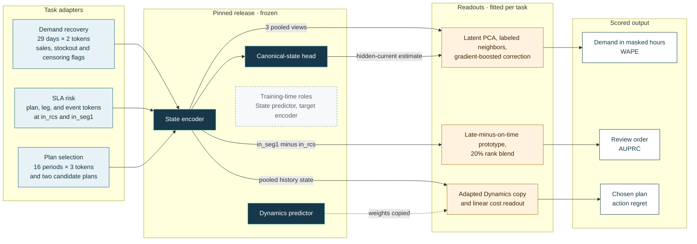
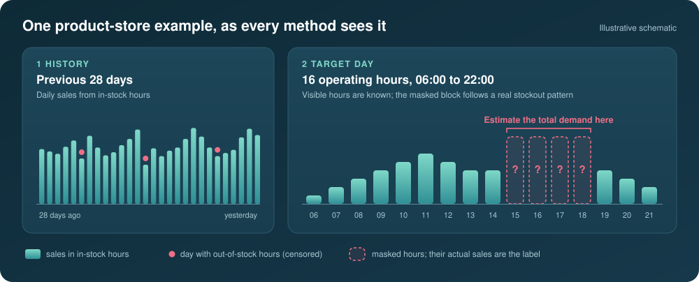

<div align="center">

# Using the model

**From a frozen pretrained state to a demand estimate, a review list, and a plan choice**

[At a glance](#at-a-glance) · [The common recipe](#the-common-recipe) · [Demand recovery](#1-recovering-demand-hidden-by-stockouts) · [SLA risk](#2-ranking-shipments-when-reports-are-late) · [Plan selection](#3-choosing-between-two-replenishment-plans) · [Reading the scores](#reading-the-scores) · [Beyond the evaluations](#beyond-the-three-evaluations)

<sub>Conceptual guide 4 of 4 · Previous: [Dynamics learning](DYNAMICS_LEARNING.md) · [Documentation index](../README.md)</sub>

</div>

The released model outputs vectors of learned numbers: a summary of the operating situation, and
predictions of hidden, future, and action-dependent states. A planner needs a demand estimate, a
review list, or an order plan. In each of the three applications in this repository, two thin
layers close that gap. A **task adapter** writes the application's records into the model's tensor
interface, and a **readout**, a small model fitted on a limited set of labels, turns the frozen
model's vectors into the business quantity. The result is scored against a conventional method
that receives the same information.

The applications use different parts of the release. Demand recovery reads the State encoder and a
small released State head; SLA-risk ranking reads only the State encoder; plan selection reads the
State encoder and adapts a copy of the Dynamics predictor. None of the three evaluation sources
was used in pretraining ([Datasets](../../DATASETS.md#hard-downstream-separation)).

## At a glance

| | Stockout demand recovery | Early SLA-risk ranking | Replenishment-plan selection |
|---|---|---|---|
| Business question | How much would have sold in the hours the shelf was empty? | Which shipments should be reviewed first while a critical leg's reports are late? | Should a fixed order quantity go to one supplier or be split between two? |
| Decision moment | A product-store day with a block of hours masked | The `in_seg1` checkpoint, with the critical leg's reports withheld | After 16 periods of impaired public history |
| Pretrained parts | State encoder and canonical-state head, both frozen | State encoder, frozen | State encoder, frozen; Dynamics predictor, copied and adapted |
| What is read out | Three pooled encoder views plus the head's hidden-current estimate | Change in the pooled state between two checkpoints | Latent state four periods ahead under each plan |
| Readout | Latent PCA, labeled-neighbor features, gradient-boosted correction of the baseline | Late-minus-on-time prototype, 20% rank blend with the fixed baseline | Linear cost readout trained together with the Dynamics copy |
| Labels for fitting | 3,000 labeled days | 47 labeled target shipments, within a 64-label target budget | Expected plan costs in the fit worlds |
| Output | Units of demand in the masked hours | A review order over shipments | The plan with the lower predicted cost |
| Primary score | [Pooled WAPE](#wape-how-much-demand-the-estimates-missed), lower is better | [AUPRC](#auprc-how-early-the-late-shipments-appear), higher is better | [Action regret](#action-regret-what-a-wrong-choice-costs), lower is better |
| Conventional comparator | Analog-day nearest neighbors | Calibrated logistic model, kept fixed | Public-history ExtraTrees |

The canonical numbers for all three, including a negative boundary cohort, are in
[Evaluation](../EVALUATION.md).

## The common recipe

Every application takes the same four steps.

1. **Fix the decision moment.** Every method, the baseline included, receives only the records a
   planner would have at that moment. Withheld values are removed rather than set to zero, and
   summary features are recomputed without them.
2. **Write the records into the released tensor interface.** A task adapter fills the released
   feature slots, normalizes each value with the released mean and standard deviation, marks it
   as observed, censored, delayed, or missing, and tags the tokens with the pretraining source
   family closest to the task. The released normalization and vocabularies are never refitted on
   downstream data ([Data contract](../DATA_CONTRACT.md#tensorized-batch)).
3. **Read vectors from frozen components.** The encoder's token outputs are averaged into
   fixed-length state vectors. A task may also pass those vectors to a released predictor.
4. **Fit a readout.** A small model is trained on a limited labeled split, its settings are chosen
   on a separate split, and it is scored once on held-out data.

The diagram routes the three applications through the shared release. Dark boxes are frozen
pretrained components; amber boxes are fitted separately for each task.



The same routing, component by component:

| Component | Demand recovery | SLA risk | Plan selection |
|---|---|---|---|
| State encoder | Frozen | Frozen | Frozen |
| Canonical-state head | Frozen, queried for the hidden current state | Not used | Not used |
| State predictor (token level) | Not used | Not used | Not used |
| Dynamics predictor | Not used | Not used | Copied, then fine-tuned with the readout |
| Readout | Fitted on 3,000 labeled days | Fitted on 47 labeled target shipments | Fitted on the fit worlds of each split |
| Conventional baseline | Analog-day estimate, also an input to the readout | Calibrated logistic score, kept for 80% of the rank | Separate model |

The canonical-state head (`bundle.state_pool_predictor`) is a small auxiliary State module. During
pretraining it learned to predict a hidden or future pooled state from the single state vector the
encoder exports ([Training](../TRAINING.md#state-loss), canonical-state prediction). The token-level
State predictor and the target encoder did their work during training and are not called by any of
the three evaluations.

Each adapter is a compact, complete example of step 2:
[`_fresh_batch`](../../evaluations/demand_recovery/representation.py) for retail sales histories,
[`cargo_state_batch`](../../evaluations/sla_risk/model_adapter.py) for cargo milestones, and
[`ModelBundleBackbone._batch`](../../evaluations/action_selection/backends.py) for inventory
histories with supplier reports.

## 1. Recovering demand hidden by stockouts



| Decision card | |
|:--|:--|
| Who decides | A demand planner cleaning sales history before forecasting or setting safety stock |
| Question | How many units would this product have sold in the hours its shelf was empty? |
| Data | FreshRetailNet-50K: hourly sales and hourly stock status for product-store series |
| Pretrained parts | State encoder and canonical-state head, both frozen; the Dynamics predictor is not used |
| Output | Estimated units of demand in the masked hours of each example |
| Score | [Pooled WAPE](#wape-how-much-demand-the-estimates-missed) over three fixed mask seeds, lower is better |
| Code | [`evaluations/demand_recovery/`](../../evaluations/demand_recovery/) |

### The decision

When a product sells out, recorded sales stop measuring demand. A forecast trained on those
records learns that the product sells less than it does, and the next replenishment plan inherits
the bias. On a real stockout day the lost demand is never observed, so no method can be scored on
it. The evaluation therefore starts from days on which the product was in stock for all 16
operating hours (06:00 to 22:00), hides a block of hours shaped like a real stockout, and asks each
method to recover the sales in that block. Mask patterns are sampled with the frequencies of the
stockout patterns observed in the adaptation stores. Because the product was available all day,
the hidden sales are a clean demand label.

### What is known and what is hidden

| Known at the decision moment | Hidden from every method |
|---|---|
| Hourly sales for the previous 28 days, with out-of-stock hours flagged as censored instead of read as zero demand<br>Sales in the visible hours of the target day, and which hours are masked<br>Daily discount, holiday, and promotion flags, plus precipitation, temperature, humidity, and wind<br>Category levels, product, city, and management-group identifiers | Sales in the masked hours, which form the label |

The split is by store. Within each city, stores are assigned to adaptation (about 70%),
validation (about 15%), and test (about 15%) groups, so no test store is seen during fitting.
Target dates also move forward in time: adaptation days come first, then two validation weeks,
then the final test week. Three test mask seeds (11, 29, and 47) generate three different sets of
masks over the same test days.

### How the model is used

The adapter turns each example into 58 tokens: one product-store token and one global token for
each of 29 days, the 28 history days plus the target day. The product-store token carries the
day's sales from in-stock hours with stockout and censoring flags; the global token repeats the
day's totals and adds the number of visible hours, the calendar position, and a flag for holidays,
promotions, or discounts. The target day is always marked censored, because part of it is
masked. The tokens carry the M5 source family, the pretraining source whose product-store sales
histories are closest to this task.

The frozen State encoder reads the 58 tokens, and its token outputs are averaged three ways: over
the whole 29-day window, over the last seven days, and over the target day alone. The whole-window
average also goes to the canonical-state head with a query for the hidden current state under an
outage-shaped mask. Its answer is the model's estimate of the situation the mask conceals. The four
384-number vectors are joined into a 1,536-number description of each example.

### The readout and the baseline

The readout is fitted on 3,000 labeled adaptation examples, 5% of a 60,000-example pool, and its
settings are chosen on the validation stores.

1. The 1,536 numbers are standardized and reduced to 64 principal components, fitted on the
   adaptation examples only.
2. For each example, the 5, 15, and 50 nearest labeled adaptation examples in that space are
   retrieved. Each neighborhood is summarized by how the baseline performed on it: the
   distance-weighted ratio of true demand to the baseline estimate, the normalized residual, the
   neighbors' true demand, and three distance statistics. These 18 retrieval features let the
   readout borrow evidence from labeled days in other stores whose encoded situation resembles
   the one at hand.
3. A gradient-boosted tree model (XGBoost) receives the conventional features, the 64 latent
   coordinates, and the 18 retrieval features, and proposes a corrected estimate. The
   conventional features include the baseline estimate itself, a historical-profile estimate, mask
   length and position, visible-hour sales, recent and 28-day history statistics, product and
   category priors, calendar, weather, identifiers, and the hourly mask pattern.
4. Nine candidates, three target forms (residual, log ratio, and log demand) times three tree
   settings, are compared on validation WAPE. A blend weight between the baseline and the model's
   proposal and an overall scale are chosen at the same time. The final estimate is the baseline
   plus the blend weight times the proposed change, multiplied by the scale and floored at zero.

The analog-day baseline compares the visible hours of the target day with the same hours on each
of the previous 28 days, adds penalties for hours missing from the comparison, for differences in
discount, holiday, promotion, or weather, and for a different weekday, then averages the
masked-hour sales of the seven closest days, weighted by closeness.

> [!NOTE]
> **Illustrative example, not an experiment result.** A perishable item usually sells about five
> units an hour in the late afternoon. On the target day, the hours from 15:00 to 19:00 are
> masked, and the visible morning sales run well above a normal weekday because of a discount. The
> analog-day baseline finds seven similar past days and borrows their afternoon sales: 18 units.
> In the latent space, the nearest labeled examples come from other stores on discount days, where
> true demand ran about 15% above the baseline. The correction model combines that signal with the
> conventional features and proposes 20 units. If the true masked demand was 21 units, the
> baseline missed by 3 and the system by 1.

<details>
<summary><b>Run the demand-recovery evaluation</b></summary>
<br>

The two FreshRetailNet-50K parquet files are acquired separately; the CLI verifies their SHA-256
hashes before reading either one. Installation and model access are covered in
[Getting started](GETTING_STARTED.md).

```bash
python -m evaluations.demand_recovery \
  --data-root /path/to/freshretail-parquet \
  --cache-dir /path/to/cache \
  --output /path/to/demand-recovery.json
```

Besides pooled WAPE, the output reports signed bias (WPE) and mean absolute error for each mask
seed, the selected target form and blend, and the share of the correction model's tree gain and
splits that comes from latent features. Protocol details are in the
[demand-recovery README](../../evaluations/demand_recovery/README.md); canonical numbers are in
[Evaluation §1](../EVALUATION.md#1-stockout-demand-recovery).

</details>

## 2. Ranking shipments when reports are late


| Decision card | |
|:--|:--|
| Who decides | A logistics control tower with limited capacity to review shipments |
| Question | Which shipments should be reviewed first for a late finish, while the latest reports on the critical incoming leg have not arrived? |
| Data | Cargo2000 air-freight process traces |
| Pretrained parts | State encoder, frozen; no predictor is used |
| Output | A review order over shipments, carrying the baseline's own probability values |
| Score | [AUPRC](#auprc-how-early-the-late-shipments-appear) on the confirmation cohort, higher is better; development and adjacent cohorts are reported alongside |
| Code | [`evaluations/sla_risk/`](../../evaluations/sla_risk/) |

### The decision

A Cargo2000 shipment joins up to three incoming air legs into one outgoing leg. Each leg passes
through reported milestones: freight check-in (RCS), departure and arrival for each flight segment
(DEP and RCF, up to three segments), and delivery (DLV). Every milestone has a planned duration
and, once it is reported, an actual one. The incoming legs run in parallel, so the shipment's total
time is the slowest incoming leg plus the outgoing leg. A shipment counts as late when its actual
total exceeds its planned total.

The ranking is made at the `in_seg1` checkpoint, when the first flight segment of each incoming leg
would normally have been reported. The protocol then makes one report stream late. It picks the
critical incoming leg, the one with the longest planned duration, so the choice uses plans only.
That leg's check-in report is withheld at the earlier `in_rcs` checkpoint, and its check-in plus
first-segment departure and arrival are withheld at `in_seg1`. All summary features are recomputed
after the reports are withheld, and a leakage check confirms that no withheld value survives.

### What is known and what is hidden

| Known at `in_seg1` | Hidden from every method |
|---|---|
| The full plan: planned durations for every milestone of every leg, leg and hop counts, airport identifiers<br>Actual durations for the check-in and first segment of the other incoming legs<br>Recomputed summaries: projected overrun, largest observed delay, share of reported milestones that ran late<br>The same shipment's earlier snapshot at `in_rcs` | The critical leg's check-in and first-segment reports<br>Every later milestone, including the whole outgoing leg<br>Whether the shipment finished late, which is the label |

### How the model is used

The adapter writes each snapshot as up to 69 tokens: up to 32 plan tokens, one per planned
milestone as a transport link with its planned duration; up to 4 leg tokens with each leg's latest
reported milestone and due time; one event token per milestone actually reported; and a global
token with counts of reported milestones, late milestones, delivered legs, and legs still in
transit. Durations are log-scaled with a scaler fitted on the source shipments, so that a typical
Cargo2000 duration lands near the typical value of the corresponding pretrained feature. The tokens
carry the MilestoneFlow source family, the pretraining simulator of cargo milestones and their
reports.

The frozen encoder's token outputs are averaged four ways (all tokens, plan tokens, event tokens,
and state tokens), giving 1,536 numbers per snapshot. The readout uses one quantity derived from
them: the change between the two snapshots of the same shipment, the `in_seg1` vector minus the
`in_rcs` vector. This transition summarizes how the encoded situation moved while the first segment
progressed and the critical leg stayed silent.

### The readout and the comparators

1. Each transition dimension is standardized over the fitting shipments.
2. A prototype direction is built from the 47 labeled target shipments: the average standardized
   transition of the late ones minus that of the on-time ones, scaled to unit length. A shipment's
   evidence score is its projection onto this direction.
3. The baseline probability and the evidence score are converted into rank fractions, and the
   priority is 80% baseline rank plus 20% evidence rank.
4. The baseline's own probability values are reassigned in priority order. The set of probabilities
   is unchanged; only which shipment receives which value changes.

The conventional baseline is a logistic regression on the public-history features above. It is
fitted on the source shipments and the 47 labeled target shipments, with source and target given
equal total weight, then recalibrated by checkpoint on 17 further labeled target shipments. Its
scores are computed once and stay fixed. Ten matched random encoders repeat the adapter,
labels, prototype, and ranking rule with randomly initialized weights of the same architecture.
Their average shows what the same pipeline achieves without pretrained weights.

Cohorts come from an external split manifest: 1,826 source shipments, 47 target-fit and 17
calibration shipments, 230 development shipments, and 126 confirmation shipments, 36 of them late.
An adjacent cohort of 1,696 shipments differs from the source by a single shift rather than the
joint route-and-topology shift. It is a deliberate boundary test, and its result is negative
([Evaluation §2](../EVALUATION.md#2-early-sla-risk-ranking-under-delayed-reports)).

> [!NOTE]
> **Illustrative example, not an experiment result.** Shipments A and B both wait on a silent
> critical leg, and their other legs ran close to plan, so the baseline scores them alike: 0.31
> for A and 0.33 for B, ranked 12th and 11th. Between `in_rcs` and `in_seg1`, A's encoded state
> moved in the direction that late shipments moved in the labeled fit set, while B's barely moved.
> With 80% of the priority from the baseline rank and 20% from the evidence rank, A moves ahead of
> B. After reassignment A carries 0.33 and B carries 0.31; no new probability value is created.

<details>
<summary><b>Run the SLA-risk evaluation</b></summary>
<br>

The Cargo2000 CSV and the split manifest are acquired separately. The evaluator finds them by
content and rejects any file whose SHA-256 differs from the pinned value.

```bash
python -m evaluations.sla_risk \
  --data-root /path/to/cargo2000 \
  --split-manifest /path/to/split_manifest.json \
  --cache-dir /path/to/cache \
  --output /path/to/sla-risk-results.json
```

The output reports AUPRC, AUROC, and Brier score for the baseline, the pretrained encoder, and each
of the ten random encoders, for all three cohorts. Protocol details are in the
[SLA-risk README](../../evaluations/sla_risk/README.md).

</details>

## 3. Choosing between two replenishment plans


| Decision card | |
|:--|:--|
| Who decides | An inventory planner who has fixed the order quantity and must decide how to source it |
| Question | Place the whole quantity with the primary supplier, or split the same quantity between the primary and secondary suppliers? |
| Data | Generated decision worlds with paired futures, in which supplier reports are delayed or missing |
| Pretrained parts | State encoder, frozen; a copy of the Dynamics predictor, adapted |
| Output | The chosen plan for each world |
| Score | [Action regret](#action-regret-what-a-wrong-choice-costs) averaged over five disjoint world splits, lower is better |
| Code | [`evaluations/action_selection/`](../../evaluations/action_selection/) |

### The decision

Supplier reliability changes over time and persists: a supplier moves between reliable, strained,
and disrupted regimes that each last several periods. The planner never sees the regime. Capacity
reports are the main evidence, and they arrive late or not at all, more often when a supplier is
impaired or the network is congested. The regular plan places the full quantity with the primary
supplier. The split plan places the same total across the primary and secondary suppliers. Which
plan costs less depends on the hidden regimes, so a good choice requires both an estimate of the
current state and a prediction of how each plan would play out.

The decision contract is fixed:

- 16 periods of public history, then one decision;
- two candidate plans with the same total quantity;
- a four-period horizon with no further orders after the decision, so the cost reflects this
  decision alone;
- both plans rolled out on the same simulated futures (common random numbers), so a cost
  difference comes from the plan rather than from luck.

### What is known and what is hidden

| Known at the decision | Hidden from every method |
|---|---|
| 16 periods of reported inventory, backlog, demand, sales, and pipeline<br>Each supplier's last reported capacity, the age of that report, and whether a report arrived in each period<br>A congestion flag for each period<br>The two candidate plans | Each supplier's reliability regime<br>Future demand and supply outcomes<br>The realized cost of each plan |

### How the model is used

The adapter writes each period as three tokens: a global token with reported inventory, backlog,
demand, sales, pipeline, and the congestion regime, and one token per supplier with reported
capacity, report age, and report availability. When a supplier's report has not arrived,
its last reported capacity is kept, marked delayed, and tagged with the report's age. The 48 tokens
carry the Stockpyl source family. The frozen encoder reads them, and its token outputs are averaged
into one 384-number state vector.

Each plan is written in the same eight-field action format used in Dynamics post-training:
quantity, action type, time, actor, target supplier, product, a presence flag, and log arrival lag.
The regular plan is one action and the split plan is two. A copy of the pretrained Dynamics
predictor, whose weights were learned from paired Stockpyl and MABIM branches
([Dynamics learning](DYNAMICS_LEARNING.md)), receives the state vector as memory, one plan's
actions, and a four-period horizon. It returns a predicted latent state for four periods ahead
under that plan.

### The readout and the comparators

A linear readout, initialized at zero, turns each predicted latent state into a cost score. The
Dynamics copy and the readout are trained together with AdamW on the fit worlds to predict each
plan's expected cost relative to the average of the two plans. The encoder stays frozen. The
learning rate is chosen from {3e-4, 1e-4} by regret on the select worlds, and the chosen model is
scored once on the report worlds. The decision rule picks the plan with the lower predicted cost.

Two comparators use the same worlds. The matched-random diagnostic repeats the recipe with a
randomly initialized encoder and Dynamics predictor of the same architecture. The conventional
baseline is an ExtraTrees regressor that reads the flattened 16-period public history and a plan
indicator, predicts each plan's cost, and picks the lower one. In the canonical summary its regret
enters as a fixed reference value.

> [!IMPORTANT]
> The canonical result comes from five protocol runs over an external paired simulator corpus;
> [`protocol.py`](../../evaluations/action_selection/protocol.py) aggregates their compact
> outputs. Running `python -m evaluations.action_selection` executes a self-contained
> reconstruction of the same contract, built for API and smoke testing. Its numbers are not the
> canonical result.

> [!NOTE]
> **Illustrative example, not an experiment result.** The primary supplier's last capacity report
> is four periods old and the network has been congested. The system encodes the history once,
> then asks the adapted Dynamics copy for the latent state four periods after each plan. The
> readout scores regular at +1.2 and split at -1.2 relative to the pair average, so it picks
> split. Across the shared simulated futures, split averages 31.0 cost units and regular 33.4. The
> choice has zero regret; choosing regular would have meant a regret of 2.4.

<details>
<summary><b>Run the protocol summary or the bundled reconstruction</b></summary>
<br>

Summarize five canonical protocol outputs:

```bash
python -m evaluations.action_selection.protocol \
  /path/to/split-0.json /path/to/split-1.json /path/to/split-2.json \
  /path/to/split-3.json /path/to/split-4.json \
  --model-revision 493786fda0855b72f61235068c62cc7b2a11fbec \
  --public-history-baseline 9.274 \
  --output /path/to/action-selection-summary.json
```

Run the bundled reconstruction with a tiny synthetic backbone, or with the released model:

```bash
python -m evaluations.action_selection \
  --tiny --worlds 30 --future-replications 3 --epochs 2 \
  --extra-trees-estimators 16 --output-dir /path/to/action-selection-smoke

python -m evaluations.action_selection \
  --model-dir /path/to/pinned/model/snapshot \
  --output-dir /path/to/action-selection-release
```

The reconstruction generates worlds with persistent supplier regimes, reports that go missing more
often when a supplier is impaired, eight common-random-number futures per world, and a
no-further-orders continuation. Its split plan orders half of the quantity from each supplier. Its
cost combines inventory holding, backlog penalties with an extra charge when backlog exceeds recent
demand, and a fixed charge for each order beyond the first. Worlds are hash-ranked into fit,
select, and report groups of 60%, 20%, and 20% for each of five salts. Protocol details are in the
[action-selection README](../../evaluations/action_selection/README.md); canonical numbers are in
[Evaluation §3](../EVALUATION.md#3-replenishment-plan-selection).

</details>

## Reading the scores

The tables below use made-up numbers to show the arithmetic.

### WAPE: how much demand the estimates missed

Weighted absolute percentage error divides the total absolute miss by the total true demand:

```math
\mathrm{WAPE} = \frac{\sum_i \lvert \hat{y}_i - y_i \rvert}{\sum_i y_i}
```

Read it as the number of units missed, counting over- and under-estimates alike, for every unit of
hidden demand. Zero is perfect. Weighting by volume keeps an item with one unit of hidden demand
from dominating the score, which is the usual weakness of an averaged percentage error, and it
matches how inventory cost scales with units. Pooled means the three mask seeds are combined into
one ratio, so each seed counts in proportion to its hidden demand.

| Masked interval | True demand | Estimate | Absolute miss |
|---|---:|---:|---:|
| A | 10 | 8 | 2 |
| B | 4 | 5 | 1 |
| C | 6 | 6 | 0 |
| Total | 20 | 19 | 3 |

WAPE is 3 / 20 = 0.15. A method that lowers WAPE misses fewer units per unit of true demand.

### AUPRC: how early the late shipments appear

Walk down the review list from the top. Each time a late shipment appears, record the precision so
far: the share of reviewed shipments that were late. AUPRC, computed as average precision, is the
mean of those precisions over all late shipments:

```math
\mathrm{AP} = \frac{1}{\lvert P \rvert} \sum_{k \,:\, \text{shipment } k \text{ is late}} \mathrm{Precision@}k
```

where $P$ is the set of late shipments and $k$ is a position in the list. A list that puts every
late shipment first scores 1. A random order scores about the share of late shipments, 36 of 126 in
the confirmation cohort. Because it rewards late shipments near the top, AUPRC suits a review queue
with limited capacity better than accuracy does, and it depends only on the order of the list,
which is what the rank blend changes.

| Six shipments, two late | Positions of the late ones | Precision at each | AUPRC |
|---|---|---|---:|
| List 1 | 1 and 3 | 1/1 and 2/3 | 0.83 |
| List 2 | 2 and 5 | 1/2 and 2/5 | 0.45 |

### Action regret: what a wrong choice costs

For each report world, regret is the expected cost of the chosen plan minus the expected cost of
the better plan, both averaged over the same simulated futures. The score averages over report
worlds and then over the five splits:

```math
\mathrm{regret} = \frac{1}{\lvert W \rvert} \sum_{w \in W} \Bigl[ C_w(\text{chosen}_w) - \min_{a \in \{\text{regular},\, \text{split}\}} C_w(a) \Bigr]
```

Zero means the better plan was always chosen. Regret is measured in the simulator's cost units and
charges each wrong choice by what it cost, so a wrong call between two nearly equal plans costs
little and a clear mistake costs a lot. A cost model can be biased in level and still reach zero
regret, as long as it orders the two plans correctly.

| World | Regular cost | Split cost | Chosen | Regret |
|---|---:|---:|---|---:|
| 1 | 40.0 | 37.0 | Regular | 3.0 |
| 2 | 30.0 | 33.0 | Regular | 0.0 |
| 3 | 25.0 | 24.5 | Split | 0.0 |
| Mean | | | | 1.0 |

## What the comparisons establish

| Comparison | Used in | What it isolates |
|---|---|---|
| Pretrained system against the conventional baseline | All three applications | The value of the complete pipeline, pretrained components plus readout, over an established method with the same information |
| Pretrained weights against matched random weights | SLA risk (ten random encoders) and plan selection (random encoder and Dynamics predictor) | The part of the effect that comes from pretrained weights, with architecture, adapter, labels, and readout held fixed |
| Adjacent cohort | SLA risk | A nearby shift on which the fixed readout is not expected to transfer; its negative result is reported |

Two of the three systems build on their baseline. The demand-recovery readout takes the analog
estimate as an input and blends its proposal with it, and the SLA-risk ranking keeps 80% of the
baseline's rank, so their gains are increments over a working method. Demand recovery has no
matched-random control; its output records instead how much of the correction model's tree gain
comes from latent features. In plan selection the matched-random gap is smaller than the gap to
the conventional baseline and varies across splits, so it serves as an attribution diagnostic
rather than a precise estimate of what pretraining contributes ([Limitations](../LIMITATIONS.md)).

## Beyond the three evaluations

> [!NOTE]
> The patterns below follow from the public API and from the three evaluations. They are not
> evaluated in this repository.

| Possible use | How it would work | Builds on |
|---|---|---|
| Retrieve comparable situations | Encode the current history and look up other histories with nearby state vectors, for analog forecasting or scenario selection | The labeled-neighbor features in demand recovery |
| Monitor progress between checkpoints | Use the change between two encodings of the same process as a feature in other monitoring scores | The transition vector in SLA risk |
| Query hidden or future states | `predict_masked_state` returns predicted target-token latents for requested hidden-current or future positions; a fitted readout translates them into quantities | The State pretraining objective; none of the three evaluations calls it |
| Screen more than two plans | `compare_actions` predicts latent futures for K candidate action sequences from one encoded state in a single call, with pairwise distances between those futures; a fitted cost readout and a decision rule or optimizer rank them | The two-plan readout in plan selection |

The latent state does not enforce inventory balance, capacity, or service constraints; those stay
with the optimization or control layer ([Limitations](../LIMITATIONS.md)).

A sketch of the last pattern with the public API:

```python
from supplychain_jepa import compare_actions, encode_state, load_pretrained

bundle = load_pretrained(device="cpu")  # pinned revision, checksums verified

# `batch` holds context_* tensors written by a task adapter in the released
# tensor interface; the three evaluation adapters are complete examples.
encoding = encode_state(bundle, batch)  # token_latents: [B, L, D]
valid = (~encoding.token_padding_mask).unsqueeze(-1).float()
state = (encoding.token_latents * valid).sum(1) / valid.sum(1).clamp_min(1.0)

comparison = compare_actions(
    bundle,
    state.unsqueeze(1),  # state memory: [B, 1, D]
    candidate_actions,  # [B, K, A, 8]: K plans of up to A eight-field actions
    horizons,  # [B, Q], for example torch.full((B, 1), 4.0)
    action_padding_mask=action_padding_mask,  # [B, K, A], True marks padding
)
latent_futures = comparison.predicted_latents  # [B, K, Q, D], input to a fitted cost readout
```

Any new use inherits the discipline of the three evaluations: an adapter that writes into the
released interface without refitting it; actions in the eight-field format, within the action
semantics covered by the paired training data; separate fit, selection, and report data; and a
conventional baseline with the same information, plus a matched-random control where possible.

## Further reading

| To check | Read |
|---|---|
| Exact protocols, canonical numbers, and the negative boundary cohort | [Evaluation](../EVALUATION.md) |
| What the release does not establish | [Limitations](../LIMITATIONS.md) |
| What the encoder, predictors, and auxiliary heads contain | [Architecture](../ARCHITECTURE.md) and [Training](../TRAINING.md) |
| How downstream records must be written into the tensor interface | [Data contract](../DATA_CONTRACT.md) |
| Release gates for the three applications | [Reproducibility](../REPRODUCIBILITY.md) |
| Compact JSON summaries of the fresh reruns | [Results](../../results/README.md) |
| Installation, model access, and the CPU smoke chain | [Getting started](GETTING_STARTED.md) |

<div align="center">
<sub>Previous: <a href="DYNAMICS_LEARNING.md">Dynamics learning</a> · <a href="../README.md">Documentation index</a> · <a href="../../README.md">Project README</a></sub>
</div>
